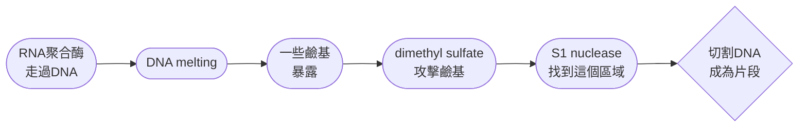
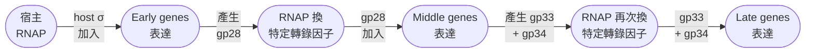
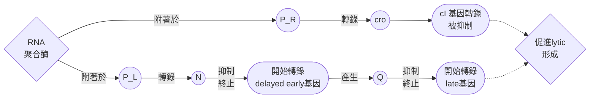
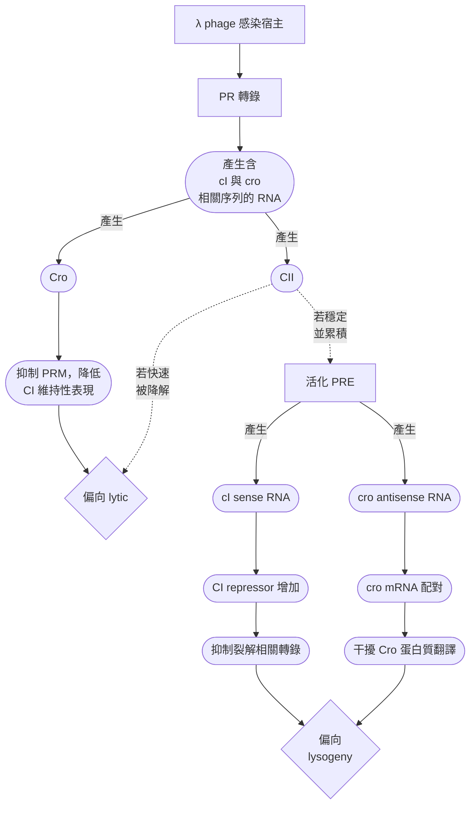
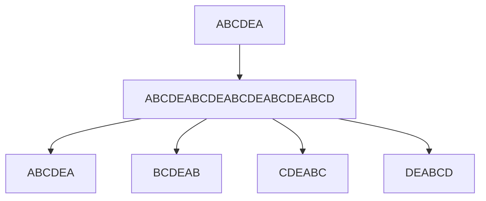

# molecular biology 1st-2
## chapter 6


### RNA polymerase
- Richard Burgess，Andrew Traver利用SDS-PAGE，發現了RNA pol的幾個非常大的subunit，包含 $\beta$ 、 $\beta \text{'}$ 、 以及 $\sigma$ 跟 $\alpha$ 。
- 他們在用離子交換層析純化蛋白質，並且分開各亞基，進行SDS-PAGE，得到的情況是...
   - $\beta \text{'}$ :最大的 subunit，所以跑得最慢，位置最高
   - $\beta$ : 第二大的，也在上面
   - $\sigma$ 比 $\beta$ 小很多，所以跑得更下面
   - $\alpha$ 更小，因此跑得更下面
   - $\text{*}$ : 這通常表示一個額外的 band，是污染蛋白或某個 degradation product


#### 當時為啥要做這張圖
- Burgess 當時的目標其實是 **"我要把 RNA polymerase 純化得更純"** 😎
- 於是他們把 RNA polymerase 做 phosphocellulose chromatography
- 結果非常怪...

> [!Note]
> - 越純的 RNA polymerase，反而越不會 transcription 💀
> - 因為 chromatography 把某個 protein fraction 給分出去了

- 而事實就是，這個protein fragment就是 $\sigma$ factor 😗

#### $\sigma$ 的重要
- **Core RNA polymerase** ( $\alpha_2 \beta\beta\text{'}$ ) 有 "做 transcription" 的能力，但沒有很好的 promoter recognition 能力 (也就是眼瞎 🤣)
- 加上 $\sigma$ factor 之後，變成 **holoenzyme**，才能有效率地辨認特定 promoter，於是 transcription activity 會大幅上升 ! 🎯
- 從下表可以看到轉錄的相對能力差距...

|DNA template|Core|Holoenzyme|
|---|----|---|
|T4|0.5|33.0|
|calf thymus|14.2|32.8|

### promoter
- 剛剛已經說過，**core enzyme並不是不會轉錄，而是眼瞎不知道要去哪裡轉**
- 如果我給一個有單股斷口的DNA餵core enzyme，它還是可以轉錄得好好的，只是你不能要求他去特定的地方轉錄 (**nonspecific**)，也就是說，**core enzyme可以透過摸到斷口轉錄**
- 但 $\sigma$ factor 就可以，因為他會辨識並結合在一個特定DNA區域，這個區域就是**promoter** ，相當於是 core enzyme 的眼鏡

#### 具體結合RNA的能力
- 還記得那個濾網實驗 (nitrocellulose filter-binding) 嗎，就是用這種方法做的
- 它們做了兩組，一組蛋白質為holoenzyme，一組為core enzyme，並且欲結合的T7 DNA以 $^3 H$ 標記
- 在兩者都結合了標記的DNA後，開始用未標記的DNA去沖洗，看看會不會因為bind的強度不夠，而被替換下來
- 而答案是肯定的，core上的DNA比holoenzyme更容易被替換掉


- 其中一個原因是， $\sigma$ 不只會辨識promoter，也會讓promoter附近的雙股被打開，對於enzyme來說，**單股的DNA親和性比雙股的好非常多**
- 這種部分解開雙股的現象，也被稱為**local melting**

> [!Tip]
> 甚至在不破壞蛋白質活性的條件下，**適時加熱環境，讓DNA雙股鬆一點**，也可以讓親和性增加 !


#### promoter的結構
- 最常出現的共同binding序列，一個是在**上游10個鹼基處**，一個是在**上游35個鹼基處**，這兩個分別被稱為 **-10 box 和 -35 box**
- 典型的 **bacterial promoter**，尤其是 E. coli $\sigma^{70}$ -dependent promoter，經典−35 box 序列為: 

$$\boxed{TTGACA}$$

- 而-10 box又被稱為**Pribnow box**，序列通常為: 

$$\boxed{TATAAT}$$

#### other 辨識序列
- 當然，辨識位點當然不一定只有-35跟-10，有些promoter還有不同區域有不同功能
- 例如 **rrnB P1 promoter 的 UP element**，也就是upstream promoter element，位置大概比-35 box更上游，約-60 ~ -40bp的位置

```text
        UP element
           ↓
──────[████████]────[-35]──[-10]──+1→

```

- 它並非主要和 $\sigma$ 有交互作用，而是可以和 RNA polymerase $\alpha$ subunit 的 **C-terminal domain (CTD)** 發生作用
- 所以它是在幫 RNA polymerase 更穩、更有效率地被招募到 promoter

> [!Tip]
> - 由於rrnB P1 基因就是負責合成rRNA，rrnB P1 promoter在轉錄開始前，還跟其他東西有相互作用: 
>   - **Fis:** 屬於**activator**，結合在 **-60 ~ -150bp** 區域的**enhancer** (Fis site)
>   - **iNTP:** 也就是 RNA polymerase 在 +1 position 用來開始合成 RNA 的第一個 NTP，**濃度越高，越容易轉錄**
>   - **ppGpp:** 當細菌遭到飢餓或是胺基酸不足時，ppGpp濃度會上升，**抑制**rrnB P1 promoter的轉錄活性 😗


### 轉錄開始
#### abortive transcription
- Carpousis and Gralla在實驗時發現一件事
- 他們把 **lac UV5 promoter DNA + E. coli RNA polymerase** 加在一起放在試管中進行轉錄，然後轉錄完後跑電泳
- 結果發現，雖然有不少完整的轉錄好的，長的pre-mRNA (聚集在凝膠底部)，但是還有**一大堆幾個核甘酸形成的小小RNA碎塊**。它們都飛在凝膠遠處，而且數量 "很多" !
- 為了確認這些片段在轉錄時，RNA pol在甚麼地方，因此它們使用了heparin，heparin 可以**抑制 free RNA polymerase**
- 結果發現這些小片段的轉錄，不被herparin影響。這也就代表，**這些小碎塊出現時，RNA pol還在模板股上面 !** 😎

#### 四大步驟
- 所以轉錄起始的這個動作，遠比之前想的要複雜得多，大概可以分成四個步驟: 
  - 和啟動子緊密結合
  - 啟動子處雙股被打開
  - 先嘗試複製幾個核甘酸，然後abort (此時RNA pol還停在promoter上沒動)
  - 聚合足夠長，可以開始延長聚合了
- 尤其是第三步，在RNA pol真的離開啟動子之前，都會停留在 "開始轉錄" 的動作
- 也因此才會在延長前產生很多小RNA

> [!Tip]
> ```text
> Initializing transcription...
> Recruiting NTPs...
> Polymerization started...
> ```
> - 3 nt → abort 「嗯，不行，再來。」 🙂
> - 5 nt → abort 「這次也不太對。」 😐
> - 7 nt → abort 「……再一次。」 🫠
> - 4 nt → abort 「靠，再一次。」 💀
> - 8 nt → abort 「……」 🗿

#### $\sigma$ 的嘗試幫助
- 到底幫忙眼瞎的core enzyme找到了啟動子的 $\sigma$ ，在整個轉錄過程中，是否都有幫忙? 
- 因此，Travers and Burges延伸之前的實驗，一樣讓RNA pol去轉錄T4 DNA，只是，它們這次在試管中先加入core enzyme，而 $\sigma$ factor另外加入，並且逐漸調高 $\sigma$ 的濃度
- 然後就是給合成RNA的材料，這些材料都標記過，例如 $\gamma^{32}P$ ATP (主要判斷initiation)、 $^{14}C$ ATP (主要判斷elongation)
- 後來發現似乎... $\sigma$ 都可以促進 elongation 跟 initiation... 嗎? 🙂


- 但是，其實 $\sigma$ **不會促進elongation**
- 這實驗用的就是用抗生素 **rifampicin**，這東西負責抑制initiation，**但是elongation的RNA pol並不會因此停止轉錄**
- 它們就在有 rifampicin 的情況下，再去丟 $\sigma$ 進去看看，檢查有沒有促進它的轉錄。**而答案是沒有**

#### $\sigma$ reuse
- $\sigma$ 可以重複使用
- Travers and Burgess (又是這兩個人) 一樣丟RNA pol跟T4 DNA，只是，它們降低了環境中的離子強度，這會讓原本跑在DNA上面的RNA pol "下不來"
- 此時溶液裡面就有幾個東西: 下不來的RNA pol，以及被使用過的 $\sigma$
- 此時，**如果我再加入core enzyme到裡面去，RNA initiation竟然增加了**，也就是說，溶液裡那些被用過的 $\sigma$ ，可以重複使用 😎

> [!Tip]
> $\sigma$ 可以被重複使用的現象，又被稱為 $\sigma$ **cycle** 😗


#### FRET 
> [!Tip]
> $\sigma$ factor 到底是在 promoter clearance 的瞬間就離開，還是 RNAP 已經開始 elongation 後， $\sigma$ 才慢慢隨機離開？ 🧐

- FRET = 螢光共振能力交換，大概就是，**兩種光敏分子距離夠近時，激發態的doner可以把能量傳給acceptor，使acceptor產生螢光**
- 反正在實驗下，就是**靠近時發光，遠離時熄火** 🤣


- 所以實驗人員乾脆就把 donor (D) 和 acceptor (A) 分別標記在 $\sigma$ 和 DNA上，就看看這兩個傢伙到底變近還是變遠

##### Trailing-edge FRET
> aka acceptor 在 RNA pol 後面附著DNA

- 可能有兩種情況: $\sigma$ 有被釋放，或是 $\sigma$ 沒被釋放
- 不過，無論 $\sigma$ 有沒有被釋放，由於RNA pol遠離acceptor，而 $\sigma$ 無論有沒有被釋放，都會遠離acceptor
- 因此，這兩個假設，都是預判FRET下降

> [!Tip]
> 好啦，反正都是 FRET 下降，看個毛，下一位 🙂

##### Leading-edge FRET
> aka acceptor 在 RNA pol 前面附著DNA

- 可能有兩種情況: $\sigma$ 有被釋放，或是 $\sigma$ 沒被釋放
- 如果被釋放，那即使RNA pol在逐漸靠近 acceptor ， $\sigma$ 也是逐漸遠離 acceptor
- 因此FRET會下降
- 但是 ! 如果 $\sigma$ 沒被馬上釋放，那他就會跟RNA pol一起逐漸靠近 acceptor，因此FRET會增加

> [!Important]
> - 所以，在 Leading-edge FRET 中，只要偵測到FRET有上升的趨勢，那就可以證明: $\sigma$ **其實還會暫時留在RNA pol上面一陣子 !** 😲😲
> - $\sigma$ 的跳車時間，其實是 **"隨機" (stochastic) 的**，它可以很快下，也可以賴著很久，看他心情。🙂


#### 人們是如何知道轉錄泡的存在的
> [!Tip]
> 你說 RNA pol 開過去時 DNA 有被打開，那你拿證據來啊 😗

- Ulrich Siebenlist在1979年，利用T7 DNA做了一個實驗
- 當時學界的核心問題就是... 以前有人估算 RNAP 會解開大約 7 到 15 bp (**透過減色效應偵測大概melt多少**)，但那些方法沒有告訴你到底哪一段 DNA 被 melt 
- 因此，Siebenlist 用了一個 methylation-S1 assay 直接定位
- 他用了**S1 (切單股)**，以及 **DMS (在單股上加上甲基)** 這兩個東西，做了實驗，當時的邏輯是...




- 等到S1 nuclease將DNA在甲基化的地方切割，形成多個fragment後，把RNA pol拿掉，然後把DNA拿去跑電泳

> [!Important]
> 實驗結果: Siebenlist 的結論是 T7 A3 promoter 上**大約有一段 11 bp 的 DNA 被 RNAP unwound**[^1]。人家在電泳上找到了非常具體的位置，論文標題甚至直接把這個數字寫出來了，**-9~+3** 😲


[^1]: https://www.nature.com/articles/279651a0

#### 到底怎麼離開promoter的?
> [!Tip]
> 你不是原本黏很緊嗎，怎麼有辦法在開始elongation時成功逃脫呢? 🧐

- 事實上，RNA pol 在還沒離開 promoter 的時候，不是直接往前走，**而是把下游 DNA 一點一點「拉進自己裡面」**
- 這個現象又被稱為**scrunching**
- 在RNA pol一直塞DNA往自己身上時，DNA 被越拉越皺，就像彈簧被壓縮一樣，**累積了構形能量**
- 當這個能量夠大時，就讓RNA pol有機會break promoter contact，使轉錄進入elongaton

> [!Note]
> 之後的RNA polymerase，我們一律簡化成RNAP，我手寫的很痠 🫠

##### FRET 實驗又來了
- 當時科學家有想過三種可能發生的現象: 
  - **Transient excursion:** RNAP 真的往 downstream 走了一小段，然後可能又回來
  - **Inchworming:** RNAP 本身的不同部分發生相對位移，可以拉伸，像毛毛蟲伸縮
  - **Scrunching:** RNAP 基本上還卡在 promoter，上游接觸維持住，但把 downstream DNA 拉進來

##### Trailing-edge FRET
> aka acceptor 在 RNAP 後面附著DNA

- Acceptor在後面，Doner在 $\sigma$ ，那這三種假設應該會看到以下三種結果: 
  - **Transient excursion:** RNAP會往前跑，所以D會遠離A，**FRET 下降**
  - **Inchworming:** RNAP只有相對位移，不會真正整個移動，所以D和A相對位置不變，**FRET不變**
  - **Scrunching:** DNA被拉動，但是RNAP並未離開promoter，所以D和A相對位置不變，**FRET不變**

##### Leading-edge FRET
- Donor在RNAP的前端，因此A相對於D還是在後面，那這三種假設應該會看到以下三種結果: 
  - **Transient excursion:** RNAP會往前跑，所以前端的D會遠離A，**FRET 下降**
  - **Inchworming:** 相對位移，RNAP的前端往前移動，但還是附著在promoter上面，D被往前帶，所以D會遠離A，**FRET 下降**
  - **Scrunching:** DNA被拉動。所以RNAP並未移動，A相對於D還是在後面，所以D和A相對位置不變，**FRET不變**

##### downstream and promoter DNA
- 這裡的D和A不是標在RNAP上，而是**Doner接在promoter上，Acceptor接在DNA下游**
  - **Transient excursion and Inchworming:** 這兩個假設裡面，主要移動或是變型的是RNAP，DNA並未有移動，因此D和A相對位置不變，**FRET不變**
  - **Scrunching:** RNAP並未移動，被拉動的是DNA，下游的DNA會被拉近到promoter，因此A會接近D，**FRET上升**

> [!Tip]
> 而實驗的結果是，在downstream and promoter DNA的情形下，FRET出現上升的情形，因此證明，**scrunching的模型可能比較合理** 😗


#### single-molecule nanomanipulation
- 另一種監測是否有scrunching的方法，是**一端的 DNA 接在磁珠上，另一端固定在玻璃表面，再用磁鐵扭轉、拉直 DNA**
- 同時，RNAP 結合 promoter 並解開 DNA 時，會改變 DNA 的 **superhelicity**，造成磁珠位置改變
- 如果磁鐵把 bead 往某個方向旋轉，每轉一圈，就相當於往 DNA 裡加入一個 superhelical turn，形成正超螺旋
- 而當RNAP接上去解旋的時候，這時又會增加一個扭轉力，再產生一圈supercoil
- 這個扭轉可能看不到，但是因為磁珠會因為多轉一個supercoil而下降，偵測磁珠的移動就可以知道是否有解旋


- 相反的，如果是利用磁珠引入負超螺旋，這時接上RNAP解旋，會減掉一圈supercoil，使得磁珠上升，進而被儀器偵測到

#### $\sigma$ 的結構和功能

> 以下是 $\sigma^{70}$ 的互動模型

<iframe src="https://Jacklyn301.github.io/molecular_model/9A8C_Escherichia%20coli%20sigma70%20in%20apo%20form.html" width="100%" height="500px"></iframe>

##### 亞區的辨識輔助
- 當你去把不同的 $\sigma$ factor 拿去比胺基酸序列，會發現很多 $\sigma$ factor 都有 **4 個高度保守的區域:** region 1, 2, 3, 4
- 通常一個細菌會有最常見的 $\sigma$ factor，負責做必需的蛋白質


  - **region 1:** **僅存在於** $\sigma^{70}$ **和** $\sigma^{43}$ ，作用是為了避免整個 $\sigma$ 和promoter結合，擋住core enzyme一起結合上去的可能性，使轉錄失效
  - **region 2:** **保守度最高**，可分為四小部分: **2.1、2.2、2.3、2.4**
  - **region 3**: 參與core enzyme的結合，以及DNA的結合
  - **region 4**: 和region 2一樣有多個亞結構域，可分為兩小部分: **4.1、4.2**


- 其中，**region 2的2.4亞區域，以及region 4的4.2亞區域**至關重要，他們兩個負責辨識box，尤其是對於典型E.coli的 $\sigma^{70}$ 來說: 
  - subregion 2.4: **辨識-10 box**， $\alpha$ **-helix** 作為序列辨識motif
  - subregion 4.2: **辨識-35 box**，**helix-turn-helix** 作為序列辨識motif
- **Arg 584 和 Arg 588** 接觸 -35 的 G 和 C
- **Gln 437 和 Thr 440** 都接觸 -10 的 T


##### 孤單的 $\sigma$ 需要有別人幫忙
- RNAP holoenzyme 接近 promoter 後，會讓一小段 DNA 解開雙股結構 (大約是 **−11 到 +1** )，這個區域形成 **transcription bubble**
- 有時候，孤零零的 $\sigma$ factor，**不容易形成有效的 promoter-binding complex**，也就是說，**這傢伙可以辨認box，但似乎抓不太住**
- 所以，我們認為，應該是**core enzyme的其他區域負責把酵素固定到nontemplate strand上**

| 問題                                    | 誰負責？                        |
| ------------------------------------- | --------------------------- |
| 認識 promoter                           | **σ + core**                |
| -35 recognition                       | 主要是 **σ4.2**                |
| -10 recognition                       | 主要是 **σ2.4**                |
| 幫助 -10 nontemplate strand interaction | **σ + core，β′ 參與**          |
| promoter DNA melting                  | **整個 holoenzyme**，不是 σ 單獨完成 |
| 形成 open complex                       | **RNAP holoenzyme**         |

#### 為什麼4.2競爭於promoter
##### 實驗a
- Gross跟他的同事做了一個實驗，他們發明了一種僅含有region 4的合成蛋白
- 然後分別把這個蛋白丟到兩種不同的，已標記的DNA樣本
  - 一個有 *tac* promoter ( $pTac$ )
  - 一個沒有 *tac* promoter ( $\Delta P$ )
- 發現說有tac promoter的DNA樣本，游離DNA濃度下降的速度更快
- 這代表region 4和該promoter有交互作用

##### 實驗b
- 它們又在做一個實驗，這次的DNA樣本不一樣: 
  - 一個在-10 box的地方有deletion ( $\Delta 10$ )
  - 另一個是在-35 box的地方有deletion ( $\Delta 35$ )
- 結果發現-35 box的地方有deletion的DNA游離數量，比-10 box缺失的多
- 這間接證明-35才是region 4主要辨視的地方


#### $\beta^\prime$ 的幫助
- Gross還做了其他實驗，想要知道究竟是誰在幫助 $\sigma$ factor的結合
- 他把 $\beta^\prime$ 切成不同片段，一個一個拿來跟 $\sigma$ 配，看看誰能恢復 $\sigma$ 對 -10 nontemplate strand 的 binding
  - Lane 1 是完整 RNAP 的正控制 (holoenzyme)，所以跟nontemplate有作用，形成訊號
  - Lane 2 是 $\sigma$ 單獨，屬於關鍵 negative control，結果發現 $\sigma$ 自己幾乎沒有 nontemplate-strand binding
  - 可以發現，Lane 3、5、7、9、11是只有加上特定 $\beta^\prime$ fragment以及 $\sigma$ ，**他們基本上都有  nontemplate-strand 的訊號**
  - 然後不斷縮小範圍，透過把兩個有效片段放在一起，找到交集
  - 最終，在只有48個胺基酸片段的 Lane 11 (262–309)，依然有nontemplate signal

> [!Important]
> $\beta^\prime$ amino acids 262–309 這個很小的區域，就足以幫助 $\sigma$ 跟 -10 region 的 nontemplate strand 發生 interaction ! 😲


#### $\alpha$ subunit在UP element中扮演的角色
- Richard Gourse利用有 $\alpha$ subunit基因突變的E.coli菌株進行實驗，然後就發現這些RNAP似乎**有一些對有UP element的啟動子效果依然不佳**
- 因此他們利用三個處理過的 $\alpha$ subunit基因做對比
  - **wild type:** 正常一般般的 $\alpha$
  - $\alpha$ **-235:** $\alpha$ -subunit的C端缺失94個胺基酸
  - **R265C:** $\alpha$ -subunit的265號精氨酸替換成cysteine
- 同時，promoter也有處理過，分別如下: 
  - **-88:** 一小段從-88~+1的正常 promoter片段
  - **SUB:** promoter中的-59~-41的UP element區域，被不相關的序列取代掉
  - **-41:** 只有-41~+1，其餘上游序列缺失
  - **lacUV5:** 沒有UP element的promoter


#### 實驗結果
- 可以發現，在三種 $\alpha$ subunit 中， $\alpha$ **-235** 和 **R265C** 幾乎都沒有對UP element產生反應，也就是說: 
  - C端序列對於 $\alpha$ subunit對UP element的反應至關重要
  - 僅僅是單獨的C端序列的其中一個胺基酸被替換，都能影響他的辨識能力

#### $\alpha$ 的亞基
- 利用**limited proteolysis**分解 $\alpha$ subunit，可以得到兩個蛋白結構域: 
   - $\alpha$ -NTD: 8-241，位於N端
   - 8 bp: 兩個亞基的橋樑
   - $\alpha$ -CTD: 249-329，位於C端
- 在模型中，Gourse等人認為 $\alpha$ -NTD 附著在core enzyme，而 $\alpha$ -CTD 會附著在UP element
- 兩個domain中間用大概13個胺基酸連起來


#### 以下initiation時的模型看一下 🐱

<iframe src="https://Jacklyn301.github.io/molecular_model/4YLN_E.%20coli%20Transcription%20Initiation%20Complex%20-%2017-bp%20spacer%20and%204-nt%20RNA.html" width="100%" height="500px"></iframe>

### Elongation
#### core enzyme 功能拆分
#### $\beta$

- Walter Zillig把E.coli的core enzyme拆分成三個部分，然後再把它們和在一起，看看可不可以重組出酵素

> [!Note]
> 它們當時做蛋白質電泳，主要用的是尿素，而不是SDS，一部份原因是因為urea相對好去除，才有辦法重組酵素

- 這種**separation–reconstitution**的方法，最終分出了 $\alpha$ 、 $\beta$ 、 $\beta^\prime$ 三大部分[^2]


[^2]: 目前可取得完整掃描檔: https://www.sciencedirect.com/science/article/pii/0014579370805191

- 甚至在後來拆分時，直接把對Rifampicin有抗藥性的細菌RNAP拆分，然後和正常RNAP的subunit做混合，結果發現: 

$$\alpha^w + \beta^{\prime w} + \sigma^w + \beta^r = RNAP^r$$

- 因此可以知道，Rifampicin的target位點就是 $\beta$ subunit的功能


- 類似的抑制轉錄抗生素streptolydigin，在依樣畫葫蘆做實驗時，也發現 $\beta^r$ 的subunit有在裡面，這個細菌就有streptolydigin抗藥性

#### affinity labeling
- 基本概念就是: 利用一個可以模仿NTP的標記物質去和RNAP互動，只是，這個東西並不會讓他合成核酸，而是在RNAP的活性位點形成共價鍵
- 之後再用放射性核甘酸和該標記物質結合 (也就是形成磷酸二酯鍵)，就可以知道RNAP的活性為點在哪


- 後來跑蛋白質電泳時，就發現只有 $\beta$ 附近超亮
- 也就是說，只有 $\beta$ 有被標記到，因此認為**磷酸二酯鍵應該就是在** $\beta$ **subunit附近形成的**


#### elongation complex
- RNAP elongation 的時候，新生 RNA 到底怎麼跟 DNA 和 RNAP 接觸？
- 咱們需要先建立 elongation complex 的概念... 😗
  - 想像 RNAP 已經逃離 promoter，RNA 正在被合成
  - 而 RNA 不會直接整條飄出去，它會跟 template DNA 暫時形成RNA-DNA hybrid
- 那研究者怎麼知道 RNA 在哪裡？他們在 RNA 上放了一個 "可以跟附近分子交聯" 的 $U^{*}$ 
  - 如果 $U^{*}$ 很靠近 DNA，它可以 cross-link 到 DNA
  - 如果 $U^{*}$ 很靠近 RNAP protein，它也可以 cross-link 到 protein
- 然後研究者把東西拆開跑 gel，這樣就能反推出**這個 RNA nucleotide 原本在 elongation complex 裡靠近誰**

##### 實驗結果
- 這裡最重要的其實是要看DNA區塊的那個條帶，因為那邊可以看出來標記的RNA在什麼地方跟DNA有cross-link
- 實驗中發現，當 $U^{*}$ 位於 -2 到 −8，它非常容易 cross-link 到 template DNA

> [!Tip]
> - elongating RNAP 裡面，RNA 和 DNA 並不是亂七八糟地纏在一起
> - 在空間上，**RNA 3′ end 附近的 −2 到 −8 區域與 template DNA 保持接近** 😗


#### core enzyme structure
- Seth Darst等人用X-ray晶體繞射 (**X-ray crystallography**) 等方式，去研究*Thermus aquaticus* 的RNAP
- 這些蛋白質模型通都會**有說明解析度** (例如各個PDB的模型數據都會寫解析度是多少奈米或是ai)
- 在模型中可以**發現RNAP像個鉗子一樣**，看起來分為上下兩大部分，兩者**中間有一個通道大概2.7 nm寬**
- 在這裡，該酵素的活性位點，大概在 $Mg^{2+}$ 的位置。具體來說，是**包含一個鎂離子，以及三個Asp殘基**
- 同時，也可以看到rifampicin的結合位點，通常認為他會擋住原本應該讓新生RNA鑽出去的通道，從而打擾轉錄

<iframe src="https://Jacklyn301.github.io/molecular_model/1HQM_Crystal%20Structure%20of%20Thermus%20Aquaticus%20Core%20RNA%20Polymerase--Includes%20Complete%20Structure%20With%20Side-Chains.html" width="100%" height="500px"></iframe>

#### holoenzyme-DNA complex
- 基本上，要是看到了**特定DNA跟蛋白質交互作用**，你可以用膝蓋猜出: $\sigma$ factor
- 然果再近一點看，可以看到 *Thermus aquaticus* 的一些 $\sigma$ 上的胺基酸，會跟特定的核甘酸接觸
- 這些區域基本上就是region 2.4對應-10 box，通常...
   - **三個aromatic residues**會在-10 bp進行所謂的**promoter melting**
   - **兩個鹼性胺基酸**會直接參與**DNA的binding**
   - 一個polymerase通常有兩個鎂離子，作為酵素催化的位點


#### elongation complex
- 在延伸的時候，一個位於 $\beta^{\prime}$ subunit的residue: **Valine**，會**卡在DNA下游的minor groove**
- 這個卡住的動作，可以**避免DNA滑脫**，並且**誘導DNA在RNAP裡面解旋時，進行更順利的 "螺旋式運動"**
- RNAP 並不是把整段 template DNA 打開，然後讓一堆 NTP 同時對號入座。**它只把當下要讀取的那一個 template base 暴露到 active site 裡**
- 只有 +1 的位置才是被催化的
- 通常聚合的過程會被分成兩個步驟: 
  - **(a) Pre-insertion** = NTP 先來報到，但還沒被 trigger loop 收進活性位點
  - **(b) Insertion** = **trigger loop 折疊成 trigger helices**，把正確 NTP 推到真正的活性位點去聚合
- Trigger helices 會跟 NTP 形成一系列交互作用，把 NTP 穩定在正確的構型上

> [!Note]
> **streptolydigin** 是一種可以抑制 bacterial RNA polymerase 的抗生素。它會**干擾 trigger loop 的正常折疊，導致trigger loop 沒辦法正常變成 trigger helices → 轉錄停止** 💀


#### 限制RNA-DNA complex
- 多種原因避免了RNA-DNA complex太長，例如: 
  - 酵素可以容納的**complex長度限制於酵素內的空腔大小**
  - 空腔末端甚至有一個**疏水口袋，會從RNA-DNA complex捕獲 (trap) RNA 鹼基**
  - 除此之外，RNAP 的 RNA exit channel 本身很適合容納一段 "像雙股 RNA 那樣細長的 RNA 結構"，所以**當新生 RNA 裡面出現兩段互補序列時，它們可以自己配對**
  - 當RNA 一離開 active site，**這兩段互補序列可能互相找到，形成hairpin**，這樣就勢必不會再跟DNA結合了

#### elongation topology
##### DNA 在 RNAP 裡面到底怎麼解旋，又怎麼重新形成雙股
- 當dsDNA進入RNAP時，在 bacterial RNAP 中，elongation 時 bubble 大約是**十幾 bp** 的量級，而 RNA-DNA hybrid 則**大約 8～9 bp**
- 要記得一件是，DNA的解旋是很多東西相互作用在一起的結果，包含: 
  - RNAP 內部的**結構限制**
  - 特定**蛋白質結構與 DNA bases 的 interaction**
- RNAP 並不是把整條 DNA 都解開來讀，它只需要讓**目前正在被讀取的那一小段 (通常只有一個核甘酸)** 進入 active center
- 要記得，RNA跟DNA是從RNAP的不同出口離開的
- 而之後的兩條原本分開的單股DNA會在RNAP後面重新自動annealing

> [!Tip]
> 這個自動annealing的動作，是因為這在熱力學上是最穩定的情形。**ssDNA在熱力學上是極度不穩定的形式，因此在離開RNAP之後，他們會幾乎自動靠在一起** 😗


##### 為什麼需要 topoisomerase
> 讓我們用兩條棉線來形容... 🧐

- 你手上有兩條棉線，現在你把他們纏繞成螺旋狀的，並且兩端固定
- 然後你在一邊利用一根針，塞在兩條棉線中間，然後針開始往右邊慢慢移動，猜猜會發生甚麼事情?
> [!Note]
> **針右邊螺旋狀的棉線會越來越緊 !** 💀

- 這種情況到達一定程度後，你就需要花更大的力氣去移動針，然後右側的棉線就捲的更緊，無限循環
- 而RNAP往前移動是需要能量的，**一旦上游的DNA轉的太緊，RNAP就跑不動了**
- 這就是為什麼需要topoisomerase的原因
- topoisomerase在做的事情，就是**暫時剪開棉線，讓它旋轉卸力，再把棉線重新接回去**

> [!Tip]
> ##### 那到底是形成nick還是DSB
> - 這取決於你是用哪一種topoisomerase
> 
> |  選項 | Type I  | Type II|
> | ---- | ---- | --- |
> | 切幾條 strand | **1**  | **2** |
> | 暫時產生  | **nick**  | **DSB** |
> | 是否讓 DNA strand 穿過   | 通常 strand rotation / passage | **一整段 DNA duplex passage** |
> | 一次改變 linking number | 通常 ±1  | 通常 ±2  |
> | 代表   | Topoisomerase I  | DNA gyrase、Topo IV  |


### 轉錄暫停和proofreading
- RNAP在聚合時，常常會時不時暫停，暫停是轉錄終止的動作之一，也是修正 (proofreading) 的必須動作
- 如果RNAP聚合RNA不小心錯了，有兩種方式可以解決: 

#### 叫auxiliary factors幫忙
- 第一個就是先把DNA往回拉一點點 (**backtrack**)，錯誤的 RNA 3′ end 會跑進 RNAP 裡面比較深的位置


- 然後 **auxiliary factors** 登場，最經典的就是 **Gre factors**，在 **E. coli 裡主要有 GreA、GreB**
- Backtracked RNAP通常比較不太可能修補自己的RNA
- GreA/GreB 可以進入 RNAP secondary channel，把自己的**酸性胺基酸殘基伸進 active center**
- **這一步可以促進 RNA cleavage**

##### RNAP自己的修復能力
- 即使沒有GreA, B可以幫忙，RNAP也可以自己proofreading
- 發生 mismatch 時，錯的 nucleotide 位在 RNA 3′ end，會讓 3′ end 的構形和定位變得不正常
- 此時，一樣會發生 backtracking，然後在化學機制上...

##### 水分子攻擊
- RNA cleavage 本質上需要**水分子參與切斷 phosphodiester bond**
- water 被 active site 正確定位、活化後，其 $-OH$ 基團可以參與親核性攻擊  (**nucleophilic attack**)，最後把 RNA backbone 切開

> [!Tip]
> 這一步可以**透過酵素中本來就有的** $Mg^{2+}$ **離子，讓水分子更有親核性攻擊性**

#### 補充: two-metal-ion
- RNAP 轉錄時要做的事情是: **RNA 3′-OH 攻擊 incoming NTP 的 α-phosphate**
- 但是RNA 的 3′-OH本身沒有強到可以很有效率地攻擊 phosphate
- 這時，Metal A(通常是 $Mg^{2+}$ )會協助穩定活性位點，並促進 3′-OH 去質子化 (形成 $-O^-$ ) ，使它更適合進行親核性攻擊
- 3′-O 會攻擊 $\alpha$ 磷酸，形成新的phosphodiester bond，**剩下的磷酸基以焦磷酸鹽 (PPi) 的形式離開**


### 轉錄終止
#### attenuation 
- 在trp operon的leader區域 (trpL)，有一段能形成不同二級結構的mRNA，其中有兩個連續的色氨酸密碼子 (UGG)
- 這個mRNA本身有多個互補序列，能彼此形成 stem-loop 結構: 
   - region 1: 包含兩個Trp密碼子
   - region 2: 能和region 1或region 3配對
   - region 3: 能和region 2或region 4配對
   - region 4: 在後面，能和region 3配對形成 "終止結構"
- 當ribosome開始轉譯leader peptide，會遇到這兩個Trp密碼子，如果色氨酸很多，那 $tRNA^{Trp}$ 很充足，ribosome可以順利快速轉譯過region 1，反之
- 當Trp很多，ribosome跑過去時，region 3與region 4配對，形成terminator hairpin，導致RNA pol卡住，無法繼續轉錄operon
- 這讓細菌能根據色氨酸濃度的不同，微調operon的表達量，而不是單純的 on/off


- 當然，很多其他的氨基酸生合成的操縱子，也都會利用 "leader peptide + 重複的對應氨基酸密碼子" 來做 attenuation，例如His operon (leader peptide裡有七個histidine密碼子)、Leu operon (leader peptide裡有四個leucine密碼子)


#### Rho-independent termination / Intrinsic
- 利用trp attenuation，Farnham and Platt發現**intrinsic terminators**有兩個重要特色 
- 第一個就是hairpin的生成，轉錄到近乎終止的地方時，已經出了RNAP的一小段RNA可以自行摺疊 (**inverted repeat**)，形成hairpin結構
- 這個拉扯可以導致RNAP暫時停下來
- 同時，**轉錄終點會出現一長串的A (非模板股是T，模板股是A)**，這在RNAP中會出現的RNA-DNA complex就是 **rU-dA**
- **rU-dA之間的作用變得很小**，比任何核甘酸都更容易解旋 (畢竟A和U之間只有兩個氫鍵，它們大概**20度就會melting**)
- 這使得兩條鏈很容易脫離，進而使轉錄結束


> [!Important]
> - **hairpin 讓 RNAP 停下來**
> - **rU-dA 讓 RNA 脫落** 😏

##### 咱們做個實驗
> [!Tip]
> RNA hairpin 到底只是讓 RNAP pause，還是真的可以參與「把 RNA 從 transcription complex 裡弄出來」？ 🐱

- W. S. Yarnell and Jeffrey Roberts利用了一條人工合成的DNA當模板，這個模板上有兩個terminator: 
  - ΔtR2
  - Δt82
- 同時，他們也為這兩個terminator做了相對應的oligonucleotide，這兩條寡核甘酸會結合合成出的RNA的terminator區域

> [!Note] 
> 這一步相當於模擬hairpin的形成，因為hairpin是合成的RNA自行互補的結果，只是這一次我們讓RNA和寡核甘酸互補

- 底下的lane中，有S和P兩種。
   - S相當於偵測到RNA脫離DNA模板，轉錄終止完成
   - P代表RNA並未成功脫離DNA模板，轉錄終止失敗

##### 實驗結果顯示 🧐

- 在完全未加入寡核甘酸的情況，只有P lane上方出現條紋。而S lane沒有，這代表多數RNA並沒有轉錄終止成功
- 當加入t19寡核甘酸時，可以發現S lane在ΔtR2 的區域出現條紋，而Δt82 沒有
- 同樣的，當加入t18寡核甘酸時，在Δt82 區域出現條紋，而ΔtR2 沒有


#### Rho-dependent termination
> [!Tip]
> ##### 如果要對比的話
> - Intrinsic termination: RNA 自己形成結構，RNAP 被弄到終止
> - Rho-dependent termination: 來一隻 Rho 蛋白，親自追 RNAP 🏃‍♂️💨

- rho是一個六聚體蛋白，結構大概長這樣: 

<iframe src="https://Jacklyn301.github.io/molecular_model/8E3H_Escherichia%20coli%20Rho-dependent%20transcription%20pre-termination%20complex%20containing%2018%20nt%20long%20RNA%20spacer.html" width="100%" height="500px"></iframe>

- 工作不是直接 "切 RNA"，而是沿著 RNA 往前跑，追上 RNAP，然後使transcription complex變得不穩定
- Rho 不會隨便黏 RNA，而是會辨認 nascent RNA 上的**rut site (Rho utilization site)**

> [!Note]
> rut site通常屬於C多G少的序列，難以形成二級結構，這樣Rho才方便穿過去 😗

- 辨識到rut site之後，就會開始**沿著已經轉錄的RNA追逐RNAP跑**
- 這過程中，Rho蛋白需要消耗ATP來達成這一點
- 當Rho蛋白終於追到時，就會和 RNAP 發生交互作用，接著它會**干擾 transcription complex 的穩定性 (尤其會促進RNA-DNA hybrid 的解離)**
- 最終導致RNAP跟RNA脫離DNA

> [!Warning]
> 要記得，rho不太可能跑得比RNAP快，因此，**RNAP在經過terminator後，會降低速度甚至暫停**，這樣rho蛋白才追得到 ! 😗

| 選項 | Intrinsic | Rho-dependent|
| --- | ---- | ---- |
| 需要 Rho？ | ❎ | ✅ |
| RNA hairpin？ | ✅   | 不需要作為核心機制|
| U-rich tract？ | 通常有| 不需要 |
| ATP？ | 不需要 Rho ATPase| Rho hydrolyzes ATP |
| 誰讓 complex destabilize？ | RNA hairpin + weak hybrid | Rho |
| RNAP pause？ | 常常重要 | **非常重要** |
| RNA release  | hairpin/弱 hybrid 促進   | Rho 追上後促進 |


#### Rho 只影響 Elongation，不影響 Initiation
- 在Roberts的實驗中，他一共用了兩種東西: 
  - $\gamma^{32}P$ **-GTP:** 這東西標記的是 $\gamma$ -磷酸，由於 $\gamma$ -磷酸只會存在於核酸的頭部，因此該信號的強度，相當於判斷到底**轉錄起始的次數有沒有變多**
  - $^3 H$ **-UTP:** 這東西是在核糖上面標記，無論是否為起始核甘酸，都會出現在RNA上，因此該信號的強度，相當於判斷**RNA的合成量多寡**
- 接下來，透過在轉錄時**逐漸增加rho的濃度**，來看看以上瞭種標記物的訊號強度為何

##### 實驗結果
- 可以發現， $\gamma^{32}P$ **-GTP** 並未有明顯下降的信號，但是 $^3 H$ **-UTP 的信號強度隨著rho濃度增加，大幅下降**

> [!Important]
> - 什麼樣的狀態下，才有可能在**明明轉錄起始的量沒有變的情況下，偏偏合成的RNA量變少了**?
> - 只有一種可能: **轉錄終止的時刻太快，以至於沒有合成多少RNA就結束了 !**
> - 因此實驗得到一個結論: **rho可以促進轉錄終止，但不影響轉錄開始 !** 😲


#### 直接測 RNA 到底有沒有變短
- 研究者用 ultracentrifugation 根據 RNA 大小/沉降速度把 RNA 分開，通常來說，越長或是越重的RNA，越容易聚集在底部，反之
- 然後研究人員就分別把加了rho跟沒加rho的轉錄都跑了一遍，然後拿去離心

##### 實驗結果
- 可以發現，相對於沒有加上rho的曲線 (藍色)，加上了rho的曲線 (紅色) 的RNA數量高峰集中在右側，也就是top
- 也就是說，相對於沒有rho，有rho的情況會產生出更多短的的RNA
- 但是你也可以發現一個非常有趣的東西: 紅色曲線並沒有在接近top的地方高速上升到 "超過藍色曲線" 的地步
- 也就是說，實際上產生的RNA量，是遠遠比沒加rho的曲線還要少的

> [!Important]
> 這也代表一件事情: **rho不是把RNA切碎導致短序列RNA變多，實際上，有rho的情況下會實際的因為提前終止聚合，降低RNA的合成量 !** 😲


## chapter 7
### the lac operon
- 此啟動子主要目的是為了分解乳糖
- E.coli可以用葡萄糖，也可以用乳糖。
- 如果我們把葡萄糖跟乳糖放在同一試管裡面，細菌通常會先用葡萄糖
- 等到葡萄糖耗盡後，細菌繁殖出現平台期
- 之後，細菌會增加lac operon的活化，開始使用乳糖
- 這個代謝變化的曲線，可以透過該時間細菌的密度來呈現出來 (**Diauxic growth**)

> [!Note]
> - **Diauxic growth (雙相生長)**
> - 細菌在培養基裡同時有兩種碳源時，不會一定同時吃，而是**先吃一種，吃完後停一下，再切換去吃第二種** 😗

- 該啟動子會轉錄出三種酵素: 
  - $\beta$ **-galactosidase** (*lacZ*)
  - **permease** (*lacY*)
  - **transacetylase** (*lacA*)
- 這三種酵素，都是轉錄於同一個啟動子，產生一條很長的mRNA

> [!Important]
> - **Polycistronic message (多順反子 mRNA)**
> - 一條 mRNA 上面，同時帶有多個不同蛋白質的 coding sequences，因此**一條 mRNA 可以被翻譯成多種蛋白質** 😗
> - 由於**該啟動子一活化，三個酵素都會同時被轉錄出來**，因此就是polycistronic message的一種


- 通常乳糖分解反應如下: 

$$lactose\quad\underrightarrow{\beta-galactosodase}\quad galactose + glucose$$

- 基因的正負調控使用的也是一些特別的蛋白質小分子
- 通常來說，負調控用的是**repressor**，這種蛋白質會堵在operator上，使RNAP附著不上去
- 對於lac operon來說，**光是把repressor從operator上拿下來並無法活化operon**，還需要**activator**的幫助
- 在此處，正調控就會出現，也就是CAP-cAMP 🚀
  - 當 glucose 很低時，**cAMP ↑，產生CAP-cAMP**
  - CAP-cAMP會幫助 RNAP **更有效率地結合、啟動 lac promoter**

#### negative control
- 在乳糖操作組中，結合repressor的operator其實是在promoter的下游
- 而我們的lac repressor從 *lacI* 這個基因轉錄的。**lacI其實也有自己的啟動子以及activator啥的，但這不是我們要討論的重點阿** 🙂
- 會使lacI tetramer發生構型改變的，其實是allolactose (異乳糖)
- 異乳糖其實並不少見，當 $\beta$ -galactosidase分解乳糖時，**會有一部份的乳糖形成異乳糖**


> [!Note]
> - *lacI* 轉錄出的其實是單體，而一個需要結合到operator的repressor，**需要聚在一起變成tetramer**，才有辦法結合上去
> - lacI repressor其實是一種**allosteric protein**，也就是說，**當一個單體結合到異乳糖之後，就會促進其他單體發生構型改變，讓他們更容易跟異乳糖結合** 😲😲
> - 以下的lacI是二聚體，但是通常來說，**lacI repressor的活化態以tetramer為主**

<iframe src="https://Jacklyn301.github.io/molecular_model/2PE5_Crystal%20Structure%20of%20the%20Lac%20Repressor%20bound%20to%20ONPG%20in%20repressed%20state.html" width="100%" height="600px"></iframe>

#### 發現operon
- operon的概念，是由François Jacob and Jacques Monod等人提出的
- Monod利用抗體標記 $\beta$ -galactosidase，發現在加入乳糖的時候，該酵素的含量似乎明顯增加
- 而且他們發現一種很有趣的突變株，被稱為 "隱性突變" (cryptic mutants)，這種突變的菌株完全有產生 $\beta$ -galactosidase的能力，但是無論如何加入lactose，該酵素表現量也沒有變多
- 其實這個關鍵突變，就**在於lacY這個基因，而這個基因轉錄的是lactose permease**
- Permease 負責把 lactose 從細胞外弄進細胞裡

> [!Note]
> - 假設是一個 $lacZ^+\ lacY^-$ mutant，它有 $\beta$ -galactosidase，**但是沒有正常的 lactose permease**
> - 結果因為Permease基因突變，lactose進不去細胞
> - 這導致一個很妙的結果: 你可以測到 $\beta$ -galactosidase 活性存在，但是**細胞就是不能有效利用 lactose 生長** 😏

|genotype|inducer|galactoside 的累積|
|---|---|---|
| $lacZ^+\ lacY^+$ |無❎|無❎|
| $lacZ^+\ lacY^+$ |有✅|有✅|
| $lacZ^+\ lacY^-$ |無❎|無❎|
| $lacZ^+\ lacY^-$ |有✅|無❎|

> [!Warning]
> ##### permease
> - 這個運輸酵素，嚴格上來說，可以運送的東西是galactoside，也就是 "半乳糖透過糖苷鍵連結其他基團的化合物" 的統稱
> - 因此，研究者可以拿一些人工合成的 galactoside來測 LacY 和 LacZ。例如ONPG (o-nitrophenyl-β-D-galactopyranoside)
> - $\beta$ -galactosidase可以把ONPG水解: 
> 
> $$ONPG\quad\underrightarrow{\beta-galactosodase}\quad o-nitrophenol + galactose$$
> 
> - o-nitrophenol 會產生黃色，所以可以拿來測 $\beta$ -galactosidase 的活性

#### cis and trans acting 概念補充
> [!Tip]
> - cis = DNA 上的「位置」本身在作用
> - trans = 可以被製造成一個「分子」，再跑去作用 😗

- cis acting基因本身**通常不需要被翻譯成蛋白質**，而是作為一個「作用位置」，DNA自己就是功能，例如: 
  - promoter
  - operator
  - enhancer
- 這種基因的突變只會影響自己那條染色體的轉錄表現狀況，另一個allele不需要擔心
- 例如，如果 operator 壞掉，通常會影響同一條 DNA 上、與它連鎖的 lacZYA。但是它不會自己跑到另一條染色體去影響另一個 operator
- 而trans acting通常是**一個可以在細胞內自由擴散的 RNA 或蛋白質分子**，例如: 
  - LacI repressor
  - CAP
  - transcription factors

| 選項  | cis-acting | trans-acting |
| --- | --- | --- |
| 本質 | DNA regulatory sequence | 可擴散的 RNA / protein |
| 自己會產生蛋白嗎？ | ❎ 通常不會 | ✅ 通常是 gene product |
| 能不能離開原本位置？ | ❎ 不行 | ✅ 可以 |
| 作用範圍 | linked DNA | 可作用於另一條 DNA  |
| 例子 | promoter、operator、enhancer | LacI、CAP、TFs |
| 關鍵字 | **site** | **factor** |

<iframe src="https://Jacklyn301.github.io/interaction_chart_with_AI/lac_operon_control.html" width="100%" height="740px"></iframe>

#### repression is sometimes leaky
- repression 不是 100% 有效的。**即使 LacI 正在壓制 lac operon，仍然會有極少量 transcription 發生**
- 其實這非常重要，repression如果是100% airtight: 

```text
沒有 lactose
      ↓
LacI 把 operator 鎖死 🔒
      ↓
lacY = 0
      ↓
沒有 lactose permease
      ↓
lactose 進不來
      ↓
細胞永遠不知道外面有 lactose
      ↓
LacI 永遠不解除 🙂🙂
```
> [!Important] 
> - 因此，leaky / basal expression 在 inducible system 裡不是單純的「控制失敗」。它有時候反而是讓系統能夠啟動的必要起點 😎

#### 讓我們來討論幾個狀況... 😗
- 我們來根據Jacob等人的實驗，來判斷這幾種突變株狀況

##### $I^-\ I^+$
- 這兩條染色體中，其中一條無法產生repressor ( $I^-$ )，但是另一條染色體的*lacI* 依然有作用，它產的repressor可以結合到兩個染色體的operator
   - **發現結果:** 兩條染色體在沒有乳糖時，都不會啟動
   - **結論:** $I^-$ 突變屬於隱性遺傳

##### $O^+\ O^c$
- 一條染色體為正常operator，另一條染色體的operator出現異常，導致repressor無法接上去
  - **發現結果:** 一條染色體在沒有乳糖時，不會啟動；另一條染色體即使沒有乳糖，也會啟動
  - **結論:** 其中一個operon停不下來，該突變屬於*cis*-dominant

##### $I^s\ I^+$
- $I^s$ 突變不同於 $I^-$ ， $I^s$ 一樣可以產生repressor單體，只是該結構單體出現異常，異乳糖黏不上去
- 即使該genotype屬於異型合子，但由於repressor在作用時是屬於tetramer，而且需要四個單體都改變結構才可以跟乳糖接觸
  - **發現結果:** 形成的repressor可以附著於operator，但是不跟異乳糖反應，
  - **結論:** 兩條染色體的operon都無法透過乳糖增加轉錄量，該突變既是*cis*-dominant，也是*trans*-dominant

##### $I^+\ I^{-d}$
- $I^{-d}$ 基因轉錄出來的repressor，不同於前者的 "無法讓乳糖附著"，它是根本黏不上operator
- 這導致最後形成的四聚體都沒有辦法結合到operator上，無法調節轉錄
  - 發現結果: 兩條染色體的operon即使沒有乳糖，也會啟動
  - 結論: 兩個operon都停不下來，該突變屬於dominant-negative

> [!Note]
> ##### dominant-negative
> - 也被稱為**顯性負效應突變**，指的是突變產物不只是自己失去功能，還會干擾正常的 gene product，讓正常版本也沒辦法正常工作
> - 跟孟德爾所為的花朵顏色隱性allele不同。普通的豌豆花朵，就算基因型是Tt，正常的色素酶依然可以產生色素，使花朵變色，因此此時的t就屬於隱性
> - 但是顯性負效應突變是會干擾正常的allele產物的最終表現的，這就會讓**整體表現型的狀態大幅下降**
> - 這種基因突變**特別容易出現在那些需要二聚化或是四聚化的蛋白質中**，例如lacI repressor、p53基因等等 😗


#### repressor-operator interaction
##### 純化蛋白質
- Walter Gilbert and Benno Müller-Hill嘗試將*lacI* repressor從細菌裡面純化出來
- 但是... 額，你知道的。*lacI* repressor在細菌身上並沒有可觀的多，而且人家在遙遠的1960年代，也沒甚麼純化蛋白質的現代技術 💀
- 最後，它們決定改從inducer下手，使用了 **isopropylthiogalactoside**，也就是**IPTG** (這東西是比 lactose 更好的 inducer)
- 除此之外，它們還刻意選了一種特別的E.coli突變株 ( $lacI^t$ )，**這種突變株產生的repressor可以跟IPTG黏的更緊**

##### Melvin Cohn接手
- 他想要看看repressor跟operator的交互作用，因此用了**老古板的nitrocellulose filter-binding法**，看看濾網上有沒有黏附蛋白質 (如果忘記內容請自己去 chapter 5 複習謝謝 🙂)
- 然後看看在有無IPTG的情況下，**repressor黏附operator的狀況怎麼樣**
   - 不出所料，在沒有IPTG的情況下，repressor黏在DNA上的比例很高
   - 一旦加入IPTG，repressor跟DNA之間的交互作用就降低了


- 除此之外，Cohn也用了其他的突變株做了實驗，例如 $lacO^c$ 的突變，將**正常operator、突變operator、以及沒有operator三種狀況**做比對
- 結果發現， $lacO^c$ **突變株並非完全失去結合repressor的能力，只是效率變很差**，需要更高的repressor濃度才有辦法形成交互作用


#### 具體怎麼個抑制法? 😗
> [!Tip]
> 到底repression是影響RNAP本身還是怎麼樣? 🤔

- Lee and Goldfarb做了一個有趣的實驗
- 他們準備了一個DNA，有lac control region跟一小段lacZ gene (所以RNAP會run-off出去)
- 他們加入repressor，給它們10分鐘結合到operator上
- 然後加入RNAP，並且**加入肝素，避免之後的游離RNAP結合到DNA上而影響實驗**
- 然後就是看看有沒有加入IPTG，以及有沒有加入repressor的情況，結果答案令人匪夷所思: 

|LacR有無|IPTG有無|RNA有無|
|---|---|---|
|❎|❎|有出現|
|✅|❎|沒出現|
|✅|✅|**有出現**|

- 這下好了，有時就算是加了LacR，還是有RNA出現阿，所以lacR到底有沒有直接影響RNAP?
- 那我們來看看有沒有abortive的RNA有沒有出現不就得了，要是lacR真的直接抑制RNAP，那abortive的那些短的RNA就絕對不會偵測得到了... 嗎?

> [!Important]
> - **實驗顯示**: 沒加上 lacR 有 abortive RNA，**有加上 lacR 也有 abortive RNA**
> - **差別在於**: 只是**abortive的長度比沒有lacR短一點點**
> - **所以就是**: lacR 跟抑制 RNAP 活性有個鎚子關係... 🙂🙂

##### Record接手
- 他這一次更狠，直接把DNA弄到了只剩下promoter以及一小段不是lacZ (也就是operator) 的長度
- 接下來他用了焦磷酸鹽的濃度強度標記，可以這樣想，合成的RNA越多，切下來的 $PP_i$ 濃度越高，**螢光訊號越強**
- 然後坐了三個情形: 正常情況、加上肝素、加上repressor，然後對照組是沒有DNA模板的情況
- 然後，**他在加入heparin跟加入repressor的情況下，看到幾乎一模一樣的曲線**
- 如果肝素只影響游離的RNAP，而不影響結合的RNAP形成abortive RNA，**那或許，repressor也不會影響結合的RNAP?** 那repressor又為什麼可以抑制轉錄出完整的mRNA?


- 當時很夯的假說有兩個: 
  - A: RNAP 可以接在 promoter 上，但是只是如果有了repression，就會因為**開不了火 (失去abortive transcription的能力) 而被抑制**
  - B: RNAP 可以接在 promoter 上，也可以開火，至於repressor能抑制轉錄，**是因為它擋路，而不是影響RNAP本身**

> [!Tip]
> - 從實驗結果來看，很明顯，**後者比較能解釋** 😏

#### 不只是repressor，連operator也是
- 你以為operator只有一個? 
- 其實在Müller-Hill的研究下發現，有**三個序列長得非常像的operator**。包含最重要的operator ( $O_1$ ) ，以及兩個次要的，分別位於 $O_1$ 上游跟下游的 auxiliary operators ( $O_3$ and $O_2$ )
  - $O_3$ : 位於-82
  - $O_1$ : 位於+11
  - $O_2$ : 位於+412
- 這兩個 auxiliary operators 聽起來是次要觀眾，其實，**缺乏他們任何一個，基因抑制效果都會減少一點**

> [!Important]
> - 甚至，如果你的DNA只有 $O_1$ ，**會幾乎喪失抑制能力 !** 😱


#### lac啟動子的正調控: CAP
- 也就是 **catabolite activator protein**
- CAP可以跟cAMP (對，就是第二信使的那東西) 結合，形成**CAP-cAMP**，這動作可以觸發轉錄的加強
- 而**葡萄糖的存在，會抑制cAMP的產生**，因此在**葡萄糖充滿環境時，lac operon的轉錄其實多少不會太高**
- Pastan為了想看看CAP到底有重要，因此他做了個實驗，看看CAP在有無突變的情況下，會不會影響轉錄
- 而結果是: 會的 😏
- 如果是正常的CAP，基本上產生 $\beta$ -galactosidase 很活躍，然而，**當加入mutant CAP時，原本很活躍的轉錄消失了**


#### CAP具體機制
- Zubay發現了一種對CAP濃度變化無感的突變種，這種突變種的lac operon轉錄速度不受CAP影響。而這種突變種的突變位點，位於promoter的地方
- CAP-cAMP主要**幫助 RNAP 更有效地被招募、定位與形成有效的initiation complex**
- CAP-cAMP 本身是 DNA-binding protein，它結合在 promoter 上游的 CAP site 後，會和 RNAP 發生蛋白質間的交互作用

> [!Tip]
> 尤其重要作用就是CAP-cAMP跟 $\alpha$ **-subunit的CTD域** (欸對接觸UP element的那個) 結合 ! 😗

- 在機制上，我們知道Rifampicin可以抑制elongation，他甚至可以永遠讓initiation的RNAP只會abortive，發不動車
- 然而，加入CAP-cAMP後的RNAP，如果我同時加入NTPs跟Rifampicin，NTPs基本上可以更快被使用

> [!Note]
> 可以這樣模擬: **CAP-cAMP 讓 RNAP 在一個隨時都可以搶跑的狀態下**，只要有NTPs，他就拚命衝，甭管有沒有Rifampicin 🤣


##### recruitment
- CAP-cAMP本身其實就有像是TF的功能，也就是招募RNAP
- 其實吧，甚至可以說，CAP/CRP 本身就是細菌的轉錄調節物質，功能上**完全可以拿來當「細菌版 transcription factor」理解**
- 假如說，按照William McClure的邏輯，你可以把招募RNAP ( $R$ ) 到promoter ( $P$ ) 這件事情，想成以下公式...

$$R + P\quad \underset{K_B}{\rightleftharpoons}\quad RP_{close} \underset{k_2}{\rightarrow}RP_{open}$$

- 那基本上，CAP-cAMP影響的就是 $K_B$ ，也就是說，**他本身加快的應該是RNAP 跟 promoter 形成複合物的過程**，而非促使轉錄泡打開
- CAP跟RNAP的麻吉程度，受到很多人支持...
  - 在cAMP存在的情況下，**CAP跟RNAP在離心時會一起沉澱**
  - 利用DNase切割，可以發現**CAP跟RNAP的覆蓋DNA位置特別近**，進到足以產生相互作用
  - CTD一部份跟DNA (可能是UP element區域) 結合，另一部分同時跟DNA還有CAP結合

<iframe src="https://Jacklyn301.github.io/molecular_model/3N4M_E.coli%20RNA%20polymerase%20alpha%20subunit%20C-terminal%20domain%20in%20complex%20with%20CAP%20and%20DNA.html" width="100%" height="500px"></iframe>

#### bend在哪邊
- Wu & Crothers在1980年代做了個實驗，他們在不影響DNA的長度下，將一個環狀的，有一個蛋白質結合位點的DNA，利用限制酶切成不同樣態
- 這些樣態的DNA長度都一樣，但是protein binding的位置有些在DNA中間，有些剛好在兩側 (限制酶切到protein binding site)
- 這個實驗有兩個有趣的前提: 
  - 某個 protein binding site 可以**讓 DNA 產生彎曲 (bending)**
  - 在電泳中，即使 DNA 長度／分子量相同，**不同的三維形狀也可能有不同的 mobility**
- 當切割完之後，全部拿去跑 gel，神奇的事情就發生了... **bend 在中間的 DNA 跑得最慢**
- 既然知道怎麼切會跑的最慢 (或是最快)，那你基本也知道binding的序列在什麼位置了
- 而這也是他們的結果: **用凝膠電泳定位了 CAP 結合 lac operon 附近 DNA 後造成的 bending locus**

> [!Note]
> - 進一步去推得角度，發現CAP結合上去，**大概使DNA彎曲到約100度左右**
> - 折彎DNA這個動作，可以**促使RNAP更容易形成打開的轉錄泡** 😗
 


##### $\alpha$ -subunit的突變
- 我們用lac P1當實驗組，然後用lac UV5當對照組: 
  - lac P1在有CAP時，轉錄活性才會大幅增強
  - lac UV5 是一種mutant，他的promoter強到根本不需要CAP就可以高速轉錄
- 接下來就是隨即用不同種的 $\alpha$ -subunit (包含wild type、 $\alpha$ -256、 $\alpha$ -235)，看看突變的 $\alpha$ 亞基是否會影響轉錄
- 答案就是: 是的，如果在 $\alpha$ 有突變的情況下，不影響 lac UV5 的轉錄，但是**會使 lac P1 的活性降低 (就算是有CAP也一樣)** 😲


#### 小總結 🐱
- CAP跟RNAP跟DNA的關係，大概就是長以下這樣，記得，**活化的CAP呈現二聚化 (dimer)**


### the ara operon
- 阿拉伯糖操縱組，屬於少數幾個讓人看到先滿頭問號的東西，結構有點點... 特殊 🙂
- 裡面一共有三個基因: ara-B、ara-A、ara-D，這些基因表現出來，負責幫助E.coli以阿拉伯糖作為碳原


- 其中，調控該操作組的東西為**ara-C**，它可以**根據 arabinose 是否存在，採取完全不同的 DNA interaction**
- 以當時的觀察來說，多數科學家根本無法理解。因為promoter跟operator ( $O_2$ ) 距離真的太遠了，到底是怎麼互相影響的? 🤔

#### ara-C
- 該基因會形成一種可以結合於DNA的蛋白質，平常是以二聚體存在
- 而這個araC蛋白質可以跟阿拉伯糖結合，但不只是改變構型而已
- 如果乳糖操作組的lacI是改變構型後，離開DNA，那**araC其實是改變構型後，換不同區域的DNA抓** 🤣

<iframe src="https://Jacklyn301.github.io/molecular_model/2ARC_E.coli%20Regulatory%20Protein%20AraC%20Complexed%20With%20L-Arabinose.html" width="100%" height="500px"></iframe>

##### 沒有arabinose
- 在沒有 arabinose 的時候，AraC 形成的 dimer 會**讓 DNA 形成一個 loop**
- araC會同時抓住DNA的兩個區域: $araO_2$ 跟 $araI_1$ ，一個subunit抓一邊DNA區域，然後折起來 (這兩個區域的距離大概有210 bp)
- 這時候的promoter其實很不容易跟RNAP結合，這導致了整體轉錄下降

> [!Tip]
> **no arabinose** → araC bind to $araO_2$ and $araI_1$ → folded DNA → **low transcription** ❎

##### 有arabinose
- 當兩個arabinose結合 AraC dimer 時，**AraC 構型發生改變**
- 他開始**偏好同時抓住** $araI_1$ **和** $araI_2$
- 這時，原本的DNA loop消失了，而此時能轉錄ara operon就相對容易

##### CAP-cAMP 幫忙
- 跟乳糖操作組一樣，細菌在葡萄糖充足時，會優先利用葡萄糖
- 在ara operon的promoter附近，也有CAP結合位點，讓RNAP轉錄更快

> [!Tip]
> **with arabinose + no glucose** → araC bind to $araI_1$ and $araI_2$ → DNA unfolded → CAP bind to RNAP → **high transcription** ✅✅


#### 突變實驗又來了
- Lobell and Schleif嘗試利用標記過的DNA，來看看araC結合突變種的情形
- 他們做了三組: 無突變、 $araO_2$ 突變、 $araI_1$ 突變三種情形，然後加入定量AraC，看看隨著時間推移，DNA的構型普遍有甚麼變化
- 由於 **folded 的DNA更容易產生超螺旋**，即使在分子量相同的情況下，supercoiled 的DNA跑得比較遠
- 結果它們發現: 
  - **wild type** 的DNA基本上在加入araC後，折疊的比例就很穩定
  - $araO_2$ 突變的DNA在剛開始加入araC時有出現折疊的DNA，但**隨著時間推移，折疊的比例越來越少** (也就是越來越多DNA失去了原本looped的構型)
  - $araI_1$ 突變的DNA情形和 $araO_2$ 突變類似，也是隨時間推移，能穩定折疊DNA量越來越少


#### arabinose會影響looped DNA
- Lobell and Schleif 這倆傢伙又做了一個實驗，不只是要看看加入arabinose的差別，還要看看加入的時間會不會影響
- 他們分別做了兩個環境: 都是對比在有無araC的情況下，加入arabinose時的狀況，只是...

> [!Important]
> 加入arabinose的環境，分成**跑電泳前加入溶液中，以及跑電泳時加入凝膠中 !** 😲

- 結果不出所料，只有在 **"沒有arabinose 並且有 araC 的狀況下"**，才會產生looped DNA
- 但是，當我是**把arabinose加入gel裡面時，出現了差不多的結果** !


#### AraC 還可以「自己調控自己」
- AraC 蛋白可以結合 araC 基因附近的 operator region，尤其是 $araO_1$
- 當 AraC 濃度太高時，它可以當作repressor，結合 $araO_1$ ，抑制自己的 transcription，也就是一種 **"自我調控的負回饋"**

> [!Important]
> 所以 $araO_1$ 主要是 araC 的 operator，araC成為repressor結合到 $araO_1$ 上，**如果以剛剛看到的課本示意圖為主，ara operon往右轉錄，araC就是往左轉錄**。 😲

### the trp operon
- 色胺酸操縱組，把前驅物chrorismic acid，變成tryptophan
- 不同於 lac operon 的 lactose 是作為誘導物，**tryptophan 在 trp operon 作為 co-repressor**
- 在沒有色胺酸時，其 repressor 屬於 "不活化" 狀態，這時被稱為 **aporepressor**，呈現dimer
- aporepressor 不會接到 operator 上面，所以此時基因是開啟的
- 只有在色胺酸活化 aporepressor 時，構型改變，讓 repressor 活化，重新附著在 operator 上面
- 該活化方式也是屬於 **allosteric regulation** (異位調節)

> [!Tip]
> trp operon 屬於 **negative control**，Trp告訴個體的是 "我的胺基酸已經夠了不用再合成了" 😗


<iframe src="https://Jacklyn301.github.io/molecular_model/1TRO_Crystal%20Structure%20of%20Trp%20Repressor-Operator%20Complex.html" width="100%" height="500px"></iframe>

#### attenuation
- 相對於乳糖操縱組，色胺酸操縱組的repressor顯得就有點... 弱。因為**他實際的抑制力量並沒有很可觀，只是讓轉錄量減少幾十倍而已**
- 如果你想要讓抑制力變成幾百倍，那麼 attenuation 的機制必不可少
- 實際上的整個trp operon結構更像是下列這樣子: 

```text
|----|----|--------|--------|--------------------|...
  ↑    ↑      ↑        ↑              ↑
trpP  trpO   trpL  attenuator       trpE~A        ...
```


- 在高色胺酸濃度下，如果RNAP依然很不幸的 (?) 開始了他的轉錄，那麼這個轉錄將會**提早在到達trpE之前 (也就是attenuator的地方) 就掉下來**
- 而attenuation作用的序列，就位於leader跟attenuator這兩個序列上面

#### 從leader sequence看


- 要知道一件事情，就是細菌的轉錄跟轉譯是一起發生的，一旦leader序列被轉譯出來，核糖體就會bind上去，此時，**核糖體轉譯的速度，會間接影響轉錄的速度** !

> [!Warning]
> - 發現leader上面的兩個連續trp codon嗎? 
> - 核糖體如果有更多Trp可以用，那就會在這個區域突然跑很快
> - 如果核糖體轉譯跑得快一點，猜猜mRNA會發生甚麼事情? 😏


- 還記得我們講到rho independent transcription termination嗎? **他是怎麼終止轉錄的? 用hairpin !!**
- 如果細菌可以轉錄轉譯同時進行，而且在trp operon裡面，有兩段特殊的片段位於trpE上游: leader跟attenuator
- 那當RNAP轉錄attenuator時，核糖體其實已經到了mRNA的leader片段上面轉錄了 (想像下RNAP跟ribosome一起的畫面)
- 而如果我們記得形成hairpin這件事情，可以讓RNAP停下來，rU-dA片段可以促使RNA脫落於模板，核糖體跑太快，導致hairpin發生這件事情，可以提前終止轉錄就特別合理
- 相反，如果 Trp 本來就沒有多少，那核糖體就容易在連續兩個trp codon上面卡住 (**ribosome stall**)，這時**不會影響RNAP繼續去轉錄**

> [!Important]
> - 因為... 在結構上，核糖體跑太快的話，就容易讓RNA形成: 
> 
> $$\boxed{3 : 4\ hairpin}$$
> 
> - RNA的hairpin一產生，**就會像是intrinsic的轉錄終止一樣，逼迫RNAP停下來 !**
> - 記得: **轉譯慢產生 2 : 3 配對，轉譯快產生 3 : 4 配對，後者才是attenuation !!** 😏😏

### Riboswitches
- 前面內容的例子直接說明了，**5'-UTR區域的結構改變，可以影響基因表現**
- 越來越多證據表明，小分子不只可以間接影響mRNA，甚至可以**直接影響**
- **riboswitch**通常是那些**可以因為ligand結合而改變構型的mRNA區域**，這些區域**通常在5'-UTR最多**
- riboswitch在真菌以及植物裡面也常見
- 而**aptamer**，就是**專門結合ligand的區域**，它們跟分子間的相互作用非常緊密

#### ribD operon
- 在很多細菌中，ribD 是 riboflavin (vitamin B2，核黃素) biosynthesis 相關基因，也就是說，細菌可以自行合成這些東西
- 具體來說: 

$$riboflavin\rightarrow FMN\rightarrow FAD$$

- 所以細胞有一個很合理的問題...

> [!Tip]
> - 「如果我已經有很多 riboflavin ，幹嘛還一直製造合成它的 enzymes？」😗

- 這時候就需要 regulation，而調控方式就是**直接FMN接上RNA的leader sequence**
- **當FMN夠多時，他會直接負調控合成**，結合mRNA上的aptamer，也就是RFN區域，然後mRNA因此變形
- 和attenuation一樣的地方是，這種ligand直接影響RNA結構，因此也會**形成hairpin，暫停甚至終止RNAP的轉錄**

> [!Note]
> - 以下圖示的黃色核甘酸，在**構型有無改變的情況下，都是以單股形式出現 (consrant scission)**
> - 而橘色核甘酸會視是否有lagand接觸，**解開鹼基配對，或是產生鹼基配對 (reduced scission)** 🐱


<iframe src="https://Jacklyn301.github.io/molecular_model/3F4G_Crystal%20structure%20of%20the%20FMN%20riboswitch%20bound%20to%20riboflavin.html" width="100%" height="400px"></iframe>

#### glmS mRNA
- 前面講的 ribD/FMN riboswitch，比較像「**小分子來了 → RNA 換構形 → transcription 被調節**」
- 但 glmS riboswitch 是「**RNA 自己當 enzyme**」，也就是**ribozyme跟riboswitch的結合 !** 😲
- glmS 編碼 glu-F6P amidotransferase，參與 glucosamine-6-phosphate (GlcN6P) 的合成

$$\text{fructose-6-P} \rightarrow \boxed{GlcN6P}$$

- 該產物GlcN6P是製造肽聚醣非常非常重要的前驅物

##### ribozyme活性
- 和ribD riboswitch一樣，glmS RNA 上有一個 regulatory region，可以直接 bind GlcN6P
- 當合成的 GlcN6P 濃度過高時，產物也會反過來**負調控合成自己的酵素轉錄**
- 但是，當glmS RNA結構在接收到GlcN6P改變時，不是促進RNAP暫停轉錄，而是**直接分解自己，RNA自己變成酵素分解自己 !**
- 一旦他用了自己的RNase活性，**就算只有對自己切一兩刀，也足夠讓mRNA不穩定而無法轉錄了** 😏


<iframe src="https://Jacklyn301.github.io/molecular_model/2Z75_T.%20tengcongensis%20glmS%20ribozyme%20bound%20to%20glucosamine-6-phosphate.html" width="100%" height="500px"></iframe>

---

## chapter 8
### sigma facter switching
#### 嗜菌體感染
- **SPO1 phage**，跟T4 phage一樣，有相對大的基因組，他的基因表達可以分成早、中、晚期
- 這種phage主要感染的是 **B. subtilis**，該細菌是**早期科學家更常用的細菌 (相對於當代較常用 E.coli)**
  - 在剛開始感染5分鐘內，表達早期基因 (**early gene**)
  - 大概在5~10分鐘，是表達中期基因 (**middle gene**)
  - 在10分鐘後，一直到細菌死亡，屬於晚期基因表達 (**late gene**)
- 要記得這種**phage沒有自己的RNAP**，所以他的基因需要宿主的RNAP

#### 替換TF
- phage 用**替換 transcription specificity factor**，來重新導向宿主 RNAP，使其每一次表達的基因會有所不同




- 這些gene就直接用數字編號，例如 **gp28 就是來自於 gene 28，以此類推**
- 這些細菌轉錄出來的專屬蛋白，會改變 RNAP 對 promoter 的 specificity
- 所以 RNAP 不再主要找 $\sigma$ 依賴性promoter，**而是那些依賴 gp28、gp33、gp34的嗜菌體基因**

> [!Tip]
> - 也就是說，phage 第一件事不是立刻把所有基因打開，而是「**先讓宿主 RNAP 幫我做一個新的 transcription factor**」 🙂

#### 實驗證明
##### $\delta$ -subunit
- $\delta$ -subunit 是一種 **Gram (+) 的細菌會有的一種蛋白質分子**
- E.coli 等陰性菌的RNAP沒有 $\delta$ -subunit，這種 $\delta$ -subunit **是 B. subtilis 等 Gram (+) 獨有的**

##### 實驗過程
- Pero等人試著純化被感染細菌中的RNAP，這純化步驟包含利用磷酸纖維層析 (phosphocellulose chromatography)
- 最終分開了三種蛋白質，分別是: 
  - **enzyme A**: 包含holoenzyme、 $\delta$ -subunit跟其他的嗜菌體因子
  - **enzyme B**: 缺乏 $\delta$ -subunit 跟 $\sigma$ -subunit，但有gp28
  - **enzyme C**: 缺乏 $\delta$ -subunit 跟 $\sigma$ -subunit，但有gp33、gp34


#### Sporulation
- 細菌在一般**營養期 (vegetative)** 生長]時，通常都是能量足夠，適合繁殖的季節
- 一旦環境不利，細菌就會產生**內孢子 (endospore)**，這東西是細菌的休眠狀態，可以讓細菌存活數年甚至更久，直到環境適合生長為止


- 光是孢子化，就要利用各種不同的factor，包含 $\sigma^F$ 、 $\sigma^E$ 、 $\sigma^H$ 、 $\sigma^C$ 、 $\sigma^K$ 等。喔，還有營養期的主要factor $\sigma^A$ 
- $\sigma^A$ 的promoter就很類似E.coli的 $\sigma^{70}$ 
- 而其他的factor，例如 $\sigma^F$ ，在早期孢子 (forespore) 會先被轉錄，然後他就會活化其他基因，包含其他 $\sigma$ factor的基因

#### 相關實驗
##### number 1
- Richard Losick利用 $\sigma^E$ 做了個實驗
- 他透過**結合 "營養期" 跟 "sporulation" 的基因**，形成一個人工DNA質體，大概長這樣: 

```text
|---|-----------------|--------|----------|----|
    ↑                 ↑        ↑          ↑
  EcoRI             HincII  HincII      EcoRI
    |    3050 bp      |        |  770 bp  |
```

- 其中，3050 bp帶有營養期基因，770 bp帶有sporulation基因
- 他們在這實驗裡同時使用 $\sigma^A$ 跟 $\sigma^E$，同時利用帶有標記的核甘酸去對它們做轉錄，並且以限制酶做切割
- 因此，在Southern blot時，應該這些在纖維素膜上的RNA，能夠跟這些基因雜交
- 也就是說，如果我的探針對應的是營養期的基因，他會附著在3050 bp的條紋上。如果探針對應sporulation的基因，那就會附著在770 bp的條紋上 😗
- 最後結果顯示可以發現，當只有加入 $\sigma^A$ 時，**只出現3050 bp的條紋探針訊號**。如果用的是 $\sigma^E$ ，可以**同時看到3050 pb，跟770 bp的條紋**

> [!Important]
> - 這顯示 $\sigma^A$ **主要target營養期基因**，而 $\sigma^E$ **可以target營養期跟sporulation !** 😲


##### number 2
- Abraham Sonenshein做了個更狠的實演，他想知道的是: 這些特殊的 $\sigma$ 可不可以target到一個已經被證實的基因呢? 畢竟770 bp裡面的基因片段具體是幹什麼的，當時還沒有答案
- 他用了已知的 *spoIID* 基因，並且丟了 $\sigma^B$ 、 $\sigma^E$ 、 $\sigma^C$ 等轉錄因子
- 而且它們用的是run-off，只有spoIID的一部分700 nt，因此它們如果有target到，就會出現很強的700信號

> [!Important]
> - 最後發現，只有 $\sigma^E$ **產生明顯的700 bp條紋訊號**， $\sigma^C$ 跟 $\sigma^B$ **沒有相關訊號** 😗


- 根據上面兩個實驗，可以看出vagetative gene跟sporulation基因是被如何切換、被哪些factor target

> [!Note]
> ##### 總之就是
> - *B. subtilis* 要變成內孢子時，會開啟一系列有關於sporulation的基因，這個時候，部分的營養期 (vegetative) 基因會關閉
> - 這種轉變最大的地方就是在轉錄方面，尤其是使用不同的 $\sigma$ -factor
> - 因為不同的 $\sigma$ 有不同的偏好基因，使用不同的 $\sigma$ factor，就可以轉變轉錄的結果 🐱

#### 多個promoter的基因呢?
- 其中一個例子就是 *spoVG* 基因，他可以同時被 $\sigma^B$ 和 $\sigma^E$ target
- Losick等人一樣用層析分離這兩種帶有不同 $\sigma$ factor 的 RNAP，但是... 其實可能分不純
- 因此他們用了run-off實驗，然後做出兩條模板，一條110 nt，一條120 nt
- 這兩條的特點在於，他們實際上所含有的promoter是不一樣的，有的可能更偏好 $\sigma^B$ ，有些是 $\sigma^E$
- 做完run-off後再做電泳，看看在以下這三種情況下...

$$\sigma^E\quad or \quad \sigma^B\quad or\quad \sigma^B + \sigma^E$$

- 到底會出現120 nt還是110 nt的RNA呢? 🤨

> [!Important]
> - 結果，**120 nt**在 $\sigma^E$ 處沒有條紋，**110 nt**在 $\sigma^B$ 處沒有條紋
> - 因此，根據他們的推論，**sopVG確實有兩個promoter，而且位置出現重疊** 😏


#### heat shock response
- 當環境溫度過高時，細胞會啟動**熱休克反應 (heat shock response)**
- 透過產生**分子伴侶 (molecular chaperones)** 來穩定和重新摺疊蛋白質
- 當我們把E.coli加熱時，原本正常的轉錄會降低甚至停止，並且開始轉錄那些編碼分子伴侶或是蛋白酶的基因，幫助細菌活下來不要熱死
- 要實踐這個目的，*rpoH* 基因編碼的 $\sigma^{32}$ ，也就是 $\sigma^H$ ，**會被表現出來**，和core enzyme結合，去轉錄出更多重要的基因

##### 可是夠快嗎... 🤔
- 熱休克反應可以在一分鐘內達成，但是轉錄跟轉譯不可能這麼快，所以是怎麼達成的?
- 有人認為， $\sigma^H$ 其實長期存在於細胞中，只是它呈現失活狀態
- 具體來說，是 $\sigma^H$ **結合了熱休克蛋白**，導致其不活化，甚至分解
- 或是說， $\sigma^H$ 在**溫度比較高的情況下，結構較為穩定**
- 只有在熱休克蛋白因為緊急狀態活化時，才會釋放 $\sigma^H$ 
- 同時，也有人認為，高溫的情況下可以**導致 *rpoH* mRNA在5'-UTR的melting**，讓核糖體可以更快結合上去

##### 其他response
- $\sigma^N$ : 在細胞缺氮時活化，**rpoN**
- $\sigma^S$ : 在細胞感到壓力應激時活化，**rpoS**

#### anti- $\sigma$ factor
- 這些因子通常是來**減慢跟調控轉錄的**
- 它們並不是跟 $\sigma$ 競爭core enzyme的位置，而是**直接黏在** $\sigma$ **上面，導致其失活**
- 例如，在 E.coli 中控制 $\sigma^{70}$ 的 anti- $\sigma$ factor，叫做 *rsd* gene 

> [!Note]
> - $\sigma^{70}$ 來自 *rpoD* gene ，因此rsd為 **r**egulator of **s**igma **D** 的縮寫

- 當然，也有抑制rsd蛋白質的分子，被稱為anti-anti- $\sigma$
- 例如，在 B. subtilis 主要是 Spol gene，包含 **anti-** $\sigma$ **的 SpolII AB，以及 anti-anti-** $\sigma$ **的 SpolII AA**
- 也有抑制 anti-anti- $\sigma$ 的分子，叫做 anti-anti-anti- $\sigma$ ... 🤣
  - 通常來說，SpolII AB 跟 SpolII AA 可以互相抑制
  - 所以這樣講的話，SpolII AB 是 anti- $\sigma$ ，也是 anti-anti-anti- $\sigma$ （？）

> [!Tip]
> - $\sigma$ :「我要去找 promoter。」😎
> - **anti-** $\sigma$ : 「不，你不能去。」🫵
> - $\sigma$ : 「oh fuck.」🙂
> - **anti-anti-** $\sigma$ : 「放開他。」😠
> - **anti-** $\sigma$ : 「蛤？」🤨
> - $\sigma$ : 「自由了！！！」🏃
> - **anti-anti-anti-** $\sigma$ :「把那個放人的抓回來。」🙂
> - **anti-anti-** $\sigma$ : 「what the hell??」 💀
> - $\sigma$ : 「……」🧍

### RNAP 跟 phage T7
- 不同於之前的T4會讓RNAP轉錄出屬於自己的 $\sigma$ factor，**phage T7轉錄出的是屬於自己的RNAP !!**
- phage T7的**早期基因** (也被稱為 **class I 基因**) 一樣會是宿主自己的 $\sigma$ + core enzyme轉錄 
- 但是 **class I 基因編碼的其中一個東西，是T7的RNAP**
- T7的RNAP轉錄 **class II and III**等**晚期基因**，產生組裝所需的蛋白質


### phage $\lambda$ 感染大腸桿菌
- 剛剛提到的各種phage (包含 T4 跟 T7)，都還停留在**virulent phages** 的階段，也就是在**注射自己的DNA後，使宿主自己的genomes碎片化**
- 並且在複製自己之後，就會**直接讓細胞溶解**，不留一點活路


- 而 $\lambda$ 屬於 **temperate phage**，當感染大腸桿菌後，並不會馬上殺死宿主。他可以走兩個mode，也就是 **lytic 跟 lysogenic mode**


#### $\lambda$ repressor
- 在剛感染細胞時，病毒一樣會開始早期基因的表達
- 其中一個基因叫做 *cI*，但是這個基因產生出來的蛋白質會 "堵住" promoter，**除了 cI gene，其他的gene通通關閉**

> [!Note]
> - 這時的 phage $\lambda$ 會**因為 cI 的 repression ，處在一個 "類休眠狀態"** 😴

- 同時，當lysogeny發生時，**phage會把自己的基因嵌入宿主的genome**，這種嵌入宿主基因的phage又稱為**prophage**
- 每一次當宿主複製時，**prophage也會跟著被複製一次 (free-ride，搭便車)**


#### 如何脫離 lysogeny
- $\lambda$ phage 的基因組在phage裡面時呈現線性，並且在**注射到宿主裡面時形成環狀**
- 裡面有一個 **cos site**，可以產生 sticky end，幫忙 phage 之後整合進宿主的基因組


- 脫離宿主的第一步是**先產生一個立即的早期基因**，這些基因通常包含 *cro* 和 *N* ，分別由 cI 兩側的promoter -- $P_R$ 和 $P_L$ 啟動
- *cro* gene產生的蛋白質可以成為 **cI gene 的 repressor**
- 而 N gene產生的蛋白質是 **antiterminator**，也就是**讓RNAP忽略終止轉錄的訊號，一路跑下去**的分子
- 這個 "忽略" 的步驟，讓轉錄的分子往**delayed early gene**的方向移動，包含 Q gene
- Q gene 也是一個 **antiterminator**，讓RNAP繼續轉錄，把**late gene**也轉錄出來




#### 怎麼 antiterminator
- 具體來說，N或是Q等蛋白質，會透過同時結合RNAP以及轉錄出的mRNA (通常結合在**nut site**)，來控制RNAP，讓他無視終止訊號

> [!Note]
> **nut site = N utilization site** 🐱

- 在N結合RNAP時，**是由 "宿主自己有的蛋白質" (NusA、NusB、NusG、S10 protein) 來幫忙N**，讓RNAP忽視終止訊號的 !
- 在E.coli裡面，antitermination complex除了宿主原本的RNAP，以及病毒的N ptotein，**剩下的就是宿主自己的轉錄因子**，也就是NusA、NusB、NusG、S10 protein


#### 通常來說
- NusA跟S10結合在**RNAP上面**
- N和NusB結合在**Box A跟Box B region，這兩個region都是在nut site**
- 同時，N 和 NusB也結合在NusA跟S10
- 其中，影響intrinsic termination最重要的分子就是NusA

#### NusA
- 具體來說，NusA這傢伙本來應該是要幫細菌更容易進行轉錄中止的
- 他會**在轉錄過的RNA以及RNAP上面相互作用，幫助RNA更快形成穩定的hairpin**，讓轉錄停下來
- 在產生hairpin之前，剛轉錄出的RNA還附著在RNAP的 "上游結合域" (**upstream binding site, UBS**)，NusA就是負責降低甚至破壞RNA跟UBS之間的鍵結，促進互補的hairpin產生

#### 當 N protein 來時
- N protein會結合在RNA上面，基本上就是搶了NusA本應該結合的位置
- 這就使得**Hairpin幾乎難以形成**
- 甚至**N protein也能跟NusA互動**，但這反倒更進一步削減了hairpin產生的可能性
- 這**降低了intrinsic termination的成功率**，進而誘導中晚期病毒基因的表現


#### 實驗開始

> [!Tip]
> - NusA 和 N protein **到底碰了 RNAP 裡的哪一段 nascent RNA?** 
> - 而這些接觸怎麼解釋「termination vs antitermination」? 🤔

- 為了回答這個問題，Gusarov & Nudler作了以下的實驗...
- 他們用了一個**特殊的核甘酸來轉錄**，把一個可以被 UV 激活的 nucleotide (4-thio-UMP) 拿去用，有點類似於同位素標記
- 它受到 UV 後，如果旁邊有蛋白質 (無論是 RNAP 還是其他因子) ，就會**形成共價交聯**，再去偵測這個核甘酸在甚麼地方即可
- 主要是用**SDS-PAGE**，看是哪個蛋白被 RNA 黏住

##### 位置標記
- 他們不是只放一個 sU，而是讓 RNAP 一步一步「走」，sU 距離 RNA 3′ end/catalytic center 的位置可以是...

```text
-6  -10  -14  -18  -24  -31
```

- 因此可以每次**把 photo-crosslinker 放在不同位置，再照 UV**

##### NusA接觸位置
- 在只有 NusA的情況下 (lane 3~8)，**NusA 的 crosslink 在比較 upstream 的位置變強 (尤其是-18到-24的區域，45kD區域出現條紋)**
- 這代表 NusA 可以接觸 terminator RNA 這一區的 upstream half，而**此區域也剛好是hairpin形成的區域**

##### NusA + N
- lane 9~14區域是兩種蛋白都加入的情況下，可以發現，除了-18到-24的區域有出現NusA條紋，這上面**14kD的區域也有形成條紋**
- 這些條紋代表**RNA-protein crosslink有出現在N protein上面**
- 而lane 15~17為控制組，僅target在-24的區域。確認NusA跟N都會結合在RNA的這個區域上面

##### 是否產生hairpin
- 它們主要選兩個target核甘酸的位置，一個是 **-14 (RNAP活性位點)**，一個是 **-24 (被認為hairpin形成的地方)**
- 狀態分析如下:

|target RNA 位點| Lane | NusA | N |
|---|---|---|---|
|**-14 nt**| 1 | − | − |
|| 2 | + | − |
|| 3 | − | + |
|| 4 | + | + |
|**-24 nt**| 5 | − | − |
|| 6 | + | − |
|| 7 | − | + |
|| 8 | + | + |

- 可以發現，在-14 nt的地方，RNA-protein的交互作用其實差不多
- 而在-24的地方，狀況有些微不同。這可以從電泳的條紋跟total cross link的程度來分析
- 例如可以發現，當有加NusA但是沒加上N時，整個cross link強度其實有些微下降，這代表他實際上是促進RNA跟蛋白質的交互作用降低，促進termination
- 但是在**加入N protein的情況下，我們可以發現交互作用變強了**，甚至在**同時加入NusA跟N protein的情況下，cross link的強度是最大的** 😎

> [!Important]
> **最難以形成 hairpin 的情況下，就是 NusA + N protein !!**


> 以下是 N protein 相關的 antitermination complex 😗

<iframe src="https://Jacklyn301.github.io/molecular_model/6GOV_Structure%20of%20the%20RNA%20Polymerase%20Lambda-Based%20Antitermination%20Complex.html" width="100%" height="600px"></iframe>

#### 那 Q protein 是幹嘛用的? 🤔
- Q 的經典機制則與 **qbt site** 有關，Q 在 late promoter 附近與 DNA 及 RNAP 建立特定的功能性複合體
- 主要作用的 promoter 位置是在 $P_{R\prime}$ ，qbt site 就是 $P_{R\prime}$ 的其中一部份
- 所以這傢伙是**在RNAP轉錄延伸前就跟RNAP建立 "良好關係" 了** 🤣🤣
- Q 主要促進的是**晚期基因表達**，也就是 **tail gene 或是 head gene 等等**
- 這些基因的 promoter 正好是 $P_{R\prime}$ ，讓 **RNAP 忽略 termination 信號**，細菌就會好好**合成病毒尾部跟頭部的蛋白**

> [!Note]
> - **qbt site = Q binding site** 
> - **nut site 是在 RNA 上，qbt site 是在 DNA 上 !!**


> 以下是 Q protein 相關的 antitermination complex 😗

<iframe src="https://Jacklyn301.github.io/molecular_model/6P18_Q21%20transcription%20antitermination%20complex--loading%20complex.html" width="100%" height="600px"></iframe>

#### N protein vs Q protein

|特徵|N protein|Q protein|
|---|---|---|
|主要作用階段|Early antitermination|Late antitermination|
|關鍵調控位點|nut，RNA 上的 site|qut，DNA 上的 site|
|建立複合體的方式|招募 Nus factors 到轉錄中的 RNAP|在 late promoter 附近與 RNAP 建立功能性複合體|
|主要結果|讀穿 early-region terminators|讀穿 late-region terminators|

### 進一步理解下
#### Lysogeny 維持
- delayed early gene 主要做兩件幫助lesogeny的事情: 
  - 有些該基因的產物可以**幫助phage DNA嵌入宿主基因組**
  - cII 跟 cIII 是幫助 cI 轉錄的幫手，因此得以**維持 cI 的抑制活性**，從而維持lysogeny的狀態
- cI gene 主要有**兩個重要的 promoter**: $P_{RM}$ 跟  $P_{RE}$
  - $P_{RM}$ : 用來維持 represion 的穩定和持續 (**promoter for repressor maintain**)
  - $P_{RE}$ : 負責首先建立 repression 的狀態 (**promoter for repressor establish**)
- $P_{RE}$ 這個啟動子由於序列關係，在in vitro的情況下，基本沒法吸引RNAP，所以他**前提一定要先轉錄cII這個轉錄因子才行**

#### 一條RNA兩個功能
- 當轉錄從 $P_R$ 開始往旁邊走時，會同時轉錄出兩種基因: cro 跟 cII
- 其中，cII 形成的蛋白質會結合到 $P_{RE}$ 啟動子上面，促進 "往左轉錄"
- 而cro蛋白主要做的是... 從 $P_{RE}$ 開始抑制 "往左轉錄"

> [!Tip]
> 沒錯，基本上 cII 跟 cro 就是兩個功能相反的冤家 🤣💀

- 所以誰會佔上風? 這取決於宿主自己的狀態好不好，看看最後累積的是 cII 還是 cro 比較多

#### sense and antisense RNA

- PRE 產生的 RNA 有兩個作用: 
  - **cI 的 sense RNA**
  - **cro 的 antisense RNA**
- 因為這條RNA剛剛好就來自cro基因的互補股，與 cro mRNA 在重疊區域具有反向互補序列
- 因此可以作為 cro mRNA 的 antisense RNA，潛在地抑制其翻譯成cro，進一步穩定lysogeny 😏




#### 那cIII是幹嘛用的?
- cIII 的主要功能是抑制宿主的 ATP-dependent protease FtsH (又稱 HflB) 對 cII 的降解，讓 cII 保持足夠的穩定性，繼續活化 lysogeny相關的promoter
- 由於感染初期是否能夠累積cII很重要，因此**確保cIII可以抑制蛋白酶，讓他不去降解cII，成為維持lysogeny的關鍵**

#### autoregulation of cI
- 作為repressor的 cI，主要結合的operator就是 $O_R$ 跟 $O_L$ ，cI會以二聚體的方式活化

<iframe src="https://Jacklyn301.github.io/molecular_model/7JVT_Crystal%20structure%20of%20a%20lambda-186%20hybrid%20repressor.html" width="100%" height="600px"></iframe>

> [!Tip]
> ##### 這個時候，問題出現了... 
> - Q: 你說，cI可以結合 $O_R$ ，可是 $O_R$ 就在cI的右邊 (或是說，上游)，這不就相當於 cI 擋了轉錄自己的路? 🤔
> - A: $O_R$ 其實有三個結合位點: $O_R1$ 、 $O_R2$ 、 $O_R3$ ，而 cI 主要結合最緊的地方是 $O_R1$ 跟 $O_R2$ ，在這個時候， $P_{RE}$ 已經不重要了 ，cI 此時改用 $P_{RM}$ 當promoter，而 $O_R3$ 主要在 cI 太多時結合於 cI，控制自身的轉錄 🤣

- 或著你也可以這樣說:
  - CI 優先結合 $O_R1$ ，抑制 $P_R$ ，減少 cro 及 cII 等基因的轉錄
  - CI 再結合 $O_R2$ ，調控 $P_{RM}$ 的轉錄，幫助維持 CI 自身的表現。
  - CI 濃度過高時，結合 $O_R3$ ，抑制 $P_{RM}$ ，形成負回饋 😏


#### 實驗開始
- Ptashne 為了證明cI對cro轉錄的影響，以及對於自身轉錄的調控，做了以下實驗
- 他想看看在repressor逐漸升高的情況下，到底RNA轉錄量是否有改變，主要以run-off的方式轉錄
- 結果發現，**在沒有repressor的情況下，cro的轉錄量很多，而cI似乎沒有對應的RNA出現**
- 但是當**加入一點repressor之後...**
  - cI表現量大幅增加 **(自己活化)**
  - 而cro明顯表現減少 **(抑制他人)**
- 而在**加入極高量的repressor時，cI的表現量也被自己負回饋抑制了**


#### 這個也有DNA looping? 😲
- 其實，cI除了dimer後和 $O_L$ 以及 $O_R$ 結合，**dimer之間也是有相互作用的**
- 這讓cI們可以互相吸引，並且把 $O_L$ 以及 $O_R$ 拉近，形成一個DNA loop !
  - **cI 在中低劑量下**，會形成 8 聚體，結合於 $O_L1$ 、 $O_L2$ 、 $O_R1$ 、 $O_R2$ ，這會**抑制** $P_R$ 跟 **RNAP 結合**
  - **cI 在高劑量下**，會有另外 4 聚體，結合於 $O_L3$ 、 $O_R3$ ，這會**抑制** $P_{RM}$ **跟 RNAP 結合**


> [!Note]
>  - 基本上 cI 的循環一旦被建立，那 $P_R$ 、 $P_{RE}$ 、 $P_L$ **就基本被鎖，那 cII、cIII、cro 基本上有沒有存在就沒那麼重要了**，cI 自產自銷維持 lysogeny 就可以 😏

#### cI 跟 RNAP 跟 $\sigma$ 的交互作用
> [!Tip]
> 你怎麼知道 cI 可以透過接觸 $P_{RM}$ 而促進轉錄? 難道cI跟RNAP有反應嗎? 你有證據嗎? 🤨

- Miriam Susskind 做了一個實驗，它們透過改造 cI 的 gene 來實行
  - 具體來說，是把原本 repressor 的 Asp 變成 Asn，然後再植入嗜菌體
  - 他們發現，這種突變的 repressor 依然可以二聚化，也可以透過結合 $P_L$ 跟 $P_M$ 影響轉錄，也可以bind在 $P_{RM}$
  - 但是問題是: **RNAP無法因為** $P_{RM}$ **被 cI 接上，而結合到DNA進行轉錄 !**
- 接下來它們從RNAP下手，試著透過改造RNAP的結構，讓它可以跟 mutant cI 進行交互作用
- 結果成功了，**mutant RNAP 跟 mutant cI 可以進行交互作用，使RNAP順利轉錄 !!**
- 這種突變對突變產生原 wild type 的效果，就是所謂的 **"補償現象"**


- 但 Susskind 接下來，又做了一個更花俏的實驗...
- 他做了一個質體，裡面有突變的 $\sigma$ (rpoD) 基因
- 接下來他在細菌的基因組上面同時加入兩個 prophage: 
   - P22: 負責提供 $O_R$ 、 $P_{RM}$ **和抗 kanamycin 的基因**
   - P $\lambda$ : 只**提供突變的 cl 基因**
- 然後三個東西混在一起，看看到底細菌可不可以在抗生素裡面活下來...
- 結果答案是肯定的，**突變的** $\sigma$ **跟突變的 cI repressor，成功跟RNAP交互作用，產生抗藥性 !** 😏

> [!Important]
> 具體來說，cI repressor 主要結合的RNAP區域是 $\alpha$ subunit **的 region 4**，同時，repressor也很靠近 -35 box，因此也可以跟 $\sigma$ factor 產生交互作用 😗


#### 如何改變命運?
- 我們已經看到，細菌到底會被裂解還是lysogeny，取決於cro跟cI的博弈狀態
- 這東西從噬菌斑 (plaque) 上面就可以看見
- 撒了 $\lambda$ phage 的培養皿，產生的噬菌斑為混濁不清的，不像T4產生的乾淨透亮，就證明有些細菌還在lysogeny，沒有裂解
- 這些在混濁噬菌斑內的細菌，可以生存下來，甚至**即使二次感染，也不會影響這個細菌的死活** (相當於類似免疫的感覺 😲)

##### 好啦我們進入正題 🙂
- 如果cI偏向先結合 $O_R1$ 再結合 $O_R3$ ，那cro就是走完全相反的動作。cro會傾向結合 $O_R3$ ，**這就導致了 cI 轉錄的抑制**
- 同時，他也會**覆蓋其他operator，使 cII 跟 cIII 也無法被合成，導致細胞最終只能走向lytic**

> [!Note]
> 那博弈的成功關鍵是什麼? 其實就是看誰人多 (濃度高)，**尤其是看第一個上場的 cII 的早期濃度**，他是戰爭輸贏的關鍵 🤣

- 剛剛有說過，cII 的敵人之一就是細菌身上本來就有的蛋白酶，cIII 即使可以保護 cII，但是擋的了一時，擋不了一世的
- 只要細菌身上有大量蛋白酶，cII依然會加速消耗，導致lytic的發生
- 而蛋白酶的濃度，取決於今天這隻細菌過得好不好 😗
- 例如，**如果細菌今天的環境營養豐富，很適合合成蛋白質，這個時候蛋白酶的濃度就會升高**

> [!Tip]
> - **CII**：「各位，我提議我們先冷靜下來。只要我能活著累積，我就能啟動 PRE，讓 CI 建立起來。我們還有機會走 lysogeny。」😎
> - **FtsH**：「你剛剛說什麼？」😗
> - **CII**：「……我說，我可以啟動 PRE。」😐
> - **FtsH**：「很好。那你可以再見了。」😗
> - **CII**：「等等，為什麼今天你的工作效率這麼高？！」😭
> - **FtsH**：「宿主今天營養充足，生長狀態很好。我只是照常工作。」😗😗
> - **Cro**：「HAHAHAHAHAHAHAHA。」😈
> - **CII**：「你閉嘴！！你只是剛好因為我快死了才有機會上位！！」😭
> - **Cro**：「對啊。這就叫 natural selection，親愛的。」😏
> - **CIII**：「CII，撐住！我來了！」😤
> - **FtsH**：「……又是你。」😗
> - **CIII**：「沒錯。你今天想吃誰，得先問過我。」😒
> - (在戰場另一頭...)
> - **CI**：「……我是不是還沒拿到出場許可？」💀

#### SOS response
- 當細菌遇到輻射或是DNA破壞等威脅時，會啟動**SOS response**
- 細菌會開啟 recA 基因，**RecA protein可以嘗試修復DNA的損害**
- 神奇的事情發生了，當 RecA protein 出現，**它會促進 cI repressor 自我切割 (autocleavage)**
- cI 被切開後，原本連接 N-terminal DNA-binding domain 與 C-terminal domain 的 hinge 被破壞，cI 的正常調控功能因而大幅下降
- 原本的 $P_L$ 跟 $P_R$ 重獲自由（？），cro的轉錄開始上升，最終導致lytic發生


#### 補充: phage 基因組複製
- 病毒的基因複製時，是透過類似滾環複製的方式，產生**串連體concatamers**
- concatamers: **想像多個DNA genome單元串在一起，再由內切酶切成一段一段**，每一段都會比原先的DNA單元長一點
- 這就是為何頭尾序列會重複。串聯體裝進外殼裡面，剛好裝滿時是一個單元，再被內切酶切掉
- 重複一點沒有關係，只要有包含完整的genome就好。例如:



---

## chapter 9
### the $\lambda$ family of repressors
- **helix motif 有時候可以卡在 major groove 上面**，其辨識序列的方式往往是DNA跟胺基酸殘基的 R group 的交互作用

#### 首先從觀察發現開始
- Mark Ptashne 利用兩個類似 $\lambda$ 的 phage (**434 and P22**) 的 repressor，以及他們相對應的operator做觀察
- 他們兩個的共同點，就是**都帶有 helix-turn-helix 的 motif**
- 但是它們兩個長相極其相似，卻辨識不同的operator，為什麼?

> [!Tip]
> 難道是... 胺基酸序列不一樣?? 🤔

- 然後他們就用 x-ray 晶體繞射的方式，辨識到 434 repressor 的構型: **螺旋的蛋白質 domain 附著在 operator 的 major groove 上**
- 為了進一步了解胺基酸序列的重要性，他們在**相應的 repressor 位點上，給 434 五個胺基酸密碼子的突變**
- 然後再利**用 DNase footprint**，看看是哪些序列被這些repressor擋住了 
- 具體作法是利用 P22 operator作為模板，P22 作為對照組，而突變的 434 作為實驗組，然後透過逐漸升高repressor的濃度，看看條紋有甚麼變化
  - lane 1 是**沒有 repressor 的情況下展性條紋**
  - 可以發現，P22 repressor濃度越高，DNA被覆蓋的面積也增加
  - 覆蓋的地方主要先從 $O_R1$ 跟 $O_R2$ 開始，逐漸連 $O_R3$ 也被包含到
  - 除此之外，就連**突變的 434 repressor 也有同樣狀況。434 repressor 竟然結合在 P22 的operator !!** 😲
  - 也就是說，**只要改變 motif 的一些胺基酸序列，就會影響他辨識的DNA序列 !!**


- 除此之外，他們也篩選出一個序列上的差別: 
   - 如果 repressor 有的是 **TQQE (Thr, Gln, Gln, Glu)**，這個repressor會**結合在 434 operator**
   - 如果 repressor 有的是 **SNVS (Ser, Asn, Val, Ser)**，這個repressor會**結合在 P22 operator**
 
> [!Note]
> - 回去看上個章節裡面的 cI repressor，可以發現兩個monomer結合DNA的方式有點不一樣
> - 一個是透過 $\alpha$ **helix 固定**，另一個是**左右夾擊DNA的 "擁抱式"**
> - **這個embrace的結構是其phage的repressor沒有的**

- cro蛋白也有heix-turn-helix的結構，他跟 cI repressor長的超像，也是在同一個operator上面作用，只是對其中的片段的親和力不一 ( $O_R1$ vs $O_R3$ )
- 影響親和力的一個重要因子，就是在辨識 helix 結構上面，第5、6個胺基酸
- 這些胺基酸如果有變化，就會影響他對於operator親合度的偏好

#### 高解析的repressor-operator互動
- Steven Jordan and Carl Pabo 嘗試用更高解析度的方式去研究這東西，他們**嘗試將解析度弄到 2.5 Å 的程度**，共92個胺基酸，20 bp的operator片段
- 這20-bp片段，**包含兩個 half-sites，每個 half-site 結合一個 cI monomer**，大概是: 

```text
  123456789
      ↓
TATATCACCGCCAGTGGTAT
 TATAGTGGCGGTCACCATAA
               ↑
           87654321
```

- 這讓dimer可以好好配對於DNA上面，是**獲得更高解析度結構的一個方法**

#### 進一步分析
- 圖上可以分析一些東西...
   - 辨識helix (3 and 3')，主要就是藏在 half-site 的 major groove 裡面
   - 5 and 5' 主要負責讓兩個monomer靠近
- 最重要有關於蛋白核酸交互作用的胺基酸，主要就是辨識helix上的**Gln 33、Gln 44、Ser 45、Lys 4、Asn 55**
- 其中，**Gln 44 跟 adenine-2產生氫鍵，Ser 45在 guanine-4上形成一個氫鍵**
- 甚至，Gln 33 跟 Gln 44產生氫鍵，Gln 33 跟 $\alpha$ 磷酸基產生氫鍵，Gln 44跟兩個鹼基產生氫鍵 !!

> [!Note]
> 這種**三個以上的大家連來連去**的狀況，也被稱為 **hydrogen bond network** 🐱

- 你在結構上可以想成，**Gln 33 拉著 Gln 44 接近核酸的最佳binding位置**，因此，即使 **Gln 33 其實是在 helix 2 上**，但是非常重要

> [!Important]
> Gln 33 的拉手作用，**在 434 phage 上面也有出現** 😏

- Ser 45 除了形成氫鍵，其 $CH_2$ 基團**也有跟 thymine-5 產生 "疏水性交互作用"** (hydrophobic interaction)

#### 非辨識區的鍵結
- Asn 55 (helix 3 跟 4 的橋樑)、Lys 4 (同時和Asn 55以及鹼基產生作用) 等等
- 即使它們不在3 或是 3' helix，他對結構依然有重大影響


#### DNA 骨架跟胺基酸
- 有時候，形成氫鍵的，是胺基酸的 $-NH$ 基團，跟DNA骨架的磷酸基互動形成的，例如Gln 33 (helix 2) 幾乎基團在結構上，**就是直直指著磷酸基**
- **磷酸基不一定只能跟一個胺基酸互動**，Lys 16，Asn 52，Gln 33 其實都黏著 "同一個磷酸基"
- 除此之外，鹼基上面的甲基也很重要，例如 G8' 這個核甘酸出現一點結構上的變形


> [!Note]
> - 蛋白質要跟DNA結合準，還要結合穩，除了辨識base，蛋白質也勢必要跟backbone (例如磷酸基)，蛋白質才不會掉下來
> - 這些蛋白質認DNA的方式，**有些只是在major groove上面摸一摸，而有些比較粗魯一點，會直接插進去**，甚至導致DNA melting 😗

#### Phage 434 repressor-operator 複合體
- 在上一個實驗中，Harrison 和 Ptashne 等人僅確定了一部份的 repressor 和 operator，其他區域並未解構出來
- 因為它們實際上是**用了含有repressor結合域的 "一種人工合成蛋白質" 做晶體繞射**，這在技術上比較簡單
- 它們懷疑負責辨識DNA的helix，有幾個Gln，似乎可以產生氫鍵，只是整體來說，這個鍵結力較低
- 同時，它們也有想到van der Waals interactions，認為醯胺基和鹼基的甲基可能產生微小的偶極矩

#### DNA的變化
- 事實上，由於跟蛋白質產生交互作用，**DNA 在交互作用處有時會產生彎折**
- 在結構分析時就可以看到，一小段DNA的一側壓縮密集，另一側則更為松散
- 這有時也是可否兩者結合的關鍵: **operator的序列可能本來在構型上面就比其他區域更容易彎曲**，促進其和repressor結合
- 當然啦，如果辨識區域就是個 $\alpha$ -helix 放在 major groove 裡面摸摸，對DNA的彎折影響其實很小 😗


#### 基因測試

> [!Tip]
> - 要是我故意影響蛋白質或是鹼基序列，是否會影響結合情形? 🤔

- 他們一樣拿了434 phage做實驗，如下: 


- 他們主要針對模型最下方的一支氫鍵，也就是 Gln 28-A1，然後發現...
  - 如果把A1換成T1，蛋白質跟DNA就黏不起來
  - 但如果我**同時把Gln 28變成Ala 28，他們的interaction又出現了**，形成 "補償作用"

> [!Note]
> - Gln 28-A1 屬於氫鍵，Ala 28-T1 屬於范德瓦力
> - 即使作用力比沒有突變的還要低，但是至少不會因為親疏水問題導致排斥

### the trp repressor
- 在繞射時，蛋白質的穩定，和晶體是否穩定也有關係
- 例如當你做晶體繞射時，如果給aporepressor一些Trp，這個晶體就會碎掉，因為蛋白質構型改變了
- 所以到底trp加上去時，誰移動了?
- 每個單體的aporepressor大概是六個螺旋，其中，A、B、C、F比較遠離DNA (外側平台)，而D跟E靠近DNA (內側讀取區)
- 當trp加上去，外側基本上比較沒有構型改變，但是內側的結構發生傾斜


> [!Note]
> - Sigler 就認為，色胺酸進去時，會使兩個負責讀取DNA的區域 (helix D and E) 處於結合的最佳位置
> - 他把色胺酸想像成 "肉片"，會把平台跟讀取區兩個 "吐司片" 推離，改變整個repressor結構 🤣


### 通則概念
> [!Tip]
> 到底是誰真正影響protein-DNA binding? 🤔

- 目前主要看到兩個狀態: 
  - 鹼基跟胺基酸之間特殊的交互作用
  - 透過鹼基序列的 "形狀" 摸出來的

#### 從major 跟 minor groove看
- ATCG鹼基對，根據一側具體為major 或是 minor groove，它們 "被看到" 的狀態是不一樣的
- 除了能接觸到胺基酸的 "長度" 會因為你處於的位置而有所不同，還有你到底是**氫鍵的供體 (Don) 還是受體 (Acc) 問題**
- 在這種情況下，**蛋白質可以在鹼基對中，"摸" 到四種不同的狀態**


#### 多聚體蛋白的優勢
- 很多的TF或是repressor都是dimer，這其實可以大大提升蛋白質跟DNA的結合程度
- 最明顯的原因就是因為TF的濃度沒有想像中高，要是都用單體的方式存在，可能大家跑來跑去，楞是一個位點都結合不到
- 但是，假如說AB形成二聚體，**A跟B就可以一起移動 (entropy reduce)，這增加的就是結合的機率**

> [!Note]
> - 蛋白質單體**一起上去容易，一起脫離比較難** 😏

#### 除此之外
- 這兩個之間的交互作用，除了用氫鍵跟范德瓦力，**偶爾也可以形成鹽橋 (帶電情況)，或是利用水分子協助鍵結**

### 當距離遠時
#### gal operon
- 半乳糖操作組負責合成半乳糖分解所需的酵素，該基因叫做 *galE*
- 但是讀著讀著就感覺... 這個操縱組其實有兩個operator
- 它們發現，有一個 $O^c$ 突變，呈現出repressor無法控制該基因的狀況，但是近看又發現，這個突變就在 galE 的區域內阿 !
- 因此它們覺得，共有兩個operator，而且這兩個都會跟同一類repressor結合: 
  - 原本的外部operator $O_E$ 
  - 基因內部新發現的operator $O_I$
- 後來的實驗發現說，如果嘗試移動 $O_E$ 跟 $O_I$ 之間的距離，**只要你確保這兩個 operator 都在雙螺旋的同一側，他們就一定會結合在dimer的repressor上**

> [!Tip]
> - 這兩個operator一起結合repressor時，會導致中間**產生DNA的小環 (looping out)** 😏


- 這個時候，這兩個東西的距離是不是雙螺旋的整數倍 (螺旋一圈是10.5 bp)，就十分重要
- 如果兩個operator都要在同一側，那距離就是要螺旋的整數倍 (例如63 bp)，如果不是，他們在位置上就不會在DNA同一側
- 這時要形成loop就非常困難

#### 第一個就是用DNase
- Ptashne 試圖用DNase footprint來解釋這個現象
- 他發現說，在距離是螺旋的整數倍情況下，looping DNA的區域雖然會因為DNase而切割，但是會**出現 "切割增強跟減弱交替" 的現象**
  - 在電泳上，就是可以看到**明暗交替類似斑馬的條紋**
  - 而如果不是整數倍，就不會有這種現象
- 同時，在蛋白質濃度不店增加的情況下，cooperative binding的條紋應該會在某個濃度出現 **"同步保護" (也就是兩個區域一起條紋消失)**
  - 在不是整數倍的turns時， "同步保護" 的狀況就消失了


#### EM 幫助
- Ptashne在電子顯微鏡下，甚至可以親眼看到DNA到底有沒有環化 !!


#### enhancer
- **glnA 基因**可以說是原核生物中，會用enhancer來增強自己轉錄的一個例子
- 他的enhancer就是一段DNA，會結合NtrC蛋白，跟距離自己70 bp的RNAP相互作用
- NtrC會水解ATP，用這種力量活化或是 "打開的" 複合體

> [!Note]
> - 具體的原因，是因為辨識promoter的 $\sigma^{54}$ 完全就是怪咖
> - 這傢伙形成holoenzyme後，**自己的 RII 區域會塞在合成位點附近**，然後 DNA 就進不去
> - 所以**還要NtrC把這個傢伙拉開才行** 🙂💀

- 而這個作用，似乎也跟DNA形成loop有一些關係
- Kustu and Echols 也做了類似老前輩（？） Ptashne的舉動，他們在enhancer跟promoter之間故意增加距離，塞一段350 bp的DNA
- 然後加入NtrC跟RNAP
- 然後，Tada，looping DNA 出現在顯微鏡下了 😗


<iframe src="https://Jacklyn301.github.io/molecular_model/9MSG_De%20novo%20SigN%20RNA%20polymerase%20transcription%20initiation%20intermediate%20with%20bound%20SigN-RII.html" width="100%" height="600px"></iframe>