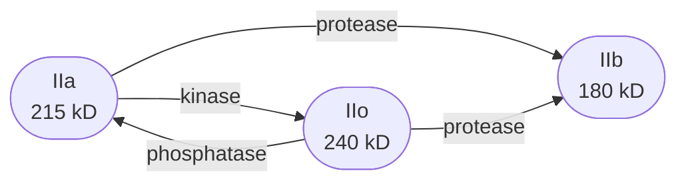
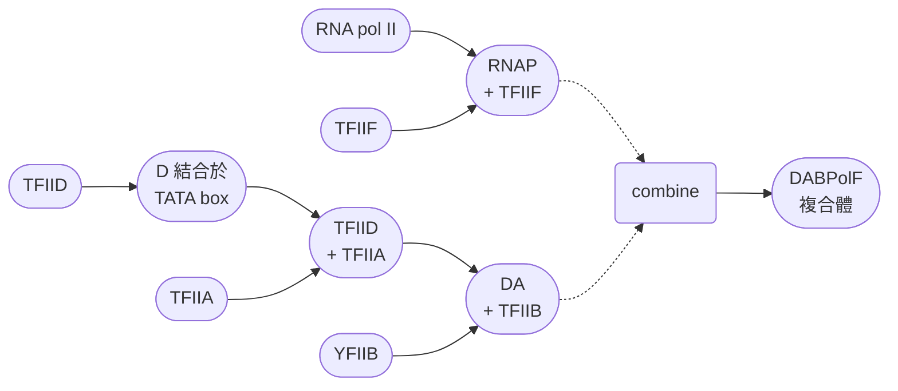
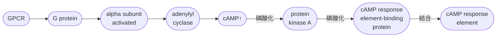
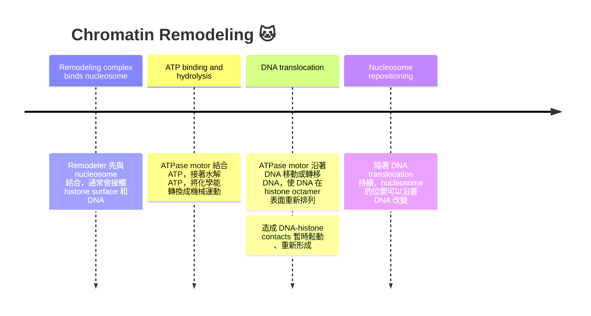

# molecular bio 2nd
## chapter 10
### 真核生物的RNAP
- Robert Roeder and William Rutter 在1969年時發現，真和生物其實有三種RNAP，除此之外，它們也成功用了離子交換層析，分離了這些蛋白質
- 這三個分別為RNAP I、RNAP II、RNAP III，之所以可以用離子交換層析，主要是因為他們對離子鍵的強度不同
- 最重要的是，他們三個所做的轉錄工作並不一樣


- 甚至，如果從不同細胞提取這些RNAP，濃度分布也有所不一
- 例如，從細胞質 (nucleoplasm) 裡面提取的RNAP 主要是RNAP II，而細胞核 (nucleolus) 的主要是RNAP I


#### 三個RNAP的產物整理

|RNAP type|會產生|
|---|---|
|I|28S、18S、5.8S rRNAs|
|II|mRNAs、snRNAs、miRNAs|
|III|5S rRNA、tRNAs、U6 snRNA、7SL RNA、7SK RNA|

- Roeder負責發現這些RNAP的產物時，用的東西叫做 $\alpha$ -amanitin，來自於 *A. phalloides* (死亡帽蘑菇)、或是 *A. bisporigera* (死亡天使蘑菇) 🍄

> [!Tip]
> - 這都是甚麼奇奇怪怪的名字 🤣💀


- 低濃度的 $\alpha$ -amanitin 就會抑制RNAP II
- 而RNAP III 在更高濃度的 $\alpha$ -amanitin 才會被影響，至於RNAP I 就基本上沒啥轉錄的抑制 (oh yeah 🙂)


- 它們拿了老鼠的細胞核，並且逐步讓RNAP暴露於越來越高的 $\alpha$ -amanitin，看看RNA的合成有沒有變化
- 它們主要是透過讓合成的RNA帶有標記，並且將樣本拿去離心後，提取含有RNA的上清液 (supernatant)
- 並且分成六組，每一組的 $\alpha$ -amanitin 濃度分別是 0.1、4、10、20、70、400 $\mu g/ml$
- 可以發現， $\alpha$ -amanitin 的濃度越高，原本的放射標記濃度就越低


#### 植物小發現
- 在為 *Arabidopsis thaliana* (阿拉伯芥) 定序時，發現另外兩種RNAP，分別為 RNAP IV 跟 RNAP V
- 它們主要轉錄一些noncoding RNA，這些RNA可以抑制或是使某些基因 "安靜"

#### 亞基構造
- 對於真核生物而言，很難真正像是原核生物一樣分離亞基
- 因此早期的科學家只能在釀酒酵母等物種裡面，透過 "預測哪些基因跟RNAP有關"，並對其進行突變，看看轉錄發生甚麼變化
- 例如，目前釀酒酵母已經確定了 RNAP II 的 "12個亞基"，並已經一一定序完畢
- 這些亞基在酵母身上，就是RPB1、RPB2等 (**R**NA **P**olymerase **B**)
- 而人類也差不多有12個類似的亞基，被稱為hRPB1、hRPB2等

##### 共同點
- 無論是酵母還是人，它們跟細菌一樣，RNAP包含兩個主要的大亞基
- 這有點類似於細菌 RNAP 的 $\beta$ 跟 $\beta^{\prime}$ 一樣
- 事實上，真核的RNAP很有可能是起源於類似原核生物的RNAP，因此他們之間有發展上的相似處

##### 如何把所有亞基都區分出來
- 後來有位科學家透過epitope tagging把這些可能的亞基透過SDS-PAGE區分出來
- 他們透過給一個已知的可能亞基 (例如Rpb3) 上面加上某種epitope的基因，然後讓酵母將Rpb3以及其他亞基結合成一個完整的RNAP
- 然後，他再用結合該epitope的抗體，把這個RNAP從細胞分離出來的混合物中提取出來
- 再透過加入SDS讓他們分開成多個亞基，最後將他拿去做蛋白質電泳
- Young等人就是透過這種方式，嘗試分離出了10個條紋，剛開始一度認為RNAP主要就是這10個亞基

> [!Note]
> - 當然，在後來的實驗中，發現其實是12個亞基，只是另外兩個亞基的遷移率有重合導致
> - 具體來說，Rpb9跟Rpb11的遷移率類似，Rpb10跟Rpb12的遷移率類似 🐱


##### core subunit
- 最主要的三個必須的亞基，分別是 **Rpb1、Rpb2 跟 Rpb3**，他們是合成RNA所必須的，因此也稱為 core subunit
- 這分別對應到E.coli的RNAP的三個亞基: $\beta^\prime$ 、 $\beta$ 、 $\alpha$ (同源的發展出來 !! 😲)
  - Rpb1 結合固定於 DNA， $\beta^\prime$ 也一樣
  - Rpb2 接近 RNA 合成活性位點， $\beta$ 也一樣
  - Rpb3 在holoenzyme上會有兩個， $\alpha$ 也一樣

##### commom subunit
- 另外五個亞基，雖然不清楚其功能，也不知道他跟細菌的RNAP有什麼關係，但是在三種酵母的RNAP裡面，都有這五個亞基，我們稱為 common subunit
- 分別為 **Rpb5、Rpb6、Rpb8、Rpb10 跟 Rpb12**

<iframe src="https://Jacklyn301.github.io/molecular_model/3M3Y_RNA%20polymerase%20II%20elongation%20complex%20C.html" width="100%" height="600px"></iframe>

#### Rpb1 的異質性
- 從上頭模型我們可以發現，Rpb1到底是個多大的亞基
- 其實，這個亞基有時候的結構並非總是相同
- 例如當他們在給漿細胞瘤做電泳時，發現在Rpb1的區域附近，出現了三條線，研究者分別稱這三種蛋白 (分子量由大到小) 為o、a、b

> [!Tip]
> - 也就是說，或許 Rpb1 有不同種形式? 🤔

- 事實上，IIa、IIo 和 IIb 都是同一個 RNA polymerase II 最大次單元 Rpb1 的不同 biochemical forms
- 它們不是三種不同的 subunits，也不是三種不同的 RNA polymerases，而是 "不同形式"


|Form|RPB1 發生了什麼事|
|---|---|
|IIa|Hypophosphorylated，CTD 磷酸化程度低|
|IIo|Hyperphosphorylated，CTD 磷酸化程度高|
|IIb|經過 proteolytic cleavage，蛋白質被切短|

- 具體的關係長得有點像是...



- 至於IIb到底是被剪斷了哪一個區域，其中一個就是CTD
- CTD是一個由7個胺基酸不斷重複幾次的一個尾巴，序列為: 

$$Tyr-Ser-Pro-Thr-Ser-Pro-Ser$$

#### 轉錄起始的三維結構
- 當時在進行RNAP II的結構分析時，最常遇到的就是 "樣本每次拿到的不一定完整"
- 做晶體最大的麻煩是有些 Pol II 帶著 Rpb4/7，有些沒有，所以樣品不夠一致 (我剛剛給妳們看的模型裡面就沒有這兩個亞基 💀)
- 當時Roger Kornberg就乾脆弄了一種突變體，直接去掉了這兩個亞基的轉錄，確保 "樣品夠純"，才在2001年完成了第一個晶體繞射圖
- 他們從結構中發現，DNA在轉錄時，坐落在這個RNAP的一個溝 (cleft) 裡面
- 同時，這裡面也是有兩個鎂離子，只是其中一個鎂離子似乎因為跟其他的基團交互作用較低，因此繞射時的信號較弱

#### 轉錄延伸的三維結構
- Roger Kornberg同時也做了同時有bind DNA跟產生RNA的模型，也就是elongation狀態的RNAP (只是這一次的解析度較低)
- 為了克服在繞射時周圍沒有轉錄因子的情形，他基本上就以一段有 "3'單股oligo-C" 的DNA模板，幫助RNAP接上去
- 然後再用heparin把 "沒有成功bind在DNA上的RNAP" 洗掉，以獲得品質更高的 "elongation RNAP II"
- 他們在核酸的型態中，找出三個RNAP可能有的架構，分別是 rudder、lid 、 跟 zipper
- 這三個結構讓DNA可以跟RNA分離，同時也在合成RNA前確保DNA雙股已經解旋


- 裡面還有一個洞 (pore 1)，離活性位點以及bridge helix的結構很近
- bridge helix在作用時會彎曲，功能是幫助移位，讓新的核甘酸有位置在活性位點聚合
- $\alpha$ -amanitin 的結合似乎很靠近這個 bridge helix，因此可能透過減少這個helix的靈活度，降低轉錄能力

#### 核甘酸特異性選擇
- Roger Kornberg 等人又在2004年的時候，解碼了更多有關於post-translocation的結構細節
- 他們透過讓轉錄中的RNA尾巴加入dATP，這阻止了進一步的轉錄，讓複合體停留在post-translocation (正準備讓下一個核甘酸進入的構型)
- 然後進而提取出RNAP後，依序分別把它們做成兩種類型: 正確配對鹼基的，以及錯誤配對鹼基的
- 具體來說，RNAP 不只要選對 NTP，還要確認它**能不能在 active site 裡形成適合催化的幾何構形**

|state|result|
|-----|------|
|正確的 nucleotide pairing|Incoming NTP 與 DNA template 上的鹼基正確配對，RNA 3′ end、incoming NTP 與 catalytic center 能維持適當的空間排列|
|錯誤的 nucleotide pairing|錯配會造成 active site 的幾何構形不理想，使底物難以正確定位，降低 phosphodiester bond formation 的效率|

_and_mismatched(b)_nucleotides_in_A_and_E_sites%2C_respectively_1101.png)

- 兩個金屬離子在這裡進行催化，其中，metal A結合在酵素上，而metal B結合在欲加入的核甘酸上
- 核甘酸首先會先進入 E (entry) site，並且在活性位點 (A site) 區域發生反轉
- 只有在正確的核甘酸結合到活性位點時，trigger loop (Rpb1) 才會發揮作用，使其產生phosphodiester bond
- 這個相互作用可能跟trigger loop和其他區域的殘基之間產生的作用力有關係

> [!Note]
> - 具體的催化，可能是透過 trigger loop 上的 His-1085 跟核甘酸底物的 $\beta$ -磷酸接觸形成
> - 組胺酸的imidazole帶正電，透過奪取 $\beta$ -磷酸的負電荷，使周圍的 $\gamma$ -磷酸變成更號的親核性target 😏

#### 消失的Rpb4 and Rpb7
- Kornberg等人嘗試把10個亞基的RNAP跟專門生產 Rpb4 and Rpb7 的改良大腸桿菌加在一起
- 至於 Rpb4 and Rpb7 的作用，則眾說紛紜，有些人認為他們負責在RNAP結合到模板股時 "關閉" 原本打開的夾子
- 也有人認為， Rpb4 and Rpb7 是為了讓RNAP可以跟通用轉錄因子結合

> [!Note]
> - 這或許可以說明為何在沒有轉錄因子的情況下，RNAP可能有 Rpb4 and Rpb7 ，可能沒有 🐱


### Class II promoter
- class II promoter = RNAP II辨識為主的promoter
- class II promoter 通常可以分成: 
  - core promoter (核心啟動子)
  - proximal promoter (近端啟動子，也稱為upstream promoter elements)

#### core promoter
- **TATA box**: 約在 -31 to -36 bp 的位置，序列通常是 `TATA(A/T)AA(G/A)`
- **TFIIB辨識元件**: 也被稱維BRE，約在 -37 to -32 的位置，序列通常為 `(G/C)(G/C)(G/A)CGCC`
- **initiator (Inr)**: 約在 -2 to +4 bp 的位置，序列通常是 `GCA(G/T)T(T/C)` (果蠅)，或是 `PyPyAN(T/A)PyPy` (哺乳動物)
- **下游啟動元件**: downstream promoter element (DPE)，約在 +28 to +32 bp 的位置
- **motif ten element (MTE)**: 約在 +18 to +27 bp 的位置


#### TATA Box
- 非模板股的共有序列大概是 `TATAAA`，他在位置跟結構上有時會跟細菌的 -10 box 做比較
- 當然，不是所有由RNAP II負責的基因都有 TATA Box，例如兔子的 $\beta$ -globin就是 CATA，而不是TATA，通常沒有 TATA Box 的基因可能有以下幾個特色: 
  - **housekeeping genes**: 幾乎所有的細胞都需要表達的基因
  - **homeotic genes**: 主要用來做發育調控的基因
- 相反的，其他的表達基因，只要**呈現出的是分化的個人特色** (例如皮膚細胞形成keratin，紅血球產生hemoglobin)，這種特色基因往往就會有 TATA box
- **刪除TATA Box，並不會降低轉路效率，但是會使轉錄起始的位置不再固定**，愛往哪開始就往哪，因此TATA box更像是圖標，而不是促進RNAP活化

##### 例外在這裡 !!
- 當然，**有些TATA Box的存亡會嚴重影響轉錄活性**
- 例如 Steven McKnight and Robert Kingsbury 在泡疹病毒的胸苷激酶 (tk) 的啟動子中，透過替換掉一段10-bp的序列
- 這替換之後幾乎沒有檢測到任何轉錄的信號 😲💀
- 下圖中的不同lane編號，代表不同的 linker-scanning mutant
- 例如 LS −95/−85，就是把 tk promoter 中 −95 到 −85 附近的一段序列替換成 linker sequence
- 每個 oocyte 都同時收到兩種 DNA: 
  - Test DNA: 帶有其中一種 linker-scanning mutation 的 tk promoter
  - Control DNA: pseudo-wild-type promoter，保留接近正常的 transcription activity，但在 −121 到 −131 位置有一個不影響轉錄的 mutation
- 因此，同一個 oocyte 裡會同時產生兩種不同來源的 RNA
- 這樣就能把 control DNA 當作內部參照，而不是拿不同 oocyte 互相比較

> [!Important]
> - 這些序列的test signal有大有小，也就代表，有些序列會影響轉錄活性，有些似乎比較不影響 🤔


##### 實驗開始
- Christophe Benoist and Pierre Chambon 具體理解 TATA box 的方式，是透過 "剪切一段DNA，看看轉錄位置的移動" 實現的，並且透過S1 mapping 確定轉錄起始的位置
- 他做了好幾次的剪切DNA，這些突變分別標示為P1A, AS, HS0, HS3, and HS4 mutants (這些還包含TATA box)，可以發現，減掉的DNA長度越長，得出的S1 mapping長度越短
- 而如果是連著TATA box一起去掉 (HS2 mutant)，會開始出現不同長度的片段，也就是說，轉錄出來的長度再也不是固定的


##### 相關轉錄因子
- 結合 TATA Box 的轉錄因子是 TFIID，包含 TATA-binding protein (TBP)
- TBP跟TATA Box的結合可以招募其他因子也一起結合上來

#### Inr、DPE 和 TFIIB 辨識元件
##### Inr
- 一些class II promoter在轉錄起始的位點 (+1) 附近，序列都相對來說比較保守，這些保守的序列也被稱為 initiator (Inr)
- deoxynucleotidyltransferase (TdT) 基因也有Inr，而且它特別的是，這傢伙似乎沒有其他明顯的上游promoter，也就是說，這基因可能光用 Inr 就撐出一片天 （？？🤣）

##### DPE
- 在果蠅的身上，DPE的普及程度就跟它的TATA Box差不多
- 它們有時候的功能就是剛好彌補了 "缺失TATA Box" 的狀況
- 也就是說，缺失TATA Box的基因，通常都有DPE "撐腰" 😗

#### proximal promoter element
##### GC Box
> [!Tip]
> - 還記得Steven McKnight and Robert Kingsbury實驗的那張圖嗎?

- 那張圖中所替換掉的序列，有些在啟動子非常上游的地方，動輒一百多bp，但是他們的替換也會降低轉錄
- 這些序列有些包含 `GGGCGG` 或是 `CCGCCC`，我們稱呼它們為 **GC Box**
- 這些Box會跟轉錄因子結合，影響基因調控

> [!Important]
> ##### GC Box vs promoter
> - GC box跟啟動子最不一樣的地方，是promoter倒位了就會失去活性，但是GC box不會
> - GC box即使旋轉180度，依然有效 😏😏

- 但是GC Box有位置遠近的影響
- 如果是一般的enhancer，就算距離promoter十萬八千里（？）也可以調控基因
- 而一旦GC Box距離promoter太遠，它就會失去刺激轉錄的能力　🫠

##### cat Box 🐱🐱
- 相關序列為 `CCAAT`，也是上游promoter element的一種
- 例如tk啟動子就有cat Box，它也需要跟轉錄因子結合 (例如CTF)，才可以發揮作用

> [!Tip]
> - 近端啟動子的兩個特性: 
>   - orientation-independent: 方向無關性 (正反沒關係)
>   - position-dependent: 位置依賴性 (位置不要太遠) 🐱😏

### Class I promoter
- RNAP I 最常辨識的基因就是 rRNA precursor gene (錐蟲例外，它另外編碼了兩個蛋白質)
- rRNA precursor gene 並不只一個，但是在genome中也只是多個拷貝而以，也就是說，它們的啟動子可能都一個樣，這也被稱為 class I promoter

> [!Important]
> - 我只有說一個物種中的rRNA precursor gene啟動子都一樣，但是**不同物種間的 class I promoter 長相依然可以天差地別** 😲

- Robert Tjian 等人發現人類的 class I promoter 基本可以分成兩大部分: 
  - **core element/rINR**: 約在 -45 to +20 之間
  - **upstream promoter element (UPE)**: 約在 -156 to -107 之間


- 這兩個之間的**距離 (也就是spacing) 似乎對轉錄有著非常大的影響**
- 如果嘗試在不破壞兩個element的情況下，縮短他們的距離，轉錄的程度就會大幅下降，縮越多降越多 🙂

### Class III promoter

> [!Tip] 
> - 我們討論的 "經典 class III promoter" (5S rRNA & tRNAs) 的特點在於: 他們的promoter在基因內部 !! 🐱

- Donald Brown 在研究非洲爪蟾 (*Xenopus borealis*) 的 5S rRNA 時有意外發現
- 科學家們嘗試從5S rRNA 基因的 5' (也就是起始區) 開始一路突變，想知道到底突變哪裡會影響轉錄活性
- 結果它們發現，單鏈 rRNA 長度約為 120 nt，但是就算手賤把前面一大段幾十個核甘酸砍掉， RNA 依然有轉錄出來
- 只有在砍掉 +50 以上的區域時，轉錄量才開始大幅降低


- 後來他們確定， +50 to +83 的區域是 "絕對要保留下來的"，其他區域，即使額外添加幾個DNA片段，對轉錄的影響也較小
- 他也給這些 "易感區域" 取了些酷炫（？）的名字，包含box A、box B、intermediate element、box C 等等
- 根據這些box的位置，可以分成三種類型: 
  - **type I**: 5S rRNA (box A、intermediate element、box C)
  - **type II**: tRNAs 和 VA RNA (box A、box B)
  - **type III**: human 7SK RNA 和 human U6 RNA (非經典型，啟動子類似於class II 的 promoter)


#### 7SL RNA 等非典型 class III gene
- 這些基因雖然也是由RNAP III來進行轉錄，但是他們整體來說更像是class II promoter的基因，因為這些基因也有 DSE、PSE、TATA box等位於上游的重要序列
- 同時，7SL RNA 也並沒有跟 class III gene 一樣的那些甚麼box A、box B的 (異類? 🙂)
- 很多 7SL RNA pseudogenes 或是 Alu sequences (轉座子) 在體內很難轉錄出來，多半原因就是因為它們上游缺乏重要序列

#### 那憑什麼長的像class II 卻是 class III? 😑
- 這些 "異類" 包含 7SL RNA 跟 7SK RNA 、以及 U6 RNA 跟 EBER2 gene
- 額，原因就在加入 $\alpha$ -amanitin 的效果，這兩個 RNA 即使加入了一些 $\alpha$ -amanitin ，依然有轉錄
- 如果是以RNAP II來轉錄這兩個RNA，按理說以RNAP的個性（？），少量的 $\alpha$ -amanitin 足以抑制轉錄了
- 所以，**除非這些傢伙由RNAP III負責，不然無法解釋這種 "神秘現象"** 🤣🤣

#### U1 vs U6

> [!Tip]
> - 讓你體驗下什麼叫做 "長的像但不是一個親媽生的"

- 對於非典型的RNA們，有時候即使是非常類似的RNA，但是由完全不同的RNAP轉錄
- 而這兩個的差別... 
  - U1 snRNA: **有 DSE 跟 PSE，由 RNAP II 轉錄**
  - U6 snRNAL **有 DSE、PSE 跟 TATA box，由 RNAP III 轉錄**

> [!Important]
> - 甚至它們發現，如果我給 U1 加上 TATA box，他就可以改由 RNAP III 轉錄，而 U6 如果去掉了 TATA box，也可以改由 RNAP II 轉錄 !! 😲


### Enhancer and Silencer
#### Enhancer
- 第一個enhancer由 Chambon 等人在 SV40 early gene 的上游發現的
- 這個序列其實在之前就已經有被關注了，因為他是一個 72-bp 為一個單元的重複序列


- 當他們嘗試在這個72 bp的區域加入突變，就可以大幅降低轉錄的水平
- 但是遠遠不只這樣，後來的科學家又發現，這個重複序列發生倒位，或是移到病毒genome的另一側 (距離promoter超過2kb的長度)，它們仍然能夠促進轉錄
- 所以這東西就是 "方向無關"、"位置無關" 的特別序列

#### 位置多樣
- 當然，enhancer也不一定要在基因上游
- 例如 Tonegawa 在研究老鼠的免疫球蛋白 $gamma_{2b}$ gene 時，就發現說該基因內部的intron，不能隨便被剪切掉
- 雖然剪切那些intron並不會導致產物失活，但是會導致其轉錄的量大幅減少
- 它們一共做了兩組剪切: 
  - $\Delta 1$ : 刪除約 180 bp
  - $\Delta 2$ : 刪除約 470 bp
- 接下來: 
  - 他們將不同版本的 $gamma_{2b}$ gene 轉殖進 plasmacytoma cells
  - 加入 radioactive amino acid，標記細胞新合成的蛋白質
  - 使用 antibody 做 immunoprecipitation
  - 將免疫沉澱的蛋白質進行 electrophoresis，再用 fluorography 偵測
- 圖中：
  - 上方的 $\gamma_{2b}$ band：欲測蛋白
  - 下方的 $\lambda$ band：$\lambda$ light-chain protein，作為細胞內的參照訊號


- 結果發現: 
  - $\Delta 1$：蛋白質表現略微下降
  - $\Delta 2$：蛋白質表現大幅下降
- 他們還做了Northern blot，直接檢查 RNA

|Lane|Sample|
|----|------|
|1|C+，原本會表現 $\gamma_{2b}$ 的 plasmacytoma cells
|2|C−，不表現 $\gamma_{2b}$ 的細胞 (contro;)
|3–4|Wild type|
|5–6| $\Delta 1$ |
|7–8| $\Delta 2$ |

- 結果不出所料， $\Delta 1$ 跟 $\Delta 2$ 都出現mRNA數量下降的趨勢

> [!Important]
> - 為了做出更好的證明，以確認他是enhancer，他開始試圖移動 $X_2 X_3$ 這個疑似含有enhancer的片段
> - 他不只是讓該片段倒位，他還從intron中移出，改轉移到promoter的上游
> - 結果你猜怎麼著? mRNA 依然有轉錄出來 !! 😲😲


- 至於把該基因轉到 fibroblast，可以促近轉錄嗎? 答案是不行，因為enhancer要能作用，就需要有相應結合的蛋白質 (activator)
- 而纖維母細胞不需要做抗體，因此他自然在分化後也失去做出activator的功能，當然就會讓enhancer沒用

#### silencer
- 人如其名，他在位置跟功能上很像enhancer，只是他主要抑制轉錄，而非促進轉錄
- 例如酵母的mating system就是一個舉例
- 在三號染色體上有三個loci，他們序列很像，分別是 MAT, HML, and HMR
- 當MAT在作用時，其餘兩個就不能一起作用，這就多虧有silencer的幫忙

> [!Tip]
> - 一個基因可能同時有對應的enhancer跟silencer 🐱

---

## chapter 11
### class II factor
- 在**preinitiation complex**裡面，主要的factor包含 **TFIIA、TFIIB、TFIID、TFIIE、TFIIF 跟 TFIIH**
- Danny Reinberg and Jack Greenblatt 乾脆就試著透過DNA電泳加上這些factor的方式，看看出現了哪些條紋 (**也就是EMSA**)
- 他們依序加入了D、A、B、F 以及 RNAP ，逐漸在不同lane增加 RNAP 濃度後，接下來逐步降低 TFIIF 的濃度
- 可以發現: 
  - D、A 跟 B 本身就可以組成複合體
  - 當 F 濃度逐漸下降時，DAB複合體似乎就失去結合 RNAP 的能力
  - D 似乎是形成複合體的必需要素，因為在沒有D的情況下，其餘factor根本無法結合在一起
  - E 跟 H 兩個複合物要在有 RNAP 出現的前提下才可以另外加上去


- 當然Reinberg等人除了做DNA電泳，他們還用DNase footprinting直觀看到蛋白質結合在模板 (或是非模板股) 的位置


> [!Tip]
> - 具體來說，他們是用了兩個可以裂解DNA strand的東西: DNase 跟 1,10-phenanthroline-copper ion complex ( $OP-Cu^{2+}$ )
> - 前者產生的空白處通常更多
> - 實驗先看D、DA、DAB是否就可以連接上DNA strand，發現它們本身就有對DNA的親和性，並且無論是否是模板股，都會跟他們結合 (阻擋的序列: `TATAAA` )
> - 之後再看加入 F 和 RNAP 的效果 (阻擋的序列: -42 ~ +17 bp)，如下:  🤔


- 因此，就這兩個個實驗情況，我們可以大致猜測，RNAP initiation complex的形成過程會比較類似以下順序...



#### 辨識TATA到底是用major還是minor groove

> [!Tip]
> - 先暴雷: 答案是 minor groove，但是等下會告訴你原因 😏

- Barry Starr and Hawley 為了證明這一點，他們乾脆將TATA Box的所有鹼基換成另一種形式: **在 minor groove 側看起來一樣，在 major groove 側卻完全不同**
- 最後他們把TATA改成了CICI box (I = inosine)，一個前看不一樣後看一模一樣的box
- 那這個 CICI box 有沒有用呢? 第一 lane 用 yeast 的 TBP，第二 lane 用 human 的 TBP，要是 CICI 跟 TATA box 的條紋一致，我跟你姓 🙂

> [!Tip]
> - gel: 那就跟我姓吧 😗
> - Me: Oh shit. 🙂🙂🙂


#### TFIID 究竟是?
- TFIID 包含一個 38-kD TATA-box binding protein (TBP)，以及其餘的區域 (也稱為 TBP-associated factors, TAFs)
- TBP 的 C 端 180 個胺基酸的區域，就是最主要 bind 在 TATA Box 的地方
- 由於 TBP 的形狀很奇特 (像馬鞍)，當那辨識區域直接塞進 minor groove 的時候，他基本上是把 DNA 的那個區域強行撐開 (你硬來啊?? 💀)

> [!Note]
> - 這會讓整個 TATA Box 的區域彎折到 80 度左右 😱😱

<iframe src="https://Jacklyn301.github.io/molecular_model/5FUR_Structure%20of%20human%20TFIID-IIA%20bound%20to%20core%20promoter%20DNA.html" width="100%" height="600px"></iframe>


#### TBP 的多能性
- TBP不僅僅是可以跟TATA Box相互作用，即使是沒有 TATA box，或是 RNAP I 或是 RNAP III 跟它作用，依然可以發揮重要角色 (通用轉錄因子???)
- Ronald Reeder and Steven Hahn 原本想要知道酵母菌的TBP是不是會因為變性 (例如溫度太高) 而降低RNAP II的轉錄能力
- 結果令人跌破眼鏡: 變性的TBP還會影響 RNAP I 跟 RNAP III的轉錄 ! 😲

##### 實驗開始
- 它們準備了wild type 跟溫度敏感型細胞 (TBP溫度高一點就報廢的突變體) ，所以共有...
  - wild type (野生型)
  - I-143 to N (Ilu 變成 Asp)
  - P65 to S (Pro 變成 Ser)
- 然後這三個從24度移至37攝氏度培養一小時，結果發現: 溫度的變化會稍微影響轉錄的活性
- 其中，I-143 to N 突變對於三種RNAP的活性都在死機，根本沒有轉錄
- 另一個 P65 to S 突變，對RNAP II 跟 RNAP III 沒有活性，但是對 RNAP I 依然有活性
- 而 wild type 在任何溫度下，對三個 RNAP 都有活性


##### 除此之外
- Pyrococcus woesei (一種古菌) 身上看到類似TBP的蛋白質，它甚至有 TFIIB-like 蛋白質

> [!Note]
> - 這些蛋白的相似傑就讓人預測，古菌跟真核的共同祖先是先跟細菌分家，之後再產生古菌和真核的分家 🤔

### TAF
- Tjian 等人先免疫沉澱了TFIID，然後再把TBP從上面剝離，剩下的TAFs就用SDS-PAGE展示
- 最後它們嘗試剝離了13種跟class II 相關的蛋白質
- 現在同一個物種中的TAF，會以分子量大小排序。最大的 TAF 就是 TAF1，以此類推
- 要是沒有特別講排序，以分子量大小命名，例如 TAF230 就是分子量為 230 kD 的蛋白
- 如果有兩個蛋白在關係上為 "旁系同源" (例如人類的TAF135 跟 TAF105)，就另外做編號 (一個是TAF4，一個是TAF4b)

#### 延伸保護作用
- 要了解一件事，雖然TBP主要bind TATA box，但是TBP本身的大小可以保護周圍約20 bp的區域，而其他的TAF甚至可以飛到 35+ 的區域結合
- 為了證實 "其他非TATA的區域" 是否會影響TFIID，Tjian 又做了幾個實驗
- 他做了兩組的基因: 
  - E1B, E4: 只有TATA Box
  - AdML, Hsp70: 有TATA Box、Inr、DPE 完整組合
- 接下來弄兩個well，一個只跟TBP做反應，一個跟TFIID做反應


- 可以發現，在只有TATA box的時候，TBP 跟 TFIID 兩個所貢獻的情況似乎一模一樣
- 但是當模板上有TATA、DPE、Inr 時，TFIID 所支持的轉錄表現，似乎比僅僅有TBP來的更好

> [!Tip]
> - 或許那些TAF就參與了Inr 跟 DPE 之類的交互作用? 🤔🤔

- Tjian 把可能參與的蛋白質跟某個改良過的promoter結合，並且用紫外光去照射複合體，使蛋白質與DNA中的特殊分子 BrdU 交聯
- 洗去有結合上去的蛋白質，再用DNase把DNA分解
- 最後這些蛋白質再去做SDS-PAGE電泳
- 他發現TAF1跟TAF2似乎有結合promoter區域的嫌疑
- 嘗試只加入TAF1跟TAF2分子去交聯，你會得到跟 "把整個TFIID拿去交聯" 一樣的電泳圖 !! 😗


#### 放心，看不到，咱們直接上工具

> [!Tip]
> - 真的覺得 Tjian 好認真證明這些事情，他是對於TAF有多大興趣... 🙂

- 直接用DNase footprinting，看看 "only TBP" 跟 "TBP + Inr + DPE" 的條紋有沒有差別
- 可以發現，兩個區域都有在TATA box的地方產生空白，但是 "TBP + Inr + DPE" 在 +1 ~ +20 bp的範圍之內，也有條紋變少甚至消失的情形

> [!Important]
> - 如果你只加入TAF1-TBP，或是只加入TAF2-TBP，它們的結合效果其實反倒是比單一TBP來的差 (TBP: 你是來煩老子的嗎 🙂)
> - 也就是說，要是TAF1跟TAF2要發揮它們的功能，單獨行動只會拖後腿，兩人一齊偕同才會得到想要的結果 😏😏

--experiment_made_by_Tijan_1103.png)

#### 所以要是沒有了 TATA box 要怎麼辦?
- 目前的觀察發現TFIID在很多地方都有作用，即使這些基因沒有TATA box，TFIID還是非常重要，因為其他的元件 (Inr、DPE)，還是需要TAF1、TAF2等蛋白質的結合

#### Sp1

- 除此之外，一些activator，例如Sp1，會結合到GC box上面，同時也會跟TAF4等蛋白質有互動
- Tjian就有提到這種activator，並且說Sp1是一個刺激轉錄的蛋白，不跟TBP作用，也就是說，正因為有TAF4等相關蛋白的存在，Sp1才能展現他的功能
- 創意無限的他還試著做積木組合，看看配來配去誰會有反應: 例如: 
  - 有TATA: TBP 結合 TATA，TAF1、TAF2 結合Inr
  - 沒有TATA: TAF1、TAF2 結合Inr
  - 只有GC box: sp1 結合 GC box 跟 TAF4


#### NTF-1
- 他可以跟TAF2、TAF3跟TAF6結合 (可以單個，也可以好幾個一起結合在NTF-1上面)
- 他target的核酸就是Gal-4


#### TAF1 是一種酵素??
- 對，他有兩種已知的酵素活性: 
  - HAT (組蛋白乙醯轉移酶)
  - kinase (磷酸化自己或是TFIIF，偶爾少程度的磷酸化TFIIA跟TFIIE)

#### TFIIA and TFIID 的愛恨情仇
- TFIIA 可以穩定 TBP 和 TATA box 結合
- 他也可以透過抗抑制機制促進TFIID跟promoter的結合 (透過避免TBP跟TAF1的N端起反應)

#### 質疑聲有想法
> [!Warning]
> - TFIID 裡面的 TAFs，究竟是不是所有 RNAP II transcription 都必需的 🤔

- Green et al. 使用了兩種 yeast mutants:

##### Experiment A: Temperature-sensitive TAF1 mutant
- TAF1 基因發生 temperature-sensitive mutation
  - Permissive temperature: 蛋白質可以正常發揮功能
  - Nonpermissive temperature：突變蛋白質失去正常功能，並且 TAF1 的濃度快速下降。
- 結果在實驗中，還發現至少另外兩種 TAF 的濃度也下降，為什麼？
- 因為 TAF1 是 TFIID 複合體的重要組成部分。當 TAF1 消失，整個 complex 的穩定性受到破壞，**其他 TAFs 也可能因為失去複合體保護而被降解**

##### Experiment B: TAF14 deletion mutant
- 研究者另外使用一個缺失 TAF14 gene 的 yeast mutant，測試 TAFs 減少是否會影響 transcription。
- 當 TAF1 和其他 TAFs 大量減少時，研究者測量了五種不同的 yeast genes
- 這些 genes 分別受到不同 transcription activators 調控，結果...

|選項|結果|
|---|---|
|TAF1 concentration|Rapid decrease 📉📉|
|Other TAF concentrations|Decrease📉|
|Transcription of 5 genes|**Unaffected**🤷‍|

- 即使 TFIID 的部分組成受到破壞，這五個基因的 in vivo transcription rates 仍然沒有明顯下降

> [!Important]
> - 這表示，至少在這些實驗條件下，這些基因的 transcription **不需要完整、正常濃度的 TAF-containing TFIID**

- 在針對全基因組中，基因對不同的轉錄因子的依賴程度，其實有所不同，而且不符合科學家原先預期的...

|General transcription factor|依賴該 subunit 的基因比例|
|---|---|
|TFIID (TAF1)|16%|
|TFIID (TAF9)|67%|
|TFIIE (Tfa1)|54%|
|TFIIH (Kin28)|87%|

- TAF1跟TBP以前一直被認為是TFIID的重點兩大哥，結果全基因組分析下的實驗似乎不支持致這一點 🫠
- 所以某些TAF在某些基因表現裡面就只是走場，並不是general的?
- 不只這樣，甚至TFIID裡面TAF是幹嘛用的也不同物種，甚至是 "不同組織" 裡面各說各話
- 例如TAF10只存在於 "人類的部分TFIID"，和雌激素的反應性有關 (好小眾的功能 🤣)

#### 一個基因兩個 promoter
- 以果蠅的 *tudor* gene為例，他是母體在卵母細胞時期先做好的基因產物。它編碼一個超大的 Tudor domain 蛋白
- tudor 有兩種 promoter 使用方式: 
  - 一個 promoter 比較像典型的 TATA promoter，由TBP結合
  - 另一個 promoter 含有 TC-rich 元件 (TC box)，由TRF-1結合
- TC-rich promoter 常見於某些特殊基因

> [!Tip]
> - promoter 序列不一樣 → 招募的 initiation factor 不一樣 → 表現時空也不一樣
> - 由於TC box介導的promoter從-77開始轉錄，而TATA box介導的從+1開始轉錄，這兩個最後產生的mRNA不太一樣!! 😲


#### TBP-like factor (TLF)
- 和TBP長的很像，但是他少了一對苯丙胺酸，這讓他難以跟TATA box結合，所以他似乎不會和 TATA box 結合
- 他也可以跟promoter互動，通常該promoter沒有TATA box

#### TBP-free TAF-containing complex
- 人如其名: TFTC = 沒有 TBP 但很多 TAFs 的複合體
- 也就是說，在某些時候，TAFs 可以組成不含 TBP 的複合體，參與 transcription regulation，不必先組裝成完整的 TFIID
- TFIID 和 TFTC 的結構在某些地方非常相似，都有容納DNA的凹槽

#### 甚至輔因子也會搞事情 !
- 一類負輔因子 negative cofactor 2 (NC2) 可以辨認並區分DPE類啟動子跟TATA類啟動子
- 具體來說，**他會促進DPE promoter的轉錄，同時抑制TATA promoter的轉錄**

> [!Note]
> - NC2或許可以做為基因調控關鍵位點?? 🤔

- Stephen Burley 等人就在 2001 年做出了NC2-TATA-TBP的複合體模型 (我給你們找到啦不要說我沒心意 😗)
- NC2 會干擾 TFIIA 跟 TFIIB 等想要跟 TFIID 互動的傢伙結合在DNA上
- 結果就是 "沒辦法形成完整的轉錄複合體" 😏

<iframe src="https://Jacklyn301.github.io/molecular_model/1JFI_Crystal%20Structure%20of%20the%20NC2-TBP-DNA%20Ternary%20Complex.html" width="100%" height="600px"></iframe>

### TFIIB
- 從Danny Reinberg等人的研究中發現，TFIIB 其實是一個單亞基因子 (35 kD)，不需要TAF輔助
- 同時，他之所以重要，是因為如果沒有他，DA根本不可能與RNAP結合
- 在複合體組裝過程中，TFIID 會位於 TFIID 跟 RNAP 之間

> [!Tip]
> - 所以 TFIIB 是橋梁囉，那既然是橋梁，一定是兩個domain，一個找 TFIID，一個找RNAP? 🤔🤔

- 沒錯，TFIIB 就分成兩個 domain，分為 TFIIBN 跟 TFIIBC，N端接RNAP，C端接TBP
- TFIIB會把 TBP 跟 RNAP 接在一起，並且將 RNAP 的活性位點對到 TATA box 下游 31 bp 的位置 (也就剛好是 +1 !! 😏)

<iframe src="https://Jacklyn301.github.io/molecular_model/1R5U_RNA%20Polymerase%20II-TFIIB%20Complex.html" width="100%" height="700px"></iframe>

- 人類的 TFIIB 有一個lysine的殘基，可以緊緊結合在DNA (Inr) 上面
- 而酵母菌的是用酸性胺基酸殘基作用，同時promoter裡面往往沒有 Inr
- 由於構造上的特殊性和不對稱性，**TFIIB除了幫助決定轉錄的起始位置，也幫助決定了轉錄的 "方向"**

#### 出芽酵母跟裂殖酵母
- 這兩個酵母中，TFIIB結合的位置有些不同
  - *Saccharomyces cerevisiae*: 在 TATA 下游 40 ~ 120 bp處開始轉錄
  - *Saccharomyces pombe*: 在 TATA 下游 25 ~ 30 bp處開始轉錄
- 要是把他們兩個的RNAP和TFIIB互相對調，他們蛋白質的結合性質也一樣: 
  - cerevisiae 有 pombe 的 RNAP + TFIIB: 在 TATA 下游 25 ~ 30 bp處開始轉錄
  - pombe 有 cerevisiae 的 RNAP + TFIIB: 在 TATA 下游 40 ~ 120 bp處開始轉錄

#### transcription factor B
- 古菌身上也有類似TFIIB 的蛋白質，叫做 transcription factor B (TFB)
- 現在的演化學認為，**古菌的 TFB 跟真核的 TFIIB 是 "同源的"**

#### Hydroxyl radical probing
- 利用羥基自由基，在非常短範圍裡面切割蛋白質的方法
- 為了更詳細知道，TFIIB 究竟結合在哪些RNAP II的位置，Hung-Ta Chen and Steven Hahn 就用這個自由基剪刀開始做實驗
- iron-EDTA (ethylenediamine tetraacetate) 可以用來製造 $\cdot OH$ ，可以把他們標記在某些胺基酸上面，讓他去攻擊 "跟他離得很近" 的蛋白
- 這兩個人就在 TFIIB 的 Cys 上面安裝一堆 iron-EDTA，當他和RNAP結合時， $\cdot OH$ 就去小範圍切割 RNAP
- 最後在做蛋白質電泳時，觀察甚麼地方有出現多的條紋 (多肽鏈斷成好幾條)

> [!Tip]
> - 它們發現，TFIIBN 跟 RNAP 最多出現交互作用的地方，大概在 RNAP 的 protrusion, wall, clamp, and fork 等區域
> - 這些區域其實就在轉錄活性位點附近 ! 😏


### TFIIH
- 是最後一個參與起始複合體的轉錄因子，他主要扮演兩種角色: 
  - 磷酸化 RNAP 的 CTD 尾巴
  - 解旋 DNA (類似helicase，只是這次作用在轉錄上面)

#### CTD 磷酸化
- 在上一章我們提到，RNA polymerase II 有兩個特別的形式: IIA (沒有磷酸化) 跟 IIO (有磷酸化)
- IIA 是在 "前起始複合物" 跟其他TF一起結合的型態，而IIO，也就是磷酸化後，就開始有了 "延長RNA" 的功能

> [!Note]
> - 可以這樣想: RNAP 的磷酸化可以讓他從 initiation 型態變成 elongation 型態 😗

- 科學家對於此一現象的假設為: **未磷酸化的RNAP IIA 對TBP 結合非常緊**，而磷酸化就是為了鬆脫這個結合，RNAP 才可以往前跑
- 反正，即使當時還在吵翻天，但是大家至少覺得TFIIH是一個負責催化elongation發生的東西
- 與此同時，Reinberg 等人已經可以在體外利用純化的 RNAP 來手動讓他從 IIA 變成 IIO 了，並且可以透過電泳呈現這個現象

##### 實驗1
- 他為了看出 "磷酸化後蛋白質移動的差異"，就一共做了四組，每一組兩個lane，一個加入ATP (磷酸化材料)，一個沒有
- 如果一組的兩個條紋在同一高度，代表沒有影響到蛋白質的遷移速率，反之
- 可以發現lane 7、8 (第四組) 的區域，有加入ATP的跑的慢，沒有加入ATP的跑得快
- 而這一組跟其他組的差別，就是有無加入TFIIH


##### 實驗2
- 第二個實驗，他打算用有label的ATP了，他做了 $\gamma^{32}-P$ 的ATP，和純化後的RNAP做實驗
- 這樣在標記時， $\gamma^{32}$ - 磷酸會結合到CTD上面，磷酸化越多，訊號強度越高
- 從下圖中可以發現，在沒有 TFIIH 時，RNAP無法磷酸化 (即使有DBFE等分子)，但是**光是加入TFIIH，即使沒有其他TF，也足夠讓RNAP一部份轉變成 IIo 的形式了**
- 其他factor也不是沒事情做，例如 **TFIIE 可以加強磷酸化**，但是還是要有TFIIH 先實現磷酸化這件事，TFIIE 強化的功能才有辦法呈現
- 轉成以下圖表，綠線是有 TFIIE 的磷酸化情況，紅線是沒有 TFIIE 的情況


#### 那為什麼磷酸化的地方一定是CTD?
- 這時就要拿IIb形式的亞基來說明了
- 目前我們已知，IIb比IIA少了一段蛋白質序列，這個序列就包含CTD
- 而**如果 RNAP 為 IIb 形式，TFIIDBFEH 無法將其磷酸化**

##### 實驗3
- Reinberg 也用了標記的磷酸，去對三種類型的RNAP下手
- 可以發現，IIb 完全沒有條紋，而IIo 條紋相對較淺 (因為原本就是磷酸化的形式，很難再塞入標記過的磷酸基)
- 而 IIa 被標記的最多，IIa 越多，條紋越明顯
- 為了直接證明 CTD 的磷酸化，Reinberg 利用 chymotrypsin (胰凝乳蛋白酶) 切除磷酸化的區域 (在 IIo 的情況下，這個區域就是CTD)，直接跑了CTD的電泳
- 例如，把剛剛標記過的RNAP IIa (現在是發光的IIo) 利用 chym 拿去剪，看看剪下來的片段是不是還是亮的


- 除此之外，他們也發現TFIIH似乎只有在好好bind在promoter上面時，磷酸化才會順利進行

#### 到底CTD是什麼玩意
- 他是一個multiple heptad repeat，序列為: 

$$Tyr-Ser-Pro-Thr-Ser-Pro-Ser$$

- 通常來說，從起始到 "開始延伸"，磷酸化的殘基會變，具體來說，**會從原本的Ser 5磷酸化，逐漸變成Ser 2磷酸化**
- 如果延伸期間，Ser 2的磷酸化不見了，這時RNAP就會停下來，一直到有人 (任何一個可能很閒的kinase) 把 Ser 2 再度磷酸化


#### 轉錄泡出現
- 由9個亞基形成的TFIIH，可以大致分成兩大部分: 
  - kinase: 四聚體，磷酸化用
  - DNA helicase/ATPase: 五聚體
- Satya Prakash 等人為了確保他真的有helicase功能，他做了一個人工的雜交DNA
- 是單股 M13 DNA (7000 + bp) 跟用 $^{32}P$ 標記的 41-base DNA
- 如果加了TFIIH，DNA就會變成兩條單股，短的才有標記，就會跑很遠，偵測到 41 bp 長度的核酸
- 相反，沒加TFIIH時，label會黏在 M13 DNA 上面，因此偵測到的就是 7000+ 長度的核酸

> [!Note]
> - RAD25 是 budding yeast 中 TFIIH 的 ATP-dependent DNA helicase subunit (對應哺乳類的 XPB) 🐱


- 為了更直觀感受到TFIIH是否影響轉錄，Prakash 利用 NTP omission assay 做實驗
- 具體來說，在RNAP合成RNA時，研究者只給它ATP、UTP、CTP，為了就是讓 RNAP II只能合成短鏈RNA，方便觀察
- 它選用 wild type ( $RAD25$ ) 跟溫度敏感型 ( $rad25-ts_24$ )，在低溫 (permissive) 跟微高溫 (nonpermissive) 下進行

> [!Important]
> - 實驗顯示: 當 $rad25-ts_{24}$ 在 nonpermissive temperature 下失去功能，RNAP II 就無法有效產生實驗中偵測的 early RNA products

_is_required_for_transcription_in_yeast--experiment_made_by_Prakash_1105.png)

- TFIIH 無論是解旋還是磷酸化CTD，都需要ATP水解的能量
- 首先要清楚的一點是， "沒有TFIIH的作用轉錄會變慢" ，並不代表 TFIIH 本身就會促進轉錄
- TFIIH 跟 TFIIE 的變化，本身並不會促進 abortive transcription ，他們的最大功能，還是DNA melting為主

#### mediator
- 雖然這並不像TFIIA、B這樣的通用轉錄因子，但是它們上也絕對需要，否則轉錄難以被活化
- Roger Kornberg and Richard Young 在1994年 "不約而同的" 從酵母菌中分離出 "RNAP + 一些TF" 的組合 

### TFIIS
- TFIIS 是 RNA polymerase II 的一個重要 transcription elongation factor
- 它負責幫助發生 backtracking 的 RNAP II 進行 transcript cleavage，讓 polymerase 恢復正常的 RNA elongation

> [!Tip]
> - RNAP II 卡住時的救援人員 🤣

- TFIIS 會進入 RNAP II 的 secondary channel，協助刺激 RNA transcript cleavage
- 它的 C-terminal domain 含有重要的 acidic residues，可以協助 active center 的 $Mg^{2+}$ catalytic machinery 進行 RNA cleavage
- 更精確地說，backtracked RNA 的 3′ end 會被切除一小段，讓新的 3′ end 回到 RNAP II active site


- 當然，不只真核有這種修復機制，原核生物也有像TFIIS一樣功能的蛋白質，例如 GreA/GreB

> [!Note]
> - TFIIS 跟 GreB 在功能跟長像上是 homologous 😏

- 在實驗中，Reinberg and Roeder 等人先加入DNA 跟 RNAP，並且一分鐘後加入heparin結合游離的RNAP，此時的它們主要是elongation state，但具體還沒延長
- 之後第2.5分鐘時，加入THIIS，發現延長開始了，而只有加入buffer的對照組沒有動靜


> [!Important]
> - **TFIIS 只刺激延伸**，就算沒有加入heparin，整體轉錄刺激的幅度並未增加 😗**

- 至於降低arract又是怎麼證明的，主要是透過轉錄出來的產物長度。
- TFIIS 可以**最大限度的減少 "未整個轉錄完成的短RNA" 數量

#### TFIIF vs TFIIS
- 它們都有減少pause的效果，但是方法不一...

|特徵|TFIIF|TFIIS|
|---|---|---|
|主要角色|Promotes elongation|Rescues arrested RNAP II|
|主要處理問題|Transient pausing|Backtracking / arrest|
|發生位置|隨機 DNA sites|特定 DNA sites 或其他造成 arrest 的位置|
|主要機制|降低 pausing、促進持續延伸|刺激 RNA transcript cleavage|

### 小總結 🐱

<iframe src="https://Jacklyn301.github.io/molecular_model/30FF_TFIID-containing%20RNA%20polymerase%20II%20pre-initiation%20complex%20in%20the%20presence%20of%20the%20%2B1%20nucleosome.html" width="100%" height="700px"></iframe>


---

## chapter 12
### Categories of Activators
- 通常分為 **DNA-binding domain** 跟 **transcription-activating domain**
- 有時也可以二聚化 (homodimers 或是 heterodimers)、四聚化 (tetramer)
- activiting domain 可以是 acidic, glutamine-rich, or proline-rich.


### 開始介紹吧哈哈哈哈哈 🙂


#### Zinc-containing DNA-binding domains
- 這類 transcription factors 利用 $Zn^{2+}$ 協助穩定蛋白質的三維結構，讓特定胺基酸側鏈能正確排列，與 DNA 結合

> [!Note]
> ##### 先釐清一件事
> - Zinc 通常不是直接負責辨識 DNA 序列的部分
> - 它主要扮演 **structural stabilizer**，真正接觸 DNA 的通常是蛋白質上的特定胺基酸

#### Classical zinc finger
> [!Tip] 
> - examples: **TFIIIA, Sp1**

- 經典 C2H2 zinc finger 通常由**兩個 cysteines 和兩個 histidines** 配位一個 $Zn^{2+}$ ，形成穩定的小型結構
- 其結構通常包含：
  - 一段 $\beta$ -sheet
  - 一段 $\alpha$ -helix
  - $Zn^{2+}$ 協助維持兩者的空間排列
- 其中 $\alpha$ -helix 常常進入 DNA 的 major groove，透過 amino acid side chains 辨識特定 DNA bases
- 很多蛋白質會串聯多個 zinc fingers，讓每個 finger 辨識 DNA 的一小段序列，增加整體辨識的 specificity

> [!Important]
> - 一個折板加上一個螺旋，中間有鋅離子火腿 🐱
> - 多個火腿三明治以 C 型環抱DNA


<iframe src="https://Jacklyn301.github.io/molecular_model/1TF6_Xenopus%20TFIIIA%20Zinc%20Finger%20Domain%20Bound%20to%20the%205S%20rRNA%20Gene%20Internal%20Control%20Region.html" width="100%" height="400px"></iframe>

#### Nuclear receptor zinc modules
> [!Tip]
>  Example: Glucocorticoid receptor (GR)，Cortisal 作為 effector

- GR 是 nuclear receptor family 的成員，其 DNA-binding domain 具有兩個 $Zn^{2+}$ coordination sites。
- 這裡的 zinc module 和 classical C2H2 zinc finger 不完全相同
- Nuclear receptor DNA-binding domain 通常具有...
  - Two zinc ions
  - 多個 cysteine residues 參與 $Zn^{2+}$ coordination
  - 特定的 $\alpha$ -helical regions 負責 DNA recognition

<iframe src="https://Jacklyn301.github.io/molecular_model/6BSF_Human%20GR%20(418-507)%20in%20complex%20with%20monomeric%20DNA%20binding%20site.html" width="100%" height="400px"></iframe>

#### 備註 Nuclear Receptors: Type I, II, III
##### Type I Nuclear Receptors
- 代表: Glucocorticoid receptor (GR)
- Ligand binding 前
  - Receptor 位於 cytoplasm
  - 與其他 cytoplasmic proteins 結合，常見的是 heat shock proteins (HSPs)
  - 通常尚未進入 nucleus，也沒有在 target DNA 上執行轉錄調控
- Ligand binding 後
  - Hormone ligand 進入細胞
  - 與 GR 的 ligand-binding domain 結合
  - Receptor 發生構形變化，**與部分 cytoplasmic partner 解離**
  - GR 轉入細胞核
  - GR dimerizes，並結合 DNA 上的 glucocorticoid response elements (GREs)
  - 招募 transcriptional co-regulators，調控目標基因表現


##### Type II Nuclear Receptors
- 代表: Thyroid hormone receptor (TR)
- Type II receptors 和 Type I 最大的差異是: 它們在沒有 ligand 的時候，就已經位於 nucleus，並且與 target DNA sites 結合
- Ligand binding 前
  - Receptor 位於 nucleus
  - 已經結合到特定 DNA response elements
  - 通常與 corepressors 結合，例如 NCoR 或 SMRT
  - 招募 histone deacetylases (HDACs)，使 chromatin 較不利於轉錄
  - 因此降低了基因表現
- Ligand binding 後
  - Thyroid hormone（主要是 T3）與 TR 結合
  - Receptor 發生 conformational change
  - Corepressors 解離
  - Coactivators 被招募，例如具有 histone acetyltransferase (HAT) 活性的複合體
  - Chromatin environment 改變，促進轉錄


##### Type III Nuclear Receptors
- 也就是Orphan nuclear receptors
- 這類 receptor 的特色是
  - 屬於 nuclear receptor superfamily
  - 具有典型 nuclear receptor 的結構特徵
  - 但其 endogenous ligand 尚未被確認，或 ligand identity 尚未完全釐清

> [!Important]
> - 不過要注意: 「Orphan receptor」不代表它一定沒有 ligand，而是指研究者尚未找到或確認其生理性 ligand
> - 有些 orphan receptors 後來已經找到 ligand，因此也可能被重新分類或稱為 adopted orphan receptors。

#### GAL4-type zinc cluster
> [!Tip]
> - ex: GAl4

- 這種結構常被稱為 $Zn(II)_2Cys_6$ cluster:
  - 兩個 $Zn^{2+}$ ions
  - 六個 cysteine residues
  - 形成特殊的 zinc-coordinated structure
它和 C2H2 zinc finger 最大的差異，是 $Zn^{2+}$ coordination 的組成與整體結構不同
- GAL4 還有一個有趣的特色: 它可以形成 dimer，並辨識 DNA 上的特定排列序列，例如 GAL4 upstream activating sequence


#### Homeodomain 
- 是一種高度保守的 DNA-binding domain，最初因為在果蠅 Drosophila 的 homeobox genes 中被發現而得名
- resembles helix-turn-helix
- Homeodomain 通常包含三段 $\alpha$ -helices：
  - Helix 1
  - Helix 2
  - Helix 3 (recognition helix)
其中第三段 $\alpha$ -helix 通常會進入 DNA major groove，參與 sequence-specific DNA recognition


- 這些基因出問題通常結局都有點慘
- Antennapedia (Antp)、Ultrabithorax (Ubx)，決定體節即將的 "身份"
  - Antp 過度表達 → 觸角變成腿
  - Ubx 缺失 → 後胸變成前胸，果蠅長出 "雙對翅"


- N-terminal arm 是 homeodomain N 端的一段延伸區域，通常不是 α-helix，而是比較 flexible 的 peptide segment
- 它會伸進 recognition helix 附近的 minor groove，提供額外的 recognition contacts，讓 DNA-binding specificity 和 binding affinity 更精細

#### 不是所有都需要二聚化 !!
- Zif268 這類 zinc finger protein 不需要透過 dimerization，就能擁有多個 DNA-binding contact
- 對於 HTH transcription factors 來說: 
  - 一個 monomer 有一個 HTH DNA-binding domain
  - Recognition helix 負責辨識 DNA sequence。
  - 常見的 DNA-binding proteins 會形成 dimer，例如兩個 monomers 各自辨識 DNA 上的半個 recognition site
- 因此，dimerization 可以增加 DNA-binding contacts，也能提高 binding specificity
- 但是zinc finger通常是很多個手 (☝️☝️☝️☝️☝️☝️☝️☝️☝️🌚) 串聯，每一個都可以辨識 DNA
- 所以一個 monomer 就已經具有多個 DNA-binding modules
- 它不需要再找另一個 monomer，才能湊出多個 DNA contacts

#### Basic leucine zipper
> [!Tip]
> - Example: C/EBP

- 它可以分成兩個部分
- Basic region
  - 富含 positively charged amino acids，例如 lysine 和 arginine
  - 因為 DNA phosphate backbone 帶負電，這些帶正電的胺基酸可以參與 DNA binding
  - Basic region 也會進入 DNA major groove，協助辨識特定序列
- Leucine zipper
  - Leucine 通常每隔七個 amino acids 出現一次，形成 heptad repeat
  - 這些 leucines 位於 α-helix 的特定一側，使兩條 α-helices 能透過 hydrophobic interactions 緊密結合，形成 coiled-coil structure

<iframe src="https://Jacklyn301.github.io/molecular_model/2WT7_Crystal%20structure%20of%20the%20bZIP%20heterodimeric%20complex%20MafB--cFos%20bound%20to%20DNA.html" width="100%" height="500px"></iframe>

#### Basic helix-loop-helix
> [!Tip]
> - Example: MyoD

- 可以拆成兩部分：
- Basic region (recognition domain)
  - 負責與 DNA 結合，尤其是辨識特定的 E-box sequences。
  - 典型 E-box consensus sequence：

$$5'-CANNTG-3'$$

- Helix-loop-helix region (dimerization domain)
  - 兩段 $\alpha$ -helices 中間由一段 loop 連接
  - 這個區域協助 protein-protein interactions 和 dimer formation
 
<iframe src="https://Jacklyn301.github.io/molecular_model/1MDY_Crystal%20Structure%20of%20MyoD%20BHLH%20Domain%20Bound%20to%20DNA.html" width="100%" height="500px"></iframe>

### Independence of the Domains of Activator
> [!Tip]
> - GAL4 的 DNA-binding domain 和 transcription-activating domain，是否能夠分開運作？
> - 換句話說，如果我把 GAL4 原本負責辨識 DNA 的部分拿掉，換成另一個蛋白質的 DNA-binding domain，它剩下的 activation domain 還能不能促進 transcription？ 🤔

- Brent 和 Ptashne 的經典 **chimeric transcription factor experiment**
- 用來證明 transcription activator 的 DNA-binding domain 和 activation domain **可以分開運作**
- 它們實驗中利用幾個東西:
  - GAL4 domain: 負責 transcription activation
  - LexA domain: 負責辨識 LexA operator
  - lacZ: reporter gene，編碼 β-galactosidase
- GAL4 是酵母的 transcription activator，可以先把它分成兩個功能區域...

|Domain|功能|
|---|---|
|DNA-binding domain (DBD)|辨識並結合 $UAS_G$ DNA sequence|
|Activation domain (AD)|招募 transcription machinery 或 coactivators，促進 transcription|

- LexA 原本是細菌中的 DNA-binding protein，能夠辨識特定的 DNA sequence，稱為 lexA operator
- 於是研究者把兩個蛋白質的功能區域重新組合：


$$\text{LexA DBD}+\text{GAL4 AD}$$

- 得到一個 hybrid protein: **LexA-GAL4 chimeric transcription factor**
- 結果，這個組合蛋白依然可以促進GAL4的轉錄
- 但是，即使有完整個蛋白，沒有可以坐落的的DNA位點，表達的基因是 0


### activator 的功能
#### TFIID 的招募
- 我們先來介紹兩個Stringer實驗的重點對象: 
- **VP16**
  - 來自 herpes simplex virus（HSV）的 transcription activator
  - 具有強大的 transcription-activating domain
  - 其中 activation domain 富含 acidic amino acids，因此稱為 acidic activation domain
- **TFIID**
  - RNAP II 的通用轉錄因子
  - 由 TBP 和多個 TAFs 組成
  - 參與 promoter 的辨識和 preinitiation complex 的形成

##### 接下來...
- 想像研究者準備了一根層析的管柱
- 他們把 VP16 的 acidic activation domain 固定在 column 的材料上，作為 affinity ligand
  - 將含有 TFIID 的 protein extract 加入 column
  - 如果 TFIID 能夠與 VP16 activation domain 結合，就會被 column 留住
  - 沒有結合的 proteins 會隨著 washing 被沖走
  - 最後使用 elution condition，將被保留的 proteins 洗脫下來
  - 分析 eluate 裡面是否含有 TFIID


- 這張圖使用的是 RNA analysis 的 autoradiography 類型讀出，箭頭標示的是一條長度約 536 nucleotides 的 RNA transcript
- 研究者透過 transcription assay，測試不同 eluate 是否具有 transcription activity

> [!Important]
> - VP16 acidic activation domain 可以在 affinity chromatography 的實驗條件下，捕捉到 TFIID 🐱

#### 具體是招募誰??
> [!Tip]
> - Transcription activator 到底是逐一招募 individual transcription factors，還是直接招募一整個 RNA polymerase II holoenzyme？🤔

##### 1. 先認識實驗中的角色

- 先把這幾個東西認清楚：

| Component   | 功能 |
| ---- | ---- |
| LexA   | DNA-binding protein，辨識 lexA operator |
| GAL4(58–97) | GAL4 的 activation domain  |
| GAL11P| GAL11 的突變型蛋白質，可與 GAL4 activation domain 產生異常強的互動|
| lacZ  | Reporter gene，用來測量 transcription activity   |

- 這裡最值得注意的是 GAL11P，他是酵母 Mediator complex 的一個 subunit
- 而 GAL11P 是一種突變型 GAL11，它獲得了與 GAL4 activation domain 直接互動的能力，所以...
  - 如果 activation domain 能夠直接抓住 holoenzyme 中的一個成員，是否就能把整個 holoenzyme 帶到 promoter？

##### 2. 實驗設計：三種 yeast strains
- 三組實驗使用相同的 reporter DNA construct：
  - lexA operator
  - GAL1 promoter（含 TATA box）
  - lacZ reporter gene
- 另外，DNA 上還有 LexA-GAL4(58–97) 的定位系統，也就是說，LexA 負責把 GAL4 activation domain 定位在 lexA operator。

##### WT cell
- 在 wild-type cells 中: 
  - LexA-GAL4(58–97) 結合 lexA operator
  - Holoenzyme 裡面有正常的 GAL11
  - 正常 GAL11 無法與 GAL4(58–97) 產生這個實驗所需的強 interaction
  - Holoenzyme 沒有被有效招募到 promoter
  - lacZ 沒有明顯 activation

> [!Important]
> - 雖然 GAL4 activation domain 已經被定位到 DNA 上，但正常 GAL11 不會提供有效的 recruitment interaction。

##### GAL11P cells
- 在實驗中: 
  - LexA-GAL4(58–97) 結合 lexA operator
  - GAL4 activation domain 接觸 holoenzyme 中的 GAL11P
  - GAL11P 將其所在的 holoenzyme 帶到 promoter 附近
  - Holoenzyme 被 recruitment 到 GAL1 promoter
  - Transcription machinery 得以啟動 lacZ transcription

> [!Important]
> - 原本沒活化能力的 GAL4 片段，只因為 GAL11 突變，突然就能活化轉錄
> - 這表示活化作用不一定需要特殊訊號傳遞。只要 activator 能抓住轉錄機器，就足以啟動轉錄 😏

##### gal11 cells
- 在holoenzyme 缺乏 GAL11 的前提下，研究者乾脆把 GAL11 + LexA，直接融合，變成 GAL11-LexA
- 此時由於 LexA 會自己定位到 LexA operator，於是 GAL11 也被帶到 DNA 上，等於你強迫 Mediator 出現在啟動子附近
- 結果 lacZ activation 照樣發生

> [!Tip]
> - Med15 (GAL11) 把 RNAP 像扛米袋一樣拖過來?? 🙂


#### 然後Kornberg又來了
> [!Tip]
> - 🤷‍：「Mediator 存不存在？」
> - Kornberg：「我把它純化出來。」🙂
> - 🤷‍：「它長什麼樣？」
> - Kornberg：「我拿去晶體繞射。」🙂
> - 🤷‍：「裡面有幾個？」
> - Kornberg：「我直接算給你看。」🙂🙂🙂

- 他想知道holoenzyme 裡每種蛋白到底有多少份，以及它們是不是以固定化學計量(stoichiometry)存在
- 左圖的dot blot，可以把他想像成 Western blot 的超簡化版
- 他在已知放了70 ng、7 ng等量的蛋白後，開始做serial dilution，連續三倍稀釋 (1:1、1:3、1:9、1:27...)
- 透過訊號梯度的比較，就可以大概知道有多少蛋白
- TAP (Tandem Affinity Purification tag) 是這些蛋白的 "小尾巴"，可以被抗體辨識

> [!Note]
> - 為什麼 WT 那欄沒訊號？
> - 因為 WT 沒有 TAP tag，抗 TAP 抗體認不到。是陰性對照

- 如果RNAP它們真的是一個穩定的大機器，那麼Mediator數量、TFIIH數量、Pol II數量，應該有合理比例
- 但是很明顯，這些蛋白質的比例就像是照心情亂點的，所以...

> [!Important]
> - 細胞裡有許多 自由 Pol II 以及少部分跟 mediator有關係的RNAP，並非所有 Pol II 都組裝成 holoenzyme 😲，也就是: 
> - recruitment of the holoenzyme as a unit is **not common**


### activator 之間的互動
- Dimerazation (二聚化) 在activator是很重要的事情，他可以提高activator跟目標DNA的親和性 (還記得那個降低自由能的策略嗎? 😏)
- 二聚化可以是**homodimer (同二聚體)**，也可以是**heterodimer (異二聚體)**

#### 有距離的enhancer

> [!Tip]
> - 各位先生女士，歡迎來到 "1990年代 enhancer 怎麼遠距離作用的假說博覽會" 🙂🙂

- 大家一直不解，

```text
Enhancer 在這 -------------------超遠------------------- Promoter 在那
🙂🙂
```

- 中間隔這麼遠，你到底怎麼碰到 promoter 啦？💀 於是各種模型瘋狂出現

##### Coil model
- DNA 不是真的拉直，而是盤成一團
- 這其實有點像隨機碰撞模型 (random collision)，Enhancer 不需要跑過去，DNA 自己折來折去，就碰到了（？？？）

##### Slide model
- Enhancer 上的蛋白 (activator) 先結合，然後一路沿著 DNA 滑行 (TF 在 DNA 上溜滑梯?)
- 但問題來了。如果 enhancer 距離 50 kb，甚至 500 kb，那你滑到天荒地老 💀

##### Loop model
- 這個是今天課本最愛講，也是現在最接近真相的，也就是DNA對折，Enhancer 和 promoter 接觸

##### Tracking model
- (超有年代感的假說 🙂)
- 概念是... Enhancer 先形成一個複合體，然後沿著 DNA 一路前進。最後抵達 promoter


#### 證明給你看啦
- 科學家利用 Xenopus oocytes 做了個實驗
- 下圖中有兩個 reporter: $\psi 40$ 跟 $\psi 52$ ，數字代表的是塞進質體裡面的序列長度 (通常是rRNA minigene 🐱)
- 可以把它們想成 Reporter A、Reporter B，做完轉錄後用 primer extension 或 S1 mapping 看訊號
- 因此膠上的黑色條紋，代表兩個promoter的活性
- 藍色的就是enhancer，橘色的是promoter
- 研究者把 enhancer 跟 promoter 放在各種奇怪位置: 
  - 同一個 plasmid
  - 不同 plasmid
  - 套在一起
  - 連在一起
  - blah blah blah 🙂
- 看看 enhancer 到底還有沒有作用

##### 最重要的是 lane 4 !!
- lane 4 的 enhancer 跟 $\psi 40$ 呈現的是 "不同的plasmid，但是兩者呈現鎖鏈結構"
- 這又被稱為 **"catenane"**
- 結果lane 4還是有promoter的活性，Enhancer 還是有作用 !!

> [!Important]
> - enhancer與promoter不需在同一條DNA。只要**之間的距離夠靠近**，即可啟動轉錄 !! 😏


#### 3C: Enhancer-looping 派的終極武器
- chromatin conformation capture
- 如果形成loop，理論上enhancer跟promoter在空間上，應該會靠非常非常近
- 問題是，你怎麼證明它們真的靠很近？你總不能拿尺量細胞核 🤣💀
- 於是有人想出，把碰在一起的 DNA 黏死，然後再去分析，主要交聯的方式，是利用formaldehyde
- 之後再用內切酶剪切 (註解: Enhancer 跟 Promoter 這時還會黏在一起)，並且用稀薄的ligate把兩個片段連接在一起
- 此 Enhancer-promoter 的序列，拿去進行 PCR 並定序

_1109.png)

#### 當你知道 enhancer 複雜的要命時
> [!Tip]
> - TATA 我認識，但前面那些字母湯是什麼鬼？💀

- 下圖的真核生物MT gene，直接呈現了什麼叫 "我放棄" 🙂
- 金屬硫蛋白基因，能夠通過其半胱氨酸殘基中的硫醇基，與生理性和外來物質中的重金屬結合
- 我直接給一個表格好了不然要命喔

|region|bind to|function|
|---|---|---|
|TATA box|TBP (TFIID)|前轉錄複合體的組裝|
|GC box|Sp1|housekeeping gene 常見區域|
|GRE|糖皮質激素為 effector，受體結合於DNA|收到類固醇激素訊號時啟動|
|MRE|金屬反應元件，和MTF-1結合|金屬離子濃度增加時活化MTF-1|
|BLE|AP-1|基礎表現的怠速模式|


#### 當enhancer開始劃分區域時
> [!Tip]
> - Endo16 (來自海膽) 這個基因到底被多少轉錄因子控制... 🙂

- 下圖那個A、B、C... 啥的，叫做調控區塊 (cis-regulatory modules)，每區都包含**很多 TF binding sites**
  - 紅色小方塊就是**TF binding site**
  - 而彩色橢圓形代表**不同轉錄因子**
  - BP 代表 “basal promoter”
- 那為什麼要分區?? 因未做這個實驗的 Davidson 他們不滿足於: 

```text
這是一個 enhancer
the end
🙂🙂
```

- 他們想知道：

```text
哪一段負責何時表現？
哪一段負責哪個細胞？
哪一段負責強度？
blah blah blah 💀💀
```

- 最後延伸出 Gene Regulatory Network (GRN) 概念，不同區域 (module) 的主要工作、工作時段不一


#### 架構型轉錄因子
- 不同於單純的增加或是抑制轉錄，他們更像是 **"負責把 DNA 和其他蛋白擺成正確形狀的人"**
- 假設 enhancer 上有 TFA、B、C，但是三個蛋白彼此距離不對
- 這時 architectural TF 出現，幫忙彎折DNA，負責把三個enhancer擺到正常位置
- 例如 T-cell receptor $\alpha$ chain gene: 
  - Ets-1: 辨認 GGAA 這類 Ets motif
  - CREB: C反應原件結合蛋白，辨認 CRE (TGACGTCA) 附近序列
  - LEF-1: Lymphoid Enhancer Factor 1，有 **HMG-box DNA binding domain**
- LEF-1 一結合，可以讓DNA彎折，促進其他的enhancer移到更好的位置

#### Enhanceosomes
> [!Tip]
> - 正所謂 "少一個就死給你看" 💀🙂

- enhanceosome = 一群activator特異性結合在enhancer上的 "集合體們"
- 最經典的例子就是 IFN- $\beta$ enhancer，需8個activator到齊才有作用

<iframe src="https://Jacklyn301.github.io/molecular_model/structure%20of%20IFN-beta%20enhanceosome--model%20made%20by%20Daniel%20Panne%20el%20al.%2C%202007.html
" width="100%" height="600px"></iframe>

#### insulator 是啥?
> [!Tip]
> - Enhancer 負責促進 transcription，Insulator 則負責限制 enhancer 可以影響哪些 promoters

- 在經典模型中，它主要有兩種功能：
  - **Enhancer-blocking activity**: 阻止 enhancer 活化不適當的 promoter
  - **Barrier activity**: 阻止 heterochromatin 等較抑制性的 chromatin state 擴散到附近的基因區域


##### 沒有 insulator
```text
Enhancer ---- Promoter A ------- Promoter B
```

- enhancer 可能影響兩個 promoter

##### 加入 insulator
```text
Enhancer----Promoter A--Insulator--Promoter B
```
- Insulator 位於 enhancer 和 promoter B 之間，阻擋 enhancer 對 B 的作用
- 這裡最重要的是位置: 
  - Insulator 必須位於 enhancer 和 promoter 之間，才可能發揮 enhancer-blocking effect
  - 如果把它放在 enhancer 的另一側，通常不會產生相同的阻擋效果

##### 至於 barrier activity...
- 某些 heterochromatin-associated proteins 可以促進周圍 chromatin 形成更抑制性的狀態
- 如果這種狀態持續向外擴散，就可能影響附近原本應該正常表現的 genes
- Barrier element 可以限制這種 spreading

#### Looping model and Sliding model
> [!Tip]
> - Insulator 究竟如何阻止 enhancer 與 promoter 之間的 communication？ 🤔

##### sliding
- 它假設某些 DNA-bound proteins 或 protein complexes 可以沿著 DNA 移動，也就是 sliding
- 額，對，請把過時的那個enhancer的sliding model拿回來，假如說activator會沿著DNA跑，擋在前面的insulator跟其結合蛋白就會阻擋activator的路了 🙂
##### looping
- 假設 DNA 上有兩個 insulators
  - Insulator A
  - Insulator B
- 當兩個 insulator-bound proteins 彼此互動時，可以形成一個 DNA loop
- 這會改變 DNA 的三維空間排列，尤其是兩個insulator分別在enhancer的兩側，這時enhancer跟activator就會在loop上
- 這樣enhancer就不能促進轉錄了 🙂


#### 實驗又又又來了
- 研究人員用了Su(Hw) insulator (果蠅，Suppressor of Hairy-wing insulator) 來做實驗...
  - 當一個 Su(Hw) 在enhancer跟promoter之間時，產生中度的insulator 作用 (他可能跟其他insulator作用)
  - 當兩個 Su(Hw) 在enhancer兩側時，他產生了最明顯的 insulator 作用
  - 當兩個 Su(Hw) 分布在enhancer同一側時，原本的 insulation 作用消失了

_insulator--experiment_made_by_Haini_Cai_and_Ping_Shen_1110.png)

#### 然後其他人開始變花招...
- Vincenzo Pirrotta 開始不只加入好幾個copies的 Su(Hw)，也開始用多個基因了
- 下圖呈現兩個基因: yellow 跟 white (這只是示意阿，實際上前者控制深色身體跟翅膀，後者控制紅眼 🙂)
  - yellow 基因突變會導致黑色素產生失調，變成黃身果蠅
  - white 基因突變會導致果蠅眼睛變成白眼
- 他們把enhancer (共三個，Eye 🔵)、yellow (Y🟡) 跟 white (W⚪) 排排站，然後就開始加入insulator (S🔴)做出以下五組組合...
  - EyeSYW 🔵🔴🟡⚪
  - EyeYSW 🔵🟡🔴⚪
  - EyeSYSW 🔵🔴🟡🔴⚪
  - EyeSYWS 🔵🔴🟡⚪🔴
  - EyeSFSYSW 🔵🔴🔴🟡🔴⚪

> [!Tip]
> - 我知道看起來很形象lmao 🙂💀

- 然後再看看他們的表現狀況，結果如下: 

|type|Yellow|White|
|---|-------|----|
|EyeSYW 🔵🔴🟡⚪|-|-|
| EyeYSW 🔵🟡🔴⚪|+|-|
|EyeSYSW 🔵🔴🟡🔴⚪|-|+|
|EyeSYWS 🔵🔴🟡⚪🔴|-|-|
|EyeSFSYSW 🔵🔴🔴🟡🔴⚪|+|+|

> [!Important]
> - 發現了嗎?? **more than two insulators, cancelled the effect!!** 😏

--experiment_made_by_Vincenzo_Pirrotta_1110.png)

#### CTCF
- CTCF = CCCTC-binding factor
- 它最初是作為 transcriptional repressor 被研究，後來發現它還能參與...
  - Transcription activation (?)
  - Transcription repression (??) 🙂
  - Enhancer blocking (insulator)
  - Chromatin loop formation
  - TAD boundary organization
- cohesin有時就像是橡皮筋一樣，可以把線性的DNA弄出一個loop
- 但是要如何確保loop不會越來越大，就是用CTCF來穩定


<iframe src="https://Jacklyn301.github.io/molecular_model/7W1M_Cryo-EM%20structure%20of%20human%20cohesin-CTCF-DNA%20complex.html" width="100%" height="600px"></iframe>


> [!Tip]
> - 除此之外，他也可以幫助Topologically Associating Domain的形成，也就是 "各據一方的DNA間比較頻繁互動的區域" 😏


### TF 的調節法


|機制|English|主要作用|常見結果|
|---|---|---|---|
|配體結合|Ligand binding|改變 receptor conformation|改變 transcriptional activity|
|磷酸化|Phosphorylation|添加 phosphate group|改變活性、定位、蛋白質互動|
|泛素化|Ubiquitination|添加 ubiquitin|蛋白質降解或調控訊號|
|SUMO 化|SUMOylation|添加 SUMO protein|改變定位、互動及 transcription|
|甲基化|Methylation|添加 methyl group|改變蛋白質互動及 chromatin regulation|
|乙醯化|Acetylation|添加 acetyl group|改變 DNA binding、蛋白質互動及 chromatin structure|

#### mediator and activator
> [!Tip]
> - 首先要知道的一個觀點是: 
>   - mediator 濃度越高，轉錄能力越強
>   - 但是不加入activator時，mediator並不促進轉錄

- Kornberg 等人用了一個人工的基因: 轉錄G-less cassette，利用 CYC1 promoter，以 GAL4-binding site 當 enhancer，也就是: 

```text
GAL4-binding site-----CYC1----G-less cassette

|   enhancer    |    |pro |   |   gene      |
```

- 然後透過是否加入activator (GAL4-VP16) 為差別，並且逐漸增加mediator的濃度
  - basal 表示沒有加入activator，只調整mediator
  - activated 表示加入 GAL4-VP16 ，並且調整mediator的濃度


#### 舉例: CREB 的磷酸化
- cAMP 的相關路徑，可能走法會變成這樣: 



- 但是，CREB 本身不是一台能夠直接啟動 transcription 的機器。它是一個 transcription activator，但它需要透過 coactivator CBP/p300，間接連接 basal transcription apparatus
- 也就是關係應該是: 

$$CRE-CREB-CBP-Basal$$

<iframe src="https://Jacklyn301.github.io/molecular_model/5ZKO_Crystal%20structure%20of%20the%20CRTC2-CREB-CRE%20complex.html" width="100%" height="600px"></iframe>

- 其中，CRE 為DNA序列
- 所以 CREB 的工作是...
   - 透過 bZIP domain 結合 CRE
   - 受到 phosphorylation 等訊號調控
   - 與 CBP/p300 互動
   - CBP/p300 再與 transcription machinery 互動，促進其在 promoter 的組裝與活性
- 除此之外，CBP/p300 本身還有 HAT activity，可以乙醯化組蛋白，協助建立較有利於 transcription 的染


#### CARM1
- 又稱 PRMT4，是一種精氨酸的 methyltransferase
- 核受體活化後會招募 CBP/p300
- 之後，CBP/p300 再招募 CARM1
- CARM1 methylates CBP/p300 上的一個特定精氨酸殘基
- 這個甲基化使 CBP/p300 失去與 CREB 互動所需的能力，因此相關基因無法透過這條 CBP/p300-dependent pathway 正常活化
- 所以... 🤔

> [!Tip]
> - 如果核受體被某個激素活化，相應就會抑制CREB相關途徑的基因活化 (相互競爭 😗)

#### CBP 不是只有管CREB的基因...
- 其實剛剛說的核受體 (NF) 們，也可以透過他活化自己的基因 (好啊主打一個擋別人肥自己 🙂💀)


- 除此之外，AP-1家族的TF在磷酸化之後 (c-Jun、c-Fos，來自MAPK)，也可以找CBP幫忙

> [!Note]
> - TBP 一次打 NR、MAPK、cAMP-PKA 三條通路 🤣

---

## chapter 13
### 染色質結構
#### Histones
- 大部分真核生物的染色質中，有5種histone，分別是: **H1, H2A, H2B, H3, and H4**
- 而且組蛋白的數量可能比大家想像要多，這樣說好了，在一個細胞核中，組蛋白的量跟DNA的量一樣重
- 同時真核生物們的組蛋白又高度保守: 約20%的胺基酸為lysine或是arginine (帶正電)
- 有幾個特別需要記的組蛋白修飾區域，務必記得以下殘基: 

|modification|target residue|
|---|---|
|乙醯化|lysine|
|甲基化|lysine (可以單甲基、二甲基、三甲基化)|
|甲基化|arginine (可以單甲基、二甲基化)|
|磷酸化|serine 或是 threonine|
|泛素化|lysine|
|SUMO 化|lysine|

#### 核小體

<iframe src="https://Jacklyn301.github.io/molecular_model/1KX5_X-Ray%20Structure%20of%20the%20Nucleosome%20Core%20Particle.html" width="100%" height="600px"></iframe>

- 人的DNA粉腸 (長:寬 = $10^8 : 1$ )，如果沒有好好整理，可想而知會有多亂 🙂
- 因此生物會用核小體 (nucleosomes) 為單位的方式整理好DNA
- 在實驗中，我們可以用一些酵素，或是高鹽，去處理chromatin
  - **Trypsin**: 可以切割 histone proteins，尤其會影響伸出 nucleosome 外的 histone tails
  - **High salt**: 高離子強度會削弱 histone 與 DNA 之間的靜電作用，也可能使 histone H1 或其他 histones 解離，視鹽濃度而定
  - **micrococcal nuclease**: 優先切割 nucleosomes 之間較容易接觸到的 linker DNA


> [!Tip]
> - trypsin + high salt: 呈現比較伸展的 beads-on-a-string 結構
> - micrococcal nuclease: 釋放一個一個 nucleosome particles


一個典型的 nucleosome core particle 包含...
  - Histone octamer: 由八個 histone proteins 組成
  - DNA: 約 147 base pairs，繞著 histone octamer 約 1.65 圈
  - Histone octamer 的組成如下...

|Histone|數量|
|---|---|
|H2A|2|
|H2B|2|
|H3|2|
|H4|2|

- Histone H1 不屬於 histone octamer
- 它是 linker histone，主要結合 DNA 進出 nucleosome 的位置，以及 linker DNA，幫助穩定 nucleosome 結構並參與更高度的染色質摺疊

#### core histone
- 四種 core histones 都具有相似的 histone fold domain。它包含...
  - Three $\alpha$ -helices
  - Two connecting loops
- 這個結構能讓 histones 彼此形成穩定的 protein-protein interactions
- 尤其 H3-H4、H2A-H2B 之間，都會利用 histone fold 形成 dimer
- 另外，histones 的 N-terminal tails 會從 nucleosome core ，沿著DNA 的minor groove向外伸出
- 這些 tails 非常重要，因為它們是許多轉譯後修飾的作用位置，包含乙醯化、甲基化、泛素化等等
- N-terminal tail 的 20~35 的殘基處，通常都有很多鹼性胺基酸


- 在1975年時，Jack Griffith也透過SV40 DNA，看到了有無加入histone的差別
- SV40 是一種小型 DNA 病毒，它的 genome 是 circular dsDNA
- 在宿主細胞核內，SV40 DNA 可以與宿主的 histones 結合，形成類似 eukaryotic chromatin 的 minichromosome
- 左邊: Deproteinized SV40 DNA
  - SV40 DNA 是 circular dsDNA
  - Deproteinized 意思是把 DNA 上的蛋白質移除
  - 因為沒有 histones 幫助組織和壓縮 DNA，所以 DNA 呈現比較鬆散、延展的環狀構造
- 右邊 inset: SV40 minichromosome
  -  SV40 DNA 與 histone proteins 結合
   - DNA 上形成許多 nucleosomes
   - Nucleosome formation 讓 DNA 能夠更緊密地組織起來


### 開始折疊
#### The 30-nm Fiber


> [!Tip]
> - 當離子強度增加時，histone 與 DNA 之間，以及 nucleosome 與 nucleosome 之間的靜電作用會被重新調節，使 chromatin 更容易形成緊密的高階結構 😗

- 我們知道: 
  - DNA 的 phosphate backbone 帶有大量負電荷
  - Histones 富含 lysine、arginine，因此帶有大量正電荷
- 兩者之間會產生 electrostatic attraction，幫助 DNA 繞在 histone octamer 上
- 但 nucleosome 不只有 DNA 和 histone 之間的作用，還有 nucleosome 彼此之間的作用
- 溶液中的 ions 越多，電荷之間的靜電作用越容易被屏蔽
  - $Na^+$ 、 $K^+$ 等陽離子可以屏蔽 DNA phosphate backbone 的負電荷
  - 其他離子也會參與溶液中的 electrostatic screening
- 原本 DNA 帶有大量負電荷，彼此靠近時會產生排斥
- 當離子強度增加，這種排斥受到屏蔽，DNA 和 nucleosome array 就比較容易靠近、摺疊及聚集


- Aaron Klug 等人在透過電子顯微鏡和X-ray繞射圖分析後，提出了 solenoid model，覺得核小體會排成一個管子 (也就是所謂的solen，也就是pipe)
- 傳統的 solenoid model 認為...
  - Nucleosomes 以螺旋方式排列
  - 每圈大約有六個 nucleosomes (經典模型)
  - Linker DNA 參與連接相鄰 nucleosomes
  - H1 會在中間 (也就是管壁內部排列) ，協助穩定 linker DNA 的排列及 nucleosome 間的組織

#### 當然不只如此...
- 當時其實一共有兩種競爭模型: 
  - **Solenoid**: Nucleosomes 沿著同一條螺旋路徑排列，六個一圈，形成類似螺旋彈簧的結構 (一條 nucleosome chain 自己捲成螺旋)
  - **Two-start helix**: 也被稱為zigzag model，Nucleosomes 分成兩列排列，linker DNA 在兩列之間來回穿梭 (兩列 nucleosomes 交錯排列，再一起形成螺旋結構)


- 這兩個模型都有支持，尤其是 two-start helix (甚至連模型都可以在PDB上面看到)，但是到底哪一個是真的?

<iframe src="https://Jacklyn301.github.io/molecular_model/1ZBB_Structure%20of%20the%204_601_167%20Tetranucleosome.html" width="100%" height="600px"></iframe>

- John van Noort等人覺得... 或許兩個都是對的?? 🙂🙂
- 甚至他覺得，NRL (nucleosome repeat length) 和 H1 都會影響 chromatin folding，也就是說，nucleosome間DNA的長度，可以影響他到底要solenoid還是zigzag 🤣

> [!Tip]
> - 甚至還有一個問題: 這些研究結構的人，研究的是一個特定的、體外 (in vitro) 組裝的model。它不能單獨證明所有 chromatin fiber 在體內 (in vivo) 都會這樣組裝 🐱

#### Higher-Order Chromatin Folding


- 參與蛋白質摺疊的，並不只是 H1 而已
- 研究者將 chromosome 中的蛋白質移除，留下 DNA，結果看到...
  - 一個 central scaffold
  - 大量 DNA loops 從 scaffold 向外延伸
- 這代表 chromosome 的 DNA 並不是單純從頭到尾隨機纏繞在一起，而是存在一種 loop-domain organization
- 在傳統的 chromosome scaffold model 中，研究者認為有一組非 histone proteins 參與組織 DNA loops，其中包括: 
  - Topoisomerase II
  - Condensin complexes
  - 其他 scaffold-associated proteins
- 這些蛋白質參與染色體的組織與壓縮

#### Radial loop model 是什麼
- 這個模型最早由染色體抽取實驗發展而來，代表性研究包括 Paulson & Laemmli (1977)、Laemmli et al. (1978)

> [!Important]
> - Chromosome 是由一個**中央軸向組織結構 (axial scaffold)** 以及從軸向向外延伸的 chromatin loops 所構成
>    - 中間: proteinaceous scaffold
>    - 外圍: 大量 DNA loops
>    - 每個 loop: 包含一段 chromatin
>    - 多個 loops 沿著 chromosome axis 排列，形成整條 chromosome

- 至於loop是怎麼形成的，可能利用 condensin


- 早期研究從 histone-depleted chromosome scaffold 中鑑定出幾種重要的非組蛋白成分。

|Topoisomerase II $\alpha$ |Condensin|
|---|---|
|Scaffold-associated protein|Major chromosome organizer|
|暫時切斷 DNA 雙股|包含 SMC2、SMC4|
|讓另一段 DNA 通過切口|參與 chromatin loop formation|
|重新接合 DNA|幫助組織 mitotic chromosome axis|
|協助解除 DNA entanglement|利用 ATP hydrolysis 進行 DNA loop extrusion|

- 至於condensin的作用步驟，可能如下... 😗
  - Condensin 與 chromatin 結合
  - 它促使 DNA loop 逐漸增大
  - DNA 被組織成連續或不連續的 loop domains
  - 多個 condensins 共同作用，建立 chromosome 的軸向組織與壓縮


### Chromatin Structure and Gene Activity
#### 組蛋白所扮演的角色
> [!Tip]
> - Histones 到底會不會直接抑制 transcription？如果會，其他 chromatin proteins 能不能解除這種抑制？ 😗

- Laybourne and Kadonaga 等人使用人工重組的 chromatin (reconstituted chromatin)
- 其中包含 Drosophila 的 Krüppel (Kr) gene
- 接著改變三個條件: 
  - Core histones 的數量
  - Polyglutamate 是否存在
  - Sarkosyl 是否存在
- 最後利用 primer extension analysis of RNA 測量 Kr gene 的 transcription。

> [!Caution]
> - 這裡的 readout 是 RNA 產物，而不是直接觀察 nucleosome 🤔

##### Lane 1、2: 沒有加入 histones
- 結果如下: 
  - Lane 1: 沒有 histones，也沒有 polyglutamate。
  - Lane 2: 沒有 histones，但有 polyglutamate。
- 兩者 transcription activity 都是 100%
- 這代表在沒有 histones 的條件下，polyglutamate 本身沒有明顯影響 transcription (control)

##### Lane 3: 加入 Core histones
- 結果如下: 
  - 加入 0.8 單位的 core histones，沒有 polyglutamate
  - Transcription 幾乎完全消失。
- 這表示 core histones 的存在可以強烈抑制 Kr gene transcription

##### Lane 4–7：加入 Polyglutamate
- 這裡才是整張圖的重點... 🐱
  - 當 polyglutamate 存在時，即使加入 core histones，transcription 仍然可以進行
  - 而且 histone 數量越多，transcription activity 越低
- Polyglutamate 可以減輕 histone 對 transcription 的抑制，但不能完全消除這種抑制

##### lane 8: 加入 Sarkosyl
- 在沒有 Sarkosyl 的條件下，同一個 DNA template 可以進行多輪 transcription
- Sarkosyl 可以避免 reinitiation，所以只能轉錄一次

> [!Note]
> - 總結來說，在有histone的存在下，相對於naked DNA，就可以抑制 75% 的轉錄 (剩下25%是因為promoter site沒有被nucleosome擋住) 🤣


#### Histone H1
> [!Tip]
> - H1 不只是讓 chromatin 變緊密，它也會影響 activator 在 chromatin 上的作用 🤔

- 這倆科學家後來又做了個實驗...
- 這個實驗有兩組: 
  - **(a) GAL4-VP16**: 使用含有五個 GAL4-binding sites 的 adenovirus E4 promoter
  - **(b) Sp1**: 使用含有 SV40 promoter GC boxes 的 Krüppel minimal promoter
- 兩組都改變三個條件...
  - 是否加入 core histones
  - H1/Nuc ratio
  - 是否加入 transcription activator

> [!Note]
> - H1/Nuc 是 **histone H1 與 nucleosome 的比例**

##### (a)
- 可以發現...
  - Lane 1–2: 沒有 core histones，GAL4-VP16 的 activation 約為 8
  - Lane 3–4: 加入 core histones，但沒有 H1，Activation 約為 12
- 這表示 core histones 存在時，GAL4-VP16 仍然可以活化 transcription，但活化程度並不高
- 但是，加入適量 H1 後，GAL4-VP16 的 transcription activation 大幅增加 !!
  - Lane 5–6: H1/Nuc = 0.5，Activation >200
- Lane 7–10: 繼續增加 H1
  - H1/Nuc = 1.0：activation >100
  - H1/Nuc = 1.5：activation = 37
- 可以看到 H1 增加到較高比例後，activation 開始下降

##### (b)
- 在 H1/Nuc = 0.5 時，Sp1 的 activation 從 2 上升到 92
- 但 H1 再增加，activation 就急遽下降

> [!Tip]
> - 所以兩個 activators 都呈現類似的趨勢: **適量 H1 大幅促進 activator-dependent transcription，過量 H1 則抑制這個現象**


- 所以在核小體的角度上，相關的狀態就會變成: 


- 在基因上，activate的方式可能有兩種: 
  - 直接結合promoter
  - remodel chromatin，去除核小體
- 這兩種機制最大的差別: 
	
|選項|左側|右側|
|---|---|---|
|原本 DNA 狀態|Activator site 可被暴露|Activator site 被 nucleosome 遮蔽|
|需要的變化|Nucleosome repositioning|Nucleosome displacement|
|Activator 如何作用|直接結合 DNA|促進 chromatin remodeling|
|結果|Transcription activation|Transcription activation|


#### Antirepressor 到底是什麼？
- 這個名詞很值得理解，因為它跟 activator 並不完全相同
- 假設一個 gene 被 chromatin repression 壓制: 

|type|function|details|
|----|--------|-------|
|Repressor|**Gene OFF**|直接抑制 transcription，例如招募 corepressors 或促進 repressive chromatin|
|Antirepressor|**Relieves repression**|對抗原本的 repression，讓 DNA 恢復可接近性|
|Activator|**Gene ON**|促進 transcription machinery 的組裝或活性|

- 所以兩者的邏輯不同
  - Activator = 促進 transcription
  - Antirepressor = 解除 transcription 的障礙
- Antirepressor 不一定能獨立啟動 transcription
- 例如，即使 GAGA factor 成功讓 promoter 變得 accessible，如果沒有適當的 activator 或 basal transcription machinery，gene 仍然不一定會被轉錄

> [!Note]
> - GAGA factor (GAF) 是果蠅的一種 DNA-binding protein，由 Trithorax-like (Trl) gene 編碼。它有幾個重要特徵: 
>   - 能辨認 DNA 上富含 GAGA 的序列，例如 GAGAG repeats
>   - 具有 zinc finger DNA-binding domain。
>   - 能透過 BTB/POZ domain 形成蛋白質間交互作用
>   - 可以協助 chromatin remodeling

#### Nucleosome Positioning
- Nucleosomes 並不是隨機、平均地分布在每一段 DNA 上
- 某些 DNA sequences 或 DNA-binding proteins 可以影響 nucleosome 的定位。例如...
  - DNA sequence 本身的結構特性
  - Transcription factors 與 DNA 的結合
  - Chromatin remodeling complexes
  - Transcriptional activity
- 這些因素都可能讓特定 DNA regions 缺乏 nucleosome occupancy


- 為了證明，nucleosome clear zone 可能是因為該區域出現轉錄，科學家用了SV40做了幾個實驗，其中: 
  - **ORI**: origin of replication
  - **Control region**: 包含重要的 transcriptional regulatory elements
  - **Predicted nucleosome-free zone**: 預測 nucleosomes 缺乏的區域
  - **BglI**: 限制酶切位，位於這個 nucleosome-free zone 的一端附近
- 因此，研究者提出的假設是: 

> [!Important]
> - 如果 late control region 確實是 nucleosome-free，那麼 BglI 切開 circular minichromosome 後，這個裸露區域應該落在 linear DNA 的其中一端

- 同時，研究者也使用了 BamHI 和 EcoRI，這兩個限制酶切割的區域不一樣，以此確認 nucleosome-free region 在 DNA 上的相對位置


- Yaniv等人在被感染的細菌裡面提取SV40的基因，並且用了BamHI (panels a–c) 或是 BglI (panels d–f)
- 可以發現，如同預測一樣，利用BamHI切的，clear zone位於中間，而BglI切的，clear zone位於末端


- 根據剛剛那張圖，我們發現內切酶 EcoRI 似乎在從ori順時針跑三分之一個圓的地方，有切點，大概是...

```
                      clear
                        ↓
|-----------------| + |---|----|

      66%                33%
```

- 如果我先用DNase處理SV40，再來用EcoRI切，我應該會看到什麼呢?
  - 你會看到非常明顯的66% 長度的區域 (被核小體保護)
  - 一堆比33%還小的碎片 (clear zone被 DNase切到)
  - 100% 完整長度 (沒切到的)

> [!Tip]
> - 最後答案呼之欲出，**對DNase敏感的地方，就在clear zone !!** 😗


- 假如說一個基因是在inactive的狀態，他幾乎完全被核小體擋住，那在做DNase處理時，中間沒有任何地方可以切，保留的DNA片段就會完整
- 相反，在gene active時，會出現明顯的clear zone，即使區域不大，只要DNase可以切，DNA片段就會碎片化，跑出來的就是短片段數據


#### 下一個實驗
- 容易被 DNase I 切割的區域，就稱為 **DNase I hypersensitive sites (HSS)**
- 研究員這次透過不同細胞來嘗試...
  - **Isolate nuclei**: 從 HEL、PUTKO、J6 等細胞取得細胞核，保留 chromatin 的原始組織狀態
  - **DNase I digestion**: 使用低濃度 DNase I，處理不同時間，例如 0、1、2、4、8 分鐘。Accessible regions 比較容易被切割
  - **Extract DNA and deproteinize**: 從細胞核中取出 DNA，再使用 proteinase K 移除蛋白質
  - **Restriction enzyme digestion**: 使用 Asp718、BglII 或 BamHI 等 restriction enzymes，將 DNA 切成特定片段
  - **Southern blot + DNA probes**: 使用特定 DNA probe 偵測含有目標區域的 fragments

##### Panel a
- 可以觀察到: 
  - 原本約 15 kb 的 DNA fragment 隨著 DNase I 處理逐漸減少
  - 出現與 HSS 3a、3b 及 HSS 4 對應的 fragments

##### Panel b
- 使用另一個 restriction enzyme 和另一段 probe，進一步偵測HSS 1、HSS 2、HSS 3a、3b
- 同一個 HSS 可以透過不同的 DNA fragment mapping 方式定位，使用不同切割位置和 probe，可以交叉確認 hypersensitive sites 在 DNA 上的位置

##### Panel c 和 d
- 圖中可以看到:
  - PUTKO 的 DNA fragments 隨 DNase I digestion 出現明顯變化
  - J6 的訊號則呈現不同的消化 pattern，尤其原始大 fragment 保留得較多
- 這說明不同細胞的 chromatin accessibility 並不相同


### Histone Acetylation
- 組蛋白尾巴上最重要被乙醯化的通常是 Lysine (K) 正常的 Lys 側鏈長這樣...

$$-NH_3^+$$

- 帶有正電荷。但是被 HAT (Histone Acetyltransferase) 加上乙醯基後...

$$-NHCOCH_3$$

- 就變成了中性，正電荷消失了
- 因此，組蛋白抓DNA的力氣變小，核小體彼此之間也不容易黏在一起


- 在 James Brownell and David Allis 的實驗中，一共分成兩個部分: 
  - **Stain**: 顯示蛋白質本身的位置。**Lane 1 可以看到核萃取物中的多種蛋白質**
  - **Activity gel**: 偵測具有 HAT 活性的蛋白質。Lane 2 出現一條明顯的 band，代表該位置存在能催化 histone acetylation 的活性
- 他們用 $^3H$ 標記組蛋白乙醯化，Lane 2 已知有明顯條紋，至於其他行... 

|Lane|實驗處理|結果|要確認什麼 🤔|
|---|---|---|---|
|2|正常 nuclear extract|有 activity|存在 HAT 活性|
|3|Nuclear extract 先加熱|無 activity|活性依賴蛋白質的完整結構|
|4|Nuclear extract 先用 NEM 處理|無 activity|活性對 NEM 敏感|
|5|BSA 取代 histones|無 activity|BSA 不能取代 histone substrate|
|6|不加入 protein substrate|無 activity|反應需要蛋白質 substrate|

> [!Important]
> - **Acetylated** histone (less +)
>    - Looser nucleosome association
>    - Active gene
>    - Many co-activators have **histone acetyltransferase (HAT)** activity
> - **De-acetylated** histone (more +)
>    - Tighten histone on DNA
>    - Inactive gene
>    - Many co-repressors have **histone deacetylase (HDAC)** activity 🐱

_activity--experiment_made_by_Brownell_and_Allis_1117.png)

#### HAT-A and HAT-B?
> [!Tip]
> - **HAT-B**: 主要處理尚未組裝進 chromatin 的新生 histones
> - **HAT-A**: 主要處理已經組裝在 chromatin 中的 histones

- 新合成的 histones 在進入 nucleus、組裝成 nucleosomes 之前，會經歷特定的 acetylation (記得組蛋白是在細胞質先摺疊好，再運回細胞核的!! 😏)
- 這就會讓 HAT-B 幫忙，尤其是H3 跟 H4，這是為了確保他們可以結合成nucleosome
- HAT-A 主要作用於已經存在於 chromatin 中的 histones
- 它的 acetylation 通常與轉錄調節有密切關係。例如...
  - Histone H3、H4 的乙醯化
  - 改變 chromatin 的局部結構與蛋白質交互作用
  - 協助 transcription-associated proteins 辨認乙醯化的組蛋白

#### Histone Deacetylation
- 沒有配體的核受體，會跟其他的共同抑制物 (co-repressor)，一起 "去乙醯化" 組蛋白
- 例如視黃酸受體 (retinoic acid receptor A or X) 會和 NcoR/SMRT (co-repressor) 組合在一起，並且招募HDAC-1


> [!Tip]
> - NcoR = nuclear receptor co-repressor
> - NcoA = nuclear receptor co-activator 🐱

<iframe src="https://Jacklyn301.github.io/molecular_model/5UAN_Crystal%20structure%20of%20multi-domain%20RAR-beta-RXR-alpha%20heterodimer%20on%20DNA.html" width="100%" height="600px"></iframe>

#### 實驗又來了
- Robert Eisenman 為了確認所謂的 corepressor complex 是否真的存在，他作了以下實驗...
- 三大角色如下: 
  - **HDAC2**: 催化 histone lysine 去乙醯化，影響 chromatin 的結構
  - **mSin3A**: Transcriptional corepressor，作為 scaffold，協助組裝包含 HDAC 的 corepressor complex
  - **Mad1**: 主要 Transcriptional repressor，屬於 Myc/Max/Mad regulatory network
- 研究者轉染細胞，讓細胞表現: 
  - FLAG tag alone，作為控制組
  - FLAG-HDAC2，讓 HDAC2 帶有 FLAG tag
- 另外，他們也分別讓細胞表現：
  - 沒有 Mad1（V）
  - Mad1
  - Mad1Pro
- 接著使用 anti-FLAG antibody 進行免疫沉澱

> [!Important]
> - 如果 mSin3A 或 Mad1 與 FLAG-HDAC2 所在的 complex 形成關聯，它們也可能一起被拉下來 😏

- 先看 lanes 1–6

|Lanes|表現的蛋白質|IP 後 mSin3A|
|---|---|---|
|1–3|FLAG alone|沒有明顯訊號|
|4–6|FLAG-HDAC2|有明顯訊號|

- 這表示 mSin3A 可以隨著 FLAG-HDAC2 一起被 immunoprecipitate，HDAC2 與 mSin3A 存在於同一個 protein complex
- 接著研究者 strip 掉第一次偵測的抗體，再用 anti-Mad1 重新偵測，看看 Mad1 或 Mad1Pro 是否也能跟著 FLAG-HDAC2 一起被拉下來

> [!Tip]
> - lane 6 在 anti-Mad1 的時候沒有出現條紋，因為 **Mad1Pro 無法跟著 FLAG-HDAC2 一起** 🐱


#### 不是只是repressor
- 剛剛提到的 RAR-RXR 核受體，不是只有能作為repressor召喚HDAC-1而已
- 他在甲狀腺素的作用下，也可以作為activator，召喚其他轉錄因子來工作
- 這些轉錄因子，包含 CBP/p300、P/CAF、TAF1，都是HAT !!


### Chromatin Remodeling
- Chromatin remodeling complexes 是一群利用 ATP hydrolysis 改變 nucleosome 結構的蛋白質複合體
- 他們可以移動nucleosome，改變 DNA 與 histone octamer 之間的相對位置 (所以需要非常大的能量)



> [!Note]
> - 移動過程稱為 Nucleosome sliding
> - 注意，主要移動的是 **DNA 相對於 histone octamer 的位置**，最後才呈現整個 nucleosome 沿 DNA 移動的結果 🐱

<iframe src="https://Jacklyn301.github.io/molecular_model/7EGP_The%20structure%20of%20SWI-SNF-nucleosome%20complex.html" width="100%" height="600px"></iframe>

#### IFN- $\beta$ 實驗
> [!Tip]
> - interferon- $\beta$ 基因被病毒誘導活化時，染色質上到底發生了哪些 histone modification？順序又是什麼？ 🤔

- Dimitris Thanos 等人利用 Sendai virus 感染 HeLa cells，並且在不同時間點做 ChIP
- 用不同抗體拉下帶有特定 histone modification 的染色質
- 再 PCR 看看這些修飾是否出現在 IFN- $\beta$ promoter
  - IFN- $\beta$ mRNA: 大約在感染後 6 h 開始被大量轉錄，成為整張圖的參考時間軸
  - TBP 的招募: TATA binding protein 和 IFN- $\beta$ mRNA 開始大量轉錄的時間吻合，**TBP 是在基因準備啟動時才被招募**

##### 重點其實在這...
- H4 acetylation 的部分，看第一排，可以發現，2 h 開始上升，3~6 h 達到高峰，**它比 mRNA 出現更早 !!** 😲
- 為了知道到底是 K5, K8, K12, K16 哪一個胺基酸主要被乙醯化，研究者們又把他們分別獨立出來做ChIP，結果發現，跟第一排吻合的，是 K8
- 其他的histone，包含 $\alpha$ -phH3 S10、 $\alpha$ -acH3 (K9, K14)、 $\alpha$ -acH3 (K9)、 $\alpha$ -acH3 (K14)，也在不同時間，出現程度不一的甲基化

##### 誰招募HAT的？
> [!Tip] 
> - H4K8 acetylation 是不是 enhancerosome 組裝造成的？

- 可以在 b 突發現，有enhancerosome 的樣本才會有信號，其他沒加的都沒有，因此... **H4K8 acetylation 的發生必須依賴 enhancerosome 的形成**
- 也就是: 
  - 病毒感染
  - NF- $\kappa$ B + IRF + ATF2/cJun 組成 enhancerosome
  - 招募 HAT，例如 CBP/p300 等
  - H4K8 acetylation
  - 染色質鬆開
  - TBP招募，IFN- $\beta$ transcription


- 第一步就是 enhancerosome 的組裝
- 組裝完成時會招募GCN5，一種HAT，乙醯化 H4 的 lysine 8，以及 H3 的 lysine 9
- 除此之外，enhancerosome 也會招募激酶，負責磷酸化絲胺酸，尤其是 H3 的 serine 10
- 這一步磷酸化也會促進 GCN5 去乙醯化 H3 的 lysine 14
- H4 的 lysine 8 會招募 SWI/SNF (隊就是那個會移動nucleosome的東東)
- 等到remodel後，TATA box裸露出來，TFIID 接上去，轉錄機器開始被招募


### Heterochromatin and Silencing
- 異染色質在電子顯微鏡下是看得到的，你可以在細胞核內壁上看到一圈凹凸不平，黑黑的東西，那就是heterochromatin
  - euchromatin: 相對來說比較舒展，轉錄較頻繁的染色質
  - heterochromatin: 通常非常緊密，例如centromere 或是 telomere 這些區域


#### telomere silencing
- 端粒上的一些蛋白質，不是單純把 DNA 包起來，而是在端粒建立一個具有抑制性質的 chromatin domain，讓附近的 genes 不容易被 transcription
- 這套系統最重要的角色就是 **RAP1、Sir2、Sir3、Sir4**

|Protein|主要功能|
|---|---|
|RAP1|結合 telomeric DNA repeats，提供 Sir proteins 的招募位置|
|Sir2|HDAC，移除 histone tails 上的 acetyl groups|
|Sir3|辨認並結合適合的，低乙醯化的 nucleosomes，協助 silencing complex spreading|
|Sir4|Scaffold protein，協助組裝與穩定 Sir complex，並與 RAP1 互動|

- H4 的 lysine 16 如果已經被乙醯化，可以讓他無法跟Sir3互動，阻止異染色質的形成


#### Histone Methylation
- 這些幫忙甲基化的蛋白質很特別，它們有一個相對來說較為保守的區域，叫做 **chromodomain**
- 例如histone methyltransferase (HMT)、methyltransferase-associated protein (如 HP-1)

> [!Tip]
> - bromodomain 認乙醯化的lysine
> - chromodomain 認甲基化的lysine

- 通常來說...
   - HP1來了，因為它有 chromodomain，可以認出A的H3K9me。與其結合
   - HP1招募 HMT ，把它抓過來，HMT跑去甲基化隔壁
   - 甲基化的B又可以去招募HP1，如此循環


#### 修飾小總結 🐱


- 可以發現，大部分的修飾都跑去了 H3 或是 H4 的尾巴了
- 這裡一共呈現了lysine乙醯化、arginine甲基化、lysine甲基化、serine磷酸化、lysine泛素化
- 其中，**H3K9 位點，既可以甲基化，也可以乙醯化**

> [!Tip]
> - 有些不是在尾巴的修飾 (例如在core histone 作用)，其作用可能不同於tail修飾，例如，在core histone的甲基話，可能是activate，也可能是 repress 基因

#### 你們還會互相影響?? 🤔
> [!Tip]
> - 一個 histone residue 上的 modification，可以影響另一個 residue 的 modification，**甚至跨越不同 histones 互相調控**

- 咱們就以最多話的 H3 尾巴拿出來看看，假如說他長這樣...

|Residue|Modification|
|---|---|
|K4|甲基化|
|K9|甲基化|
|S10|磷酸化|
|K14|乙醯化|
|R17|甲基化|
|K27|乙醯化|
|K36|甲基化|
|K79|甲基化|

- 這些傢伙其實可以互相溝通，甚至是跟另一個組蛋白的residue溝通 !
  - 例如 H2B K123 被泛素化時，他也可以促進 H3 的 K4 和 K79 的甲基化 ! 😏


#### The Role of FACT
- FACT (Facilitates Chromatin Transcription) 複合體專門處理的是 transcription 過程中一個很麻煩的障礙... 

> [!Tip]
> - RNAP II 要沿著 DNA 前進，但 DNA 上偏偏有 nucleosomes 擋路 😗💀

- 在哺乳動物中的FACT，主要由兩個 subunits 組成: 
  - Spt16: 移動 H2A–H2B dimers
  - SSRP1: 結合 H3–H4 tetramers
 
<iframe src="https://Jacklyn301.github.io/molecular_model/4Z2M_Crystal%20structure%20of%20human%20SPT16-H3-H4%20tetramer%20FACT%20Histone%20complex.html" width="100%" height="600px"></iframe>

> [!Note]
> - 特別的是，FACT **並不是典型的 ATP-dependent chromatin remodeling complex**，不像剛剛看的那些 SWI/SNF 要用 ATP

- 這傢伙做的事情，比想像中簡單粗暴: 讓 H2A-H2B dimer 暫時鬆動或移位，然後 RNAP 通過後，再組回去 🤣
- Reinberg 等人就做了這個實驗，他們把 wild type 的 FACT，以及 Spt16 subunit 少了C-terminus 的突變體 FACT $\Delta C$ ，看看dimer 跟 tetramer 的比例會不會不一樣
- 如果說，dimer/tetramer ratio 下降，就很有可能代表 Spt16 有作用，把 dimer 移走

> [!Important]
> - 他也可以是 chaperone，因為他可以把 dimer 組回去，如果有histone 失去一些蛋白， FACT 就可以幫忙 🐱


