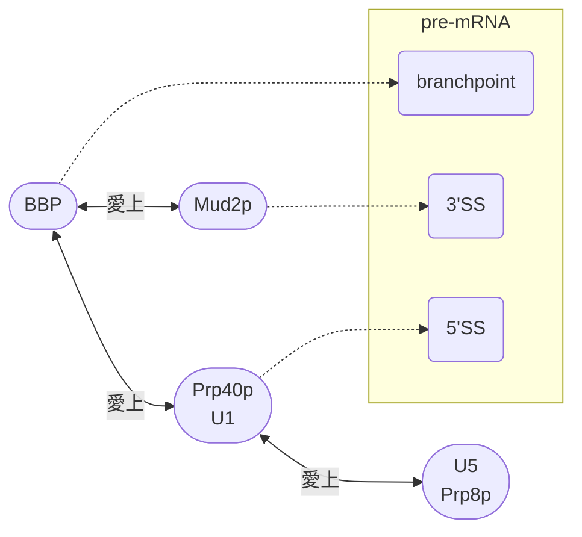

# molecular bio 2nd
## RNA splicing
### 讓我們回到 19XX 年... 🙂
#### size of nuclear RNA ≠ cytoplasmic RNA
- 我們目前知道這是因為剪切，所以細胞核裡面沒有修飾後的RNA自然跟細胞質中的不太一樣
- 很多更高級的eukaryote，會編碼mRNA跟tRNA，也有編碼rRNA的
- 只是在真核生物中，這些東西還包含一些以前被認為是垃圾的片段，也就是intron
- intron 跟 intron中間的區域，就是exon
- exons是最後在成熟的mRNA裡面會保留的東西
- mRNA裡面含有的exon數量 vary differently，目前發現的，有些似乎很少或是沒有intron (zero)，有些有好幾百個intron

> [!Note]
> - tRNA 通常沒有多少 intron，最多就一個

#### R-looping 實驗
- 研究者將成熟的RNA，跟原始DNA進行雜交，看看會發生甚麼事情
- 由於成熟 mRNA 已經沒有 introns
  - Exon sequences 可以和 DNA 上互補的區域配對
  - Introns 沒有出現在成熟 mRNA 中，因此無法形成 RNA-DNA hybrid
  - 原本的 DNA intron sequences 會以未配對的 loops 形式凸出來

> [!Note]
> - 在圖 b 中: 
>    - **紅色區域為 RNA hybrid**: 成熟 RNA 與 DNA 互補序列形成的 hybrid
>    - **黑色為 DNA**: DNA 上沒有與 RNA 配對的部分會形成 loop


#### 啥叫做splicing
- 通常分為好幾步: 
  - 初級轉錄物的產生: 這些mRNA precursor 依然包含 intron
  - 我們會稱呼這些在細胞核裡面的RNA門，集體統稱為hnRNAs
  - 接下來就是mRNA的成熟，成熟的其中一步就包含檢intron，這也被稱為RNA splicing 

#### Splicing signals
- Spliceosome 並不是隨便找一段 RNA 就剪
- 它必須辨認 **pre-mRNA 上特定的 sequence signals**，才能正確判斷 intron 的起點、終點與剪接位置
- 在典型的 nuclear pre-mRNA 中，有幾個重要的 consensus sequences...

##### 大致長相

$$exon\quad |\quad GU-intron-AG\quad |\quad exon$$

- GU: intron 開始的地方
- AG: intron 結束的地方

##### Branchpoint
- Intron 中間還有一個重要位置，叫做 branchpoint
- 它通常包含一個重要的 Adenosine（A）

##### 為什麼 mutation 會出問題？
- 想像原本的 GU 突變掉了
- 細胞可能認不出 intron 的起點，結果...
  - 剪錯位置
  - 把 exon 一起剪掉
  - intron 沒有被正常移除
- 這就是 abnormal splicing


#### 先轉錄後再切
##### Panel (a): Intron 還存在於 RNA 中
- 可以看到一段尚未完成剪接的 RNA 結構
- 這時候...
  - Exon 已經被轉錄出來
  - Intron 也已經被轉錄出來
  - RNA 尚未完成 splicing
- 也就是說，細胞一開始產生的是完整的 pre-mRNA，而不是直接產生沒有 intron 的 mature mRNA。
##### Panel (b):  Intron 被剪接後
- 特別標示了 Intron loop
- 這個結構代表 intron 在 splicing 過程中形成的 lariat structure (套索結構)
  - Branchpoint A 的 2′-OH 攻擊 5′ splice site。
  - Intron 的 5′ end 與 branchpoint A 形成特殊的 2′-5′ phosphodiester bond
  - Intron 形成 lariat
  - 接著兩側 exon ligation，intron lariat 被釋放

> [!Tip]
> - 我們能觀察到包含 intron sequence 的 RNA，以及形成 lariat 的剪接中間產物
> - 這表示 intron 並不是在 DNA transcription 階段就被跳過，而是先成為 RNA transcript 的一部分，之後才透過 splicing reaction 移除


#### 不只是剪切
- Splicing 不只是移除 introns，它還能透過招募 Exon Junction Complex（EJC），促進後續 gene expression，尤其是 translation
- ELJ黏起來，當永遠的跟屁蟲的概念? 🙂
  - Spliceosome 完成 exon ligation 後，EJC 被沉積在 mRNA 上
  - EJC 可以與其他 mRNA-binding proteins 互動，例如與 mRNA export、translation regulation 有關的因子
  - EJC 參與 mRNA 從 nucleus 輸送到 cytoplasm，也能影響後續 translation
  - 其中一個重要機制是 EJC 與 translation initiation machinery 的互動，可以提高某些 mRNA 的 translation efficiency

### 機制說明時間
#### 實驗試試看

- 研究者將 RNA substrate 在不同 incubation times（0、15、30、60、120、180 min）下進行反應，再利用 electrophoresis 分析不同 RNA products。
- 各 band 代表：


|RNA species|中文解釋|
|----|---|
|Pre|尚未剪接的原始 pre-mRNA|
|Intron-exon 2|第一次 transesterification 後形成的 lariat intermediate，intron 仍與 exon 2 相連|
|Intron|完成剪接後釋放的 intron lariat|
|Spliced exons + intron 2|第一個 intron 已移除，但第二個 intron 尚未剪除的 RNA|
|Spliced exons|完成剪接的 exon products|

- 右圖中，Graph 顯示各 RNA species 在不同 incubation times 中所占的比例（% of total）
  - **Intron-exon 2**（紫色）： 早期出現，之後逐漸減少，代表它是暫時性的 splicing intermediate，會隨後續反應而被消耗。
  - **Intron**（綠色）： 隨反應時間增加而累積，代表 intron lariat 被釋放。
  - **Spliced exons + intron 2**（紅色）： 隨時間增加，表示第一個 intron 已經完成剪接，但第二個 intron 仍保留。
  - **Spliced exons**（藍色）： 隨時間逐漸增加，代表後續剪接反應完成，形成成熟的 exon product。


- 此實驗顯示 **RNA splicing 是一個分階段進行的反應，而非一次完成**
  - 第一次 transesterification：Branchpoint A 的 2′-OH 攻擊 5′ splice site，形成 intron lariat intermediate
  - 第二次 transesterification：Exon 1 的 3′-OH 攻擊 3′ splice site，使相鄰 exons ligation，並釋放 intron lariat
  - 若 RNA 含有多個 introns，則不同 introns 可以依序完成剪接，產生部分剪接及完全剪接的 RNA products

> [!Tip]
> - 透過不同 RNA intermediates 在時間上的出現與消失，可以推測 RNA splicing 的反應順序，並證明剪接過程包含可辨認的中間產物。

#### another experiment
> [!Tip]
> - Spliceosome 怎麼知道應該使用哪一個 AG 作為 3′ splice site？🤔

- Langford 和 Gallwitz 在 1983 年研究的是 yeast actin gene intron，他們透過改造 intron 的 DNA sequence，觀察 RNA 最後如何被剪接
- 先認識圖中的顏色...
  - 🔵：Exon 1
  - 🔴：Conserved intron sequence
  - 🟡：Exon 2
  - 🩷：人工插入的 DNA sequence

##### Mutant #1：刪除紅色區域
> [!Note]
> - [ ] spliced
> - [x] not spliced
> - [ ] Aberrantly spliced


- RNA 無法正常進行 splicing
- 因此，紅色區域對 yeast actin intron 的正常剪接是必要的
- 光有兩端的 splice-site sequences，並不足以保證正常剪接

> [!Tip]
> - 備註: 其實這個紅色的區域，就包含**specific A** !!!

##### Mutant #2：在紅色區域下游插入新序列

> [!Note]
> - [ ] spliced
> - [ ] not spliced
> - [x] Aberrantly spliced

- 這次研究者沒有刪除紅色區域，而是在它下游、原本 3′ splice site 前面插入一段新的 DNA sequence。插入片段中含有一個新的 AG。
- 結果非常有意思：
  - Splicing 仍然能發生。
  - 但 spliceosome 沒有使用原本正常的 3′ splice site。
  - 它改用插入片段中的 AG 作為新的剪接位置。
  - 也就是切錯位置啦 🤣🤣
- 這表示紅色 conserved sequence 仍然具有功能，而且可以協助選擇它下游的 AG

##### Mutant #3：把紅色區域移到 exon 2

> [!Note]
> - [ ] spliced
> - [ ] not spliced
> - [x] Aberrantly spliced

- 研究者把紅色 conserved sequence 從原本的 intron 位置移到下游的 exon 2 裡面。結果...
  - Splicing 仍然發生。
  - 原本的正常 3′ splice site 不再是最終使用的位置。
  - RNA 改用移動後的 conserved sequence 下游第一個 AG。
- 也就是說，即使紅色序列被移到原本的 exon 區域，它仍然能影響下游 AG 的選擇。

> [!Note]
> - 進一步研究下來，這個specific A保守序列，通常為: 
> 
> $$ -UACUAAC- $$


#### Spliceosome
- Spliceosome 是一個由 snRNPs 和其他 proteins 組成的動態分子機器，負責辨認 pre-mRNA 的 splice sites，移除 intron，並把 exons 接起來
- 核心由五種 snRNPs（small nuclear ribonucleoproteins）組成：

|snRNP|主要工作|
|---|---|
|U1|辨認 5′ splice site|
|U2|辨認 branchpoint sequence|
|U4|暫時抑制 U6 的活性|
|U5|協助排列兩側 exons，讓它們接合|
|U6|參與形成催化中心，執行 splicing reactions|

- 酵母的spliceosome 大概40S，哺乳動物大概 60S


##### Spliceosome 如何組裝
- **辨認 5′ splice site**
   - U1 snRNA 透過 base pairing 辨認 pre-mRNA 上的 5′ splice site
   - 典型 intron 以 GU 開始
   - 這一步相當於先找到 intron 的入口
- **辨認 branchpoint**
   - U2 snRNP 會辨認 branchpoint sequence
   - 它與 branchpoint 附近的 RNA 配對，但會讓關鍵的 branchpoint A 保持突出 (bulged out)
   - 因為這個 A 的 2′-OH 必須能夠參與第一個 transesterification reaction
- **形成 pre-catalytic spliceosome**
   - U4、U6、U5 會以 **tri-snRNP** 的形式加入
   - 此時 spliceosome 已經包含五種主要 snRNPs，但還沒有進入真正的催化狀態 
- **兩次 Transesterification**
   - Branchpoint A 的 2′-OH 攻擊 5′ splice site，Exon 1 與 intron 分離
   - 同時 Intron 的 5′ end 與 branchpoint A 形成 2′-5′ phosphodiester bond
   - 產生 lariat intermediate
   - 接下來，Exon 1 新產生的 3′-OH 攻擊 3′ splice site。
   - Exon 1 和 Exon 2 接合，Intron lariat 被釋放，產生 spliced mRNA


<iframe src="https://Jacklyn301.github.io/molecular_model/6AHD_The%20Cryo-EM%20Structure%20of%20Human%20Pre-catalytic%20Spliceosome%20(B%20complex)%20at%203.8%20angstrom%20resolution.html" width="100%" height="600px"></iframe>

#### 選擇性剪切 and U1 snRNP
> [!Tip]
> - 同一個 gene，如何透過選擇不同的 5′ splice sites，產生不同長度的 mRNA? 🤔

- 我們可以看到下圖的三個例子，三種 mRNA **都使用黃色區域前方的同一個 3′ splice site**
- 但是，它們各使用了三種不同的 5′ splice sites
  - 🔴 9S: 使用紅色區域的左端作為 5′ splice site
  - 🟠 12S: 使用橘色區域的左端作為 5′ splice site
  - 🔵 13S: 使用藍色區域的左端作為 5′ splice site
- 三種 mRNA 都會接到黃色區域，但因為選擇的 5′ splice site 不同，所以被保留在成熟 mRNA 中的上游 exon 長度也不同


##### 遺傳抑制實驗
> [!Tip]
> - 如果破壞 mRNA 和 U1 snRNA 之間的互補配對，splicing 就會出問題嗎？如果再把 U1 snRNA 改成能重新配對的版本，能不能救回 splicing？ 😗

- Yuan Zhuang and Alan Weiner 就嘗試做了這個實驗
- 這種實驗叫做 compensatory mutation experiment，非常適合用來證明兩條 RNA 之間的 base pairing 是否具有功能上的重要性
- 以 12S splice-site mutation 跟 hr440 mRNA 為例: 
  - **Wild-type mRNA precursor**: 有正常的 5′ splice-site sequence
  - **Wild-type U1 snRNA**: 與它形成互補配對
  - **Mutant hr440**: mRNA 的 splice-site sequence 發生 mutation，造成部分鹼基不再匹配
  - **Mutant U1 snRNA (U14u)**: 研究者再改變 U1 snRNA 的序列，使它重新與 hr440 mRNA 配對


- 結果分析利用跑膠呈現，參考如下: 

|Lane|實驗條件|目的|
|---|---|---|
|2|**Mock**|實驗背景／對照|
|3|**E1Awt**|Wild-type splicing control|
|4|**hr440**|觀察 12S splice-site mutation 的影響|
|5|**hr440 + U1-4u**|測試12S的補償性 U1 mutation 能否救回剪接|
|6|**pm1114**|觀察 13S splice-site mutation 的影響|
|7|**pm1114 + U1-6a**|測試13S的補償性 U1 mutation|

- 最值得比較的是: 
  - Lane 4 vs. Lane 5
  - Lane 6 vs. Lane 7
- 當 mRNA splice site 發生 mutation，正常的 U1 配對受到破壞，splicing products 會改變
- 但當研究者再改變 U1 snRNA，使它恢復與 mutant mRNA 的互補配對，原本受到影響的 splicing pattern 就能獲得恢復 (對比一下lane 3 的 wild-type，可以看到12S and 13S 的產物，尤其是 Lane 5 的恢復，特別明顯 😏)
- **裡面唯一一個看起來比較遜的，就是lane 7，有救比沒救還差** 🤣🤣💀


> [!Important]
> - U1 snRNA 能夠辨認 5′ splice site，**不代表 spliceosome 就一定能完成 splicing**
> - U1 snRNA 會跟那個 `5′-AG | GUAAGU-3′` 區域的序列互補，但是只有他一個傢伙是不可能完成所有工作的 🙂
> - 這也能間接說明為什麼並不是完全能rescue

#### U6 snRNP
- U6 snRNA 會透過互補鹼基配對，與 intron 的 5′ splice-site 附近區域結合
- intron 的 `UGU` 會和U6 snRNA的 `ACA` 配對


- 我們知道在形成套索結構時，Branch-point A 的 2′-OH 攻擊 5′ splice site，形成 2′–5′ phosphodiester bond
- U6 和 intron 5′ end 的配對不是 lariat 形成後才出現的結果，相反的，**它在第一步反應發生之前就已經建立**
- 除此之外，U2 和 U6 snRNA 會透過 RNA–RNA base pairing 形成重要的 interaction network
- U2–U6 interaction 不只是兩條 RNA 黏在一起而已，它**參與建立 spliceosome 的 catalytic center**，通常來說: 
  - U6 和 intron 5′ end 配對
  - U6 和 U2 snRNA 配對
  - 兩者共同參與組織 RNA-based catalytic center

> [!Tip]
> - 在微觀上，**pre-mRNA、U6、U2就是纏在一起的** 😏
> - 而在哺乳動物身上，U2 跟 U6 會形成兩個helix: 
>   - **helix I**: 最主要負責splicing的區域
>   - **helix II**: 5'-U2 + 3'-U6，哺乳動物中的splicing輔助區域


<iframe src="https://Jacklyn301.github.io/molecular_model/8XI2_Cryo-EM%20structure%20of%20the%20Chlamydomonas%20C-star%20complex.html" width="100%" height="600px"></iframe>


#### what about U2??
> [!Tip]
> - Q: U2 既然可以跟pre-mRNA配對，那具體來說結合誰啊? 
> - A: 答案很簡單明瞭: 就是**specific A !!**

- Christine Guthrie 姊姊們做了相關實驗證明這一點 🐱

##### 我們先看圖 (b) 的 wild-type
- Branchpoint sequence (intron):  `5′-UACUAACA-3′`
- U2 snRNA (注意方向相反): `3′-AUGAUGU-5′`
- 它們透過反平行互補配對，但這裡有個重點: 

> [!Important]
> - 圖中間的 **branchpoint A 不參與配對，而是突出來，形成 bulged adenosine** 😲

- 為什麼 A 要突出來？因為這個 A 就是稍後執行第一個 transesterification reaction 的關鍵核苷酸
- 它的 2′-OH 會攻擊 5′ splice site，形成 **2'-5' phosphodiester bond**，最後產生 intron lariat
- 所以 U2 和 branchpoint 序列配對時，並不是要把整段 RNA 完全配對，而是刻意讓 branchpoint A 保持 bulged-out conformation

_1122.png)


##### 第一組：A256 mutation
- 原本 branchpoint 序列的某個位置發生 mutation:
  - Intron: A256 mutation
  - U2: 維持 wild-type
> [!Note]
> - 這會破壞原本的 base pairing

- 接著研究者也改變 U2: 
  - Intron: 保留 A256 mutation
  - U2: 引入 U37 suppressor mutation
> [!Note]
> - 能重新建立互補配對 (**rescue !!**)

##### 第二組：A257 mutation
- 同樣的設計...
  - Intron: A257 mutation
  - U2: wild-type
- 實驗完後，接下來...
  - Intron: A257 mutation
  - U2: U36 suppressor mutation
> [!Note]
> - 再透過 compensatory mutation 恢復 base pairing
> - 又又又一次rescue 成功 **(👉ﾟヮﾟ)👉**


#### U5 snRNP
> [!Tip]
> - U5 就像是 spliceosome 裡的「exon alignment assistant」，負責把兩側 exon 的末端對好

- U5 會協助兩側 exon 的末端靠近，讓第二次 transesterification reaction 能順利進行

##### 實驗整理
- 下圖呈現**第一次 transesterification 已經完成，準備進行第二次反應**的狀態
  - Exon 1（藍色）已經與 intron 分離，末端具有自由的 3′-OH。
  - Intron 已經形成 lariat。
  - Exon 2（黃色）仍然連接在 intron 的 3′ 端。
- 第二次反應需要 Exon 1 的 3′-OH 攻擊 Exon 2 前方的 3′ splice site，完成 exon ligation
- 圖中的紅色粗體 U 是研究者刻意引入的 4-thiouridine（4-thioU）。
- 它是一種經過修飾的 uridine，可以在適當的 UV 照射條件下，與附近的分子形成共價交聯 (欸嘿是不是很熟悉阿 😗😗)
- 因此研究者在特定位置將 RNA nucleotide 替換成 4-thioU，並且讓 RNA substrate 進入 spliceosome

##### 結果...
- 圖中 intron 5′ 端附近的 4-thioU，與 U6 snRNA 形成 cross-link
  - 這表示 U6 位於 5′ splice-site 附近
- 圖中 U5 與 exon 末端附近的 4-thioU 形成 cross-links， U5 接觸的位置包含...
  - Exon 1 的末端附近
  - Exon 2 的起始端附近
- 這支持 U5 能夠透過直接和這兩個 exon 互動，協助兩個 exon ends 保持在適當的位置


#### U4 snRNP
> [!Tip]
> - U4 會跟U6產生base pair，暫時抑制 U6，避免 U6 太早進入催化構形。等 spliceosome 的其他部分組裝完成後，U4 才會離開，讓 U6 重新排列並參與催化中心的形成

- 我們剛剛已經知道，U6 是 spliceosome 裡非常重要的 catalytic RNA，它會與 U2 snRNA 形成 RNA-RNA interactions，組成催化中心的重要結構，參與兩次 transesterification reactions
- 但問題來了...
  - U6 如果太早與其他 RNA 配對、形成活性構形，會干擾 spliceosome 的正確組裝
  - 因此細胞需要一種方式，讓 U6 在適當時機才進入催化狀態，在適當時機到來之前，先睡覺 🙂
- U4 snRNA 會與 U6 snRNA 形成 **extensive base pairing**
- 這個 U4/U6 duplex 有兩個重要效果...
  - 限制 U6 的 RNA 結構與構形
  - 暫時阻止 U6 與 U2 形成催化中心所需的 RNA interaction


#### 小小整理 🐱


|snRNP|圖中的位置與互動|
|----|---|
|U1|初期結合接近 5′ exon 的 splice site|
|U2|結合 branchpoint，讓 A bulge out|
|U4|與 U6 配對，暫時抑制 U6|
|U5|接觸並排列 exon ends|
|U6|後期取代 U1，並與 U2 形成催化中心|

> [!Important]
> ##### 必考在這裡 !! 🐱
> - [ ] 和 5' 或是 3' 要剪切位點的共有序列完全互補: **U1、U5、U6**
> - [ ] 和 branchpoint 的共有序列形成鹼基配對: U2、U6
> - [ ] 維持spliceosome結構: U4

#### 當你開始試著背cycle... 🫠
- 1️⃣ U1 snRNP 接在5'ss，也就是靠近5'的 exon 切點附近
- 2️⃣ 消耗一ATP，U2 snRNP 接在branchpoint 的 A
- 3️⃣ 三姊妹: U5、U6、U4 到來，U4 snRNP 鎖著 U6
- 4️⃣ U1 先離開，同時解鎖 U6，U4 工作完畢
- 5️⃣ U2 + U6 互補，切割活性中心
- 6️⃣ 消耗ATP，U2 使 intron 形成套索結構 (截斷 5'ss)
- 7️⃣ U5 連接兩個 exons，任務完成


#### Sm doughnut 到底是什麼？
- 它是由七種 Sm proteins 組成的環狀結構: SmB/B′、SmD1、SmD2、SmD3、SmE、SmF、SmG
- 這七個蛋白質組成一個 heptameric ring，讓 U1 snRNA 穿過中央的孔洞
- 他有穩定**U1 snRNA** 的功能，避免snRNA被酵素分解
- 當然，它不只是讓 U1 snRNA 活下來，還幫助它成為能夠進入 nucleus、參與 spliceosome assembly 的成熟 snRNP


### Commitment, Splice Site Selection, and Alternative Splicing
- Spliceosome 在決定如何剪接 pre-mRNA 時，需要先辨認哪些區域應該被保留、哪些區域應該被移除
- 這個辨認過程可以有兩種策略...

#### Exon definition: 以 exon 為辨識單位
- 假如說你的基因長這樣...

```text
Intron 1 hen 長... | 短 Exon | Intron 2 hen 長...
🙂🙂
```

- 此時...
  - U2AF 與上游 intron 的 3′ splice site 互動
  - U1 snRNP 與下游 intron 的 5′ splice site 互動
    
> [!Tip]
> - 也就是跨越一個 exon 建立辨識複合體

#### Intron definition: 以 intron 為辨識單位
- 如果基因長成...

```text
Exon 1 | 短的 Intron | Exon 2
🐱🐱
```

- 這時，splicing factors 會跨越 intron 進行互動: 
  - U1 snRNP 辨認 intron 的 5′ splice site
  - U2AF 辨認 intron 的 3′ splice-site region
  - U2 被招募到 branchpoint


#### 比較下 😗


|  選項  | Exon definition | Intron definition |
| --- | --- | --- |
| 辨識單位 | Exon | Intron |
| 跨越哪個區域？ | Exon | Intron |
| 主要互動 | 上游 3′SS 與下游 5′SS | 同一 intron 的 5′SS 與 3′SS |
| 常見情境 | 脊椎動物較長的 introns | 較短的 introns，例如許多酵母 introns |

#### 當 spliceosome 手殘 (或是故意) 切錯... 🙂
##### Exon skipping
- 在 exon definition 模式下，splicing machinery 會跨越一個 exon，辨認它兩側的 splice sites
- 底下圖中黃色 exon 的辨認失敗，沒有順利找到切點，因此最後只剩藍色 ── 紅色的 mature mRNA

##### Intron retention
- splicing machinery 會跨越同一個 intron，辨認它兩端的 splice sites
- 但是在底下圖中...
  - 藍色 exon 與黃色 exon 之間的 intron: 成功辨認並移除
  - 黃色 exon 與紅色 exon 之間的 intron: 辨認失敗
- 因此最後的mature mRNA 的紅色跟黃色之間多了一段intron沒切掉

##### cryptic splice site (aka 未知的切點跑出來)
- 原本 spliceosome 應該辨認正確的 exon 邊界，黃色 exon 兩側都有正常的 splice-site signals，讓它能夠被正確辨認
- 現在黃色 exon 附近有一個額外的候選剪接位置 🫠
- 這個位置可能是...
  - 本來就存在，但通常不被使用的 cryptic site
  - 因為 mutation 改變了序列，使它被 spliceosome 辨認 (WTF)
    
> [!Important]
> - 因此，Spliceosome 使用了錯誤的位置 💀

- 原本應該使用正常 splice site，卻改用 cryptic splice site
- 結果就是**剪接邊界發生偏移**


#### 甚麼是 Commitment? 🤔
> [!Tip]
> - **splicing commitment (剪接承諾)** 指的是Splicing machinery 已經辨認並選定特定的 splice sites，使這段 pre-mRNA 朝特定的剪切路徑前進

- 簡單說，就是 spliceosome 不只是碰到 RNA、試著辨認，而是逐漸確定: 「這裡就是我要剪接的位置。😎」

#### 實驗again
- Xiang-Dong Fu 在 1993 年做了一個實驗[^1]，想看看一些所謂的蛋白，可不可以促進commitment

> [!Tip]
> - 一個 SR protein 能不能單獨讓 pre-mRNA 進入 splicing pathway？
> - 不同的 pre-mRNA 是否需要不同的 SR proteins？😗🤔

- 作者研究了 SC35、其他 SR proteins，以及 human $\beta$ -globin pre-mRNA 來做實驗
- 當時已知 SR proteins 參與早期 spliceosome assembly，也會影響剪切位點的選擇
- 但有一個更細的問題... **SR protein 是否能在沒有其他 SR proteins 共同參與的情況下，單獨促使 pre-mRNA 形成 committed complex?**

[^1]: https://doi.org/10.1038/365082a0

##### part 1
- 作者設計了兩個步驟
  - 先讓 labeled pre-mRNA 在有或沒有 SC35 的條件下進行 preincubation
  - 再加入 nuclear extract，以及不同種類的 competitor RNA，反應 2 小時
- Competitor RNA 分成幾種：

| Competitor | 意義  |
| --- | --- |
| −   | 沒有加入 competitor |
| C1、C2 | 非特異性 RNA control |
| 5′SS | 含有 5′ splice-site sequence 的 RNA |
| 3′SS | 含有 3′ splice-site sequence 的 RNA |
| 5′SS + 3′SS | 同時含有兩種 splice-site sequences 的 RNA |

> [!Important]
> - Splicing 需要許多 factors，例如 U1 snRNP、U2AF、U2 snRNP 等
> 如果我們額外加入大量含有 splice-site sequence 的 RNA，它們會**競爭性地結合相關 splicing factors**
> - 但是如果已經有commitment，這些競爭性的RNA 不會影響 $\beta$ -globin pre-mRNA 的剪切
> - 這是一個篩選，去除那些沒有commitment 的 RNA !! 😏

- **Lane 2、3** 加入 nonspecific RNAs，但是mRNA 仍然可以產生，這表示不是隨便加入 RNA 就會抑制 splicing
- **lane 4** 由於加入含有 5′ splice-site sequence 的 competitor 後，mRNA band 幾乎消失
- 這代表 5′SS competitor 能有效干擾 β-globin pre-mRNA 的 splicing
- 接下來，**Lane 6、7、8 是重點...**
  - 這三組在加入 nuclear extract 和 competitor 之前，先進行了 SC35 preincubation
  - 結果，**即使加入5′SS、3′SS、還是 5′SS + 3′SS competitor，仍然可以觀察到 mRNA**


#### Branchpoint Bridging Protein 是什麼
- Abovich and Rosbash 在研究酵母時，發現一個在 commitment complex 常見的蛋白質: **BBP (Branchpoint Bridging Protein)**，原名 Msl5p
- 也是在這時發現了，intron 其實兩端可以連在一起，這也被稱為 cross-intron bridging

> [!Note]
> - U1 snRNP 在 intron 的 5′ 端，BBP 辨認 branchpoint，Mud2p 參與 intron 3′ 端的辨認
> - BBP 透過蛋白質互動，**協助把 intron 兩端連接起來**

- 他們用的是**Yeast two-hybrid assay**，利用兩個 fusion proteins 測試蛋白質之間是否互相作用
- 如果兩個蛋白質互相作用，兩個 domain 就會被帶到一起，啟動 lacZ reporter
- lacZ 表現後，X-gal 會產生藍色反應 🔵

| Activating-domain fusion | DNA-binding-domain fusion | result |
| --- | --- | --- |
| Mud2p | BBP | **Positive** |
| Prp40p | BBP | **Positive** |
| Prp8p | Prp40p | **Positive** |

- 而 Mud2p 與 Prp40p 沒有顯示出直接互動 (negative)


#### 那這跟 commitment 啥關係? 
- 如果只有 U1 認出 5′SS，並不代表整個 intron 已經被完整辨認。但是如果...
  - U1 snRNP 辨認 5′SS
  - BBP 辨認 branchpoint
  - BBP 與 Prp40p (U1 的亞基) 互動
  - BBP 與 Mud2p 互動
- 這些互動就能協助建立跨越 intron 的辨認複合體
- spliceosome 不只是分別找到幾個 RNA signals，而是開始把它們組織成一個具有正確空間與分子關係的功能單元




