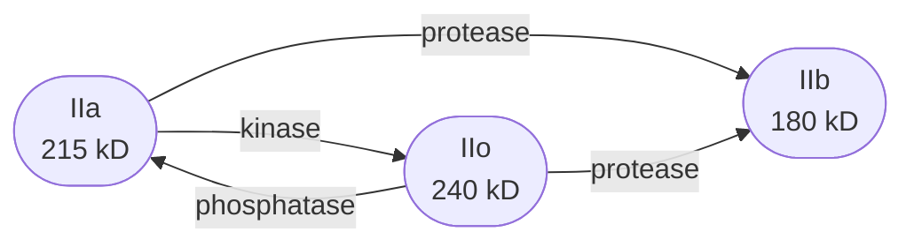
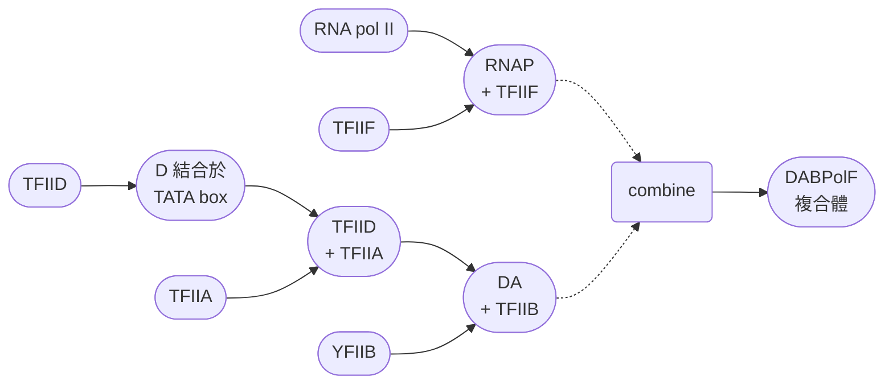

# molecular bio 2nd
## chapter 10
### 真核生物的RNAP
- Robert Roeder and William Rutter 在1969年時發現，真和生物其實有三種RNAP，除此之外，它們也成功用了離子交換層析，分離了這些蛋白質
- 這三個分別為RNAP I、RNAP II、RNAP III，之所以可以用離子交換層析，主要是因為他們對離子鍵的強度不同
- 最重要的是，他們三個所做的轉錄工作並不一樣

- 甚至，如果從不同細胞提取這些RNAP，濃度分布也有所不一
- 例如，從細胞質 (nucleoplasm) 裡面提取的RNAP 主要是RNAP II，而細胞核 (nucleolus) 的主要是RNAP I

#### 三個RNAP的產物整理

|RNAP type|會產生|
|I|28S、18S、5.8S rRNAs|
|II|mRNAs、snRNAs、miRNAs|
|III|5S rRNA、tRNAs、U6 snRNA、7SL RNA、7SK RNA|

- Roeder負責發現這些RNAP的產物時，用的東西叫做 $\alpha$ -amanitin，來自於 *A. phalloides* (死亡帽蘑菇)、或是 *A. bisporigera* (死亡天使蘑菇) 🍄

> [!Tip]
> - 這都是甚麼奇奇怪怪的名字 🤣💀

- 低濃度的 $\alpha$ -amanitin 就會抑制RNAP II
- 而RNAP III 在更高濃度的 $\alpha$ -amanitin 才會被影響，至於RNAP I 就基本上沒啥轉錄的抑制 (oh yeah 🙂)

- 它們拿了老鼠的細胞核，並且逐步讓RNAP暴露於越來越高的 $\alpha$ -amanitin，看看RNA的合成有沒有變化
- 它們主要是透過讓合成的RNA帶有標記，並且將樣本拿去離心後，提取含有RNA的上清液 (supernatant)
- 並且分成六組，每一組的 $\alpha$ -amanitin 濃度分別是 0.1、4、10、20、70、400 $\mu g/ml$
- 可以發現， $\alpha$ -amanitin 的濃度越高，原本的放射標記濃度就越低

#### 植物小發現
- 在為 *Arabidopsis thaliana* (阿拉伯芥) 定序時，發現另外兩種RNAP，分別為 RNAP IV 跟 RNAP V
- 它們主要轉錄一些noncoding RNA，這些RNA可以抑制或是使某些基因 "安靜"

#### 亞基構造
- 對於真核生物而言，很難真正像是原核生物一樣分離亞基
- 因此早期的科學家只能在釀酒酵母等物種裡面，透過 "預測哪些基因跟RNAP有關"，並對其進行突變，看看轉錄發生甚麼變化
- 例如，目前釀酒酵母已經確定了 RNAP II 的 "12個亞基"，並已經一一定序完畢
- 這些亞基在酵母身上，就是RPB1、RPB2等 (**R**NA **P**olymerase **B**)
- 而人類也差不多有12個類似的亞基，被稱為hRPB1、hRPB2等

##### 共同點
- 無論是酵母還是人，它們跟細菌一樣，RNAP包含兩個主要的大亞基
- 這有點類似於細菌 RNAP 的 $\beta$ 跟 $\beta^{\prime}$ 一樣
- 事實上，真核的RNAP很有可能是起源於類似原核生物的RNAP，因此他們之間有發展上的相似處

##### 如何把所有亞基都區分出來
- 後來有位科學家透過epitope tagging把這些可能的亞基透過SDS-PAGE區分出來
- 他們透過給一個已知的可能亞基 (例如Rpb3) 上面加上某種epitope的基因，然後讓酵母將Rpb3以及其他亞基結合成一個完整的RNAP
- 然後，他再用結合該epitope的抗體，把這個RNAP從細胞分離出來的混合物中提取出來
- 再透過加入SDS讓他們分開成多個亞基，最後將他拿去做蛋白質電泳
- Young等人就是透過這種方式，嘗試分離出了10個條紋，剛開始一度認為RNAP主要就是這10個亞基

> [!Note]
> - 當然，在後來的實驗中，發現其實是12個亞基，只是另外兩個亞基的遷移率有重合導致
> - 具體來說，Rpb9跟Rpb11的遷移率類似，Rpb10跟Rpb12的遷移率類似 🐱

##### core subunit
- 最主要的三個必須的亞基，分別是 **Rpb1、Rpb2 跟 Rpb3**，他們是合成RNA所必須的，因此也稱為 core subunit
- 這分別對應到E.coli的RNAP的三個亞基: $\beta^\prime$ 、 $\beta$ 、 $\alpha$ (同源的發展出來 !! 😲)
  - Rpb1 結合固定於 DNA， $\beta^\prime$ 也一樣
  - Rpb2 接近 RNA 合成活性位點， $\beta$ 也一樣
  - Rpb3 在holoenzyme上會有兩個， $\alpha$ 也一樣

##### commom subunit
- 另外五個亞基，雖然不清楚其功能，也不知道他跟細菌的RNAP有什麼關係，但是在三種酵母的RNAP裡面，都有這五個亞基，我們稱為 common subunit
- 分別為 **Rpb5、Rpb6、Rpb8、Rpb10 跟 Rpb12**

<iframe src="https://Jacklyn301.github.io/molecular_model/3M3Y_RNA%20polymerase%20II%20elongation%20complex%20C.html" width="100%" height="600px"></iframe>

#### Rpb1 的異質性
- 從上頭模型我們可以發現，Rpb1到底是個多大的亞基
- 其實，這個亞基有時候的結構並非總是相同
- 例如當他們在給漿細胞瘤做電泳時，發現在Rpb1的區域附近，出現了三條線，研究者分別稱這三種蛋白 (分子量由大到小) 為o、a、b

> [!Tip]
> - 也就是說，或許 Rpb1 有不同種形式? 🤔

- 事實上，IIa、IIo 和 IIb 都是同一個 RNA polymerase II 最大次單元 Rpb1 的不同 biochemical forms
- 它們不是三種不同的 subunits，也不是三種不同的 RNA polymerases，而是 "不同形式"

|Form|RPB1 發生了什麼事|
|---|---|
|IIa|Hypophosphorylated，CTD 磷酸化程度低|
|IIo|Hyperphosphorylated，CTD 磷酸化程度高|
|IIb|經過 proteolytic cleavage，蛋白質被切短|

- 具體的關係長得有點像是...

- 至於IIb到底是被剪斷了哪一個區域，其中一個就是CTD
- CTD是一個由7個胺基酸不斷重複幾次的一個尾巴，序列為: 

$$Tyr-Ser-Pro-Thr-Ser-Pro-Ser$$

#### 轉錄起始的三維結構
- 當時在進行RNAP II的結構分析時，最常遇到的就是 "樣本每次拿到的不一定完整"
- 做晶體最大的麻煩是有些 Pol II 帶著 Rpb4/7，有些沒有，所以樣品不夠一致 (我剛剛給妳們看的模型裡面就沒有這兩個亞基 💀)
- 當時Roger Kornberg就乾脆弄了一種突變體，直接去掉了這兩個亞基的轉錄，確保 "樣品夠純"，才在2001年完成了第一個晶體繞射圖
- 他們從結構中發現，DNA在轉錄時，坐落在這個RNAP的一個溝 (cleft) 裡面
- 同時，這裡面也是有兩個鎂離子，只是其中一個鎂離子似乎因為跟其他的基團交互作用較低，因此繞射時的信號較弱

#### 轉錄延伸的三維結構
- Roger Kornberg同時也做了同時有bind DNA跟產生RNA的模型，也就是elongation狀態的RNAP (只是這一次的解析度較低)
- 為了克服在繞射時周圍沒有轉錄因子的情形，他基本上就以一段有 "3'單股oligo-C" 的DNA模板，幫助RNAP接上去
- 然後再用heparin把 "沒有成功bind在DNA上的RNAP" 洗掉，以獲得品質更高的 "elongation RNAP II"
- 他們在核酸的型態中，找出三個RNAP可能有的架構，分別是 rudder、lid 、 跟 zipper
- 這三個結構讓DNA可以跟RNA分離，同時也在合成RNA前確保DNA雙股已經解旋

- 裡面還有一個洞 (pore 1)，離活性位點以及bridge helix的結構很近
- bridge helix在作用時會彎曲，功能是幫助移位，讓新的核甘酸有位置在活性位點聚合
- $\alpha$ -amanitin 的結合似乎很靠近這個 bridge helix，因此可能透過減少這個helix的靈活度，降低轉錄能力

#### 核甘酸特異性選擇
- Roger Kornberg 等人又在2004年的時候，解碼了更多有關於post-translocation的結構細節
- 他們透過讓轉錄中的RNA尾巴加入dATP，這阻止了進一步的轉錄，讓複合體停留在post-translocation (正準備讓下一個核甘酸進入的構型)
- 然後進而提取出RNAP後，依序分別把它們做成兩種類型: 正確配對鹼基的，以及錯誤配對鹼基的
- 具體來說，RNAP 不只要選對 NTP，還要確認它**能不能在 active site 裡形成適合催化的幾何構形**

|state|result|
|-----|------|
|正確的 nucleotide pairing|Incoming NTP 與 DNA template 上的鹼基正確配對，RNA 3′ end、incoming NTP 與 catalytic center 能維持適當的空間排列|
|錯誤的 nucleotide pairing|錯配會造成 active site 的幾何構形不理想，使底物難以正確定位，降低 phosphodiester bond formation 的效率|

_and_mismatched(b)_nucleotides_in_A_and_E_sites%2C_respectively_1101.png)

- 兩個金屬離子在這裡進行催化，其中，metal A結合在酵素上，而metal B結合在欲加入的核甘酸上
- 核甘酸首先會先進入 E (entry) site，並且在活性位點 (A site) 區域發生反轉
- 只有在正確的核甘酸結合到活性位點時，trigger loop (Rpb1) 才會發揮作用，使其產生phosphodiester bond
- 這個相互作用可能跟trigger loop和其他區域的殘基之間產生的作用力有關係

> [!Note]
> - 具體的催化，可能是透過 trigger loop 上的 His-1085 跟核甘酸底物的 $\beta$ -磷酸接觸形成
> - 組胺酸的imidazole帶正電，透過奪取 $\beta$ -磷酸的負電荷，使周圍的 $\gamma$ -磷酸變成更號的親核性target 😏

#### 消失的Rpb4 and Rpb7
- Kornberg等人嘗試把10個亞基的RNAP跟專門生產 Rpb4 and Rpb7 的改良大腸桿菌加在一起
- 至於 Rpb4 and Rpb7 的作用，則眾說紛紜，有些人認為他們負責在RNAP結合到模板股時 "關閉" 原本打開的夾子
- 也有人認為， Rpb4 and Rpb7 是為了讓RNAP可以跟通用轉錄因子結合

> [!Note]
> - 這或許可以說明為何在沒有轉錄因子的情況下，RNAP可能有 Rpb4 and Rpb7 ，可能沒有 🐱

### Class II promoter
- class II promoter = RNAP II辨識為主的promoter
- class II promoter 通常可以分成: 
  - core promoter (核心啟動子)
  - proximal promoter (近端啟動子，也稱為upstream promoter elements)

#### core promoter
- **TATA box**: 約在 -31 to -36 bp 的位置，序列通常是 `TATA(A/T)AA(G/A)`
- **TFIIB辨識元件**: 也被稱維BRE，約在 -37 to -32 的位置，序列通常為 `(G/C)(G/C)(G/A)CGCC`
- **initiator (Inr)**: 約在 -2 to +4 bp 的位置，序列通常是 `GCA(G/T)T(T/C)` (果蠅)，或是 `PyPyAN(T/A)PyPy` (哺乳動物)
- **下游啟動元件**: downstream promoter element (DPE)，約在 +28 to +32 bp 的位置
- **motif ten element (MTE)**: 約在 +18 to +27 bp 的位置

#### TATA Box
- 非模板股的共有序列大概是 `TATAAA`，他在位置跟結構上有時會跟細菌的 -10 box 做比較
- 當然，不是所有由RNAP II負責的基因都有 TATA Box，例如兔子的 $\beta$ -globin就是 CATA，而不是TATA，通常沒有 TATA Box 的基因可能有以下幾個特色: 
  - **housekeeping genes**: 幾乎所有的細胞都需要表達的基因
  - **homeotic genes**: 主要用來做發育調控的基因
- 相反的，其他的表達基因，只要**呈現出的是分化的個人特色** (例如皮膚細胞形成keratin，紅血球產生hemoglobin)，這種特色基因往往就會有 TATA box
- **刪除TATA Box，並不會降低轉路效率，但是會使轉錄起始的位置不再固定**，愛往哪開始就往哪，因此TATA box更像是圖標，而不是促進RNAP活化

##### 例外在這裡 !!
- 當然，**有些TATA Box的存亡會嚴重影響轉錄活性**
- 例如 Steven McKnight and Robert Kingsbury 在泡疹病毒的胸苷激酶 (tk) 的啟動子中，透過替換掉一段10-bp的序列
- 這替換之後幾乎沒有檢測到任何轉錄的信號 😲💀
- 下圖中的不同lane編號，代表不同的 linker-scanning mutant
- 例如 LS −95/−85，就是把 tk promoter 中 −95 到 −85 附近的一段序列替換成 linker sequence
- 每個 oocyte 都同時收到兩種 DNA: 
  - Test DNA: 帶有其中一種 linker-scanning mutation 的 tk promoter
  - Control DNA: pseudo-wild-type promoter，保留接近正常的 transcription activity，但在 −121 到 −131 位置有一個不影響轉錄的 mutation
- 因此，同一個 oocyte 裡會同時產生兩種不同來源的 RNA
- 這樣就能把 control DNA 當作內部參照，而不是拿不同 oocyte 互相比較

> [!Important]
> - 這些序列的test signal有大有小，也就代表，有些序列會影響轉錄活性，有些似乎比較不影響 🤔

##### 實驗開始
- Christophe Benoist and Pierre Chambon 具體理解 TATA box 的方式，是透過 "剪切一段DNA，看看轉錄位置的移動" 實現的，並且透過S1 mapping 確定轉錄起始的位置
- 他做了好幾次的剪切DNA，這些突變分別標示為P1A, AS, HS0, HS3, and HS4 mutants (這些還包含TATA box)，可以發現，減掉的DNA長度越長，得出的S1 mapping長度越短
- 而如果是連著TATA box一起去掉 (HS2 mutant)，會開始出現不同長度的片段，也就是說，轉錄出來的長度再也不是固定的

##### 相關轉錄因子
- 結合 TATA Box 的轉錄因子是 TFIID，包含 TATA-binding protein (TBP)
- TBP跟TATA Box的結合可以招募其他因子也一起結合上來

#### Inr、DPE 和 TFIIB 辨識元件
##### Inr
- 一些class II promoter在轉錄起始的位點 (+1) 附近，序列都相對來說比較保守，這些保守的序列也被稱為 initiator (Inr)
- deoxynucleotidyltransferase (TdT) 基因也有Inr，而且它特別的是，這傢伙似乎沒有其他明顯的上游promoter，也就是說，這基因可能光用 Inr 就撐出一片天 （？？🤣）

##### DPE
- 在果蠅的身上，DPE的普及程度就跟它的TATA Box差不多
- 它們有時候的功能就是剛好彌補了 "缺失TATA Box" 的狀況
- 也就是說，缺失TATA Box的基因，通常都有DPE "撐腰" 😗

#### proximal promoter element
##### GC Box
> [!Tip]
> - 還記得Steven McKnight and Robert Kingsbury實驗的那張圖嗎?

- 那張圖中所替換掉的序列，有些在啟動子非常上游的地方，動輒一百多bp，但是他們的替換也會降低轉錄
- 這些序列有些包含 `GGGCGG` 或是 `CCGCCC`，我們稱呼它們為 **GC Box**
- 這些Box會跟轉錄因子結合，影響基因調控

> [!Important]
> ##### GC Box vs promoter
> - GC box跟啟動子最不一樣的地方，是promoter倒位了就會失去活性，但是GC box不會
> - GC box即使旋轉180度，依然有效 😏😏

- 但是GC Box有位置遠近的影響
- 如果是一般的enhancer，就算距離promoter十萬八千里（？）也可以調控基因
- 而一旦GC Box距離promoter太遠，它就會失去刺激轉錄的能力　🫠

##### cat Box 🐱🐱
- 相關序列為 `CCAAT`，也是上游promoter element的一種
- 例如tk啟動子就有cat Box，它也需要跟轉錄因子結合 (例如CTF)，才可以發揮作用

> [!Tip]
> - 近端啟動子的兩個特性: 
>   - orientation-independent: 方向無關性 (正反沒關係)
>   - position-dependent: 位置依賴性 (位置不要太遠) 🐱😏

### Class I promoter
- RNAP I 最常辨識的基因就是 rRNA precursor gene (錐蟲例外，它另外編碼了兩個蛋白質)
- rRNA precursor gene 並不只一個，但是在genome中也只是多個拷貝而以，也就是說，它們的啟動子可能都一個樣，這也被稱為 class I promoter

> [!Important]
> - 我只有說一個物種中的rRNA precursor gene啟動子都一樣，但是**不同物種間的 class I promoter 長相依然可以天差地別** 😲

- Robert Tjian 等人發現人類的 class I promoter 基本可以分成兩大部分: 
  - **core element/rINR**: 約在 -45 to +20 之間
  - **upstream promoter element (UPE)**: 約在 -156 to -107 之間

- 這兩個之間的**距離 (也就是spacing) 似乎對轉錄有著非常大的影響**
- 如果嘗試在不破壞兩個element的情況下，縮短他們的距離，轉錄的程度就會大幅下降，縮越多降越多 🙂

### Class III promoter

> [!Tip] 
> - 我們討論的 "經典 class III promoter" (5S rRNA & tRNAs) 的特點在於: 他們的promoter在基因內部 !! 🐱

- Donald Brown 在研究非洲爪蟾 (*Xenopus borealis*) 的 5S rRNA 時有意外發現
- 科學家們嘗試從5S rRNA 基因的 5' (也就是起始區) 開始一路突變，想知道到底突變哪裡會影響轉錄活性
- 結果它們發現，單鏈 rRNA 長度約為 120 nt，但是就算手賤把前面一大段幾十個核甘酸砍掉， RNA 依然有轉錄出來
- 只有在砍掉 +50 以上的區域時，轉錄量才開始大幅降低

- 後來他們確定， +50 to +83 的區域是 "絕對要保留下來的"，其他區域，即使額外添加幾個DNA片段，對轉錄的影響也較小
- 他也給這些 "易感區域" 取了些酷炫（？）的名字，包含box A、box B、intermediate element、box C 等等
- 根據這些box的位置，可以分成三種類型: 
  - **type I**: 5S rRNA (box A、intermediate element、box C)
  - **type II**: tRNAs 和 VA RNA (box A、box B)
  - **type III**: human 7SK RNA 和 human U6 RNA (非經典型，啟動子類似於class II 的 promoter)

#### 7SL RNA 等非典型 class III gene
- 這些基因雖然也是由RNAP III來進行轉錄，但是他們整體來說更像是class II promoter的基因，因為這些基因也有 DSE、PSE、TATA box等位於上游的重要序列
- 同時，7SL RNA 也並沒有跟 class III gene 一樣的那些甚麼box A、box B的 (異類? 🙂)
- 很多 7SL RNA pseudogenes 或是 Alu sequences (轉座子) 在體內很難轉錄出來，多半原因就是因為它們上游缺乏重要序列

#### 那憑什麼長的像class II 卻是 class III? 😑
- 這些 "異類" 包含 7SL RNA 跟 7SK RNA 、以及 U6 RNA 跟 EBER2 gene
- 額，原因就在加入 $\alpha$ -amanitin 的效果，這兩個 RNA 即使加入了一些 $\alpha$ -amanitin ，依然有轉錄
- 如果是以RNAP II來轉錄這兩個RNA，按理說以RNAP的個性（？），少量的 $\alpha$ -amanitin 足以抑制轉錄了
- 所以，**除非這些傢伙由RNAP III負責，不然無法解釋這種 "神秘現象"** 🤣🤣

#### U1 vs U6

> [!Tip]
> - 讓你體驗下什麼叫做 "長的像但不是一個親媽生的"

- 對於非典型的RNA們，有時候即使是非常類似的RNA，但是由完全不同的RNAP轉錄
- 而這兩個的差別... 
  - U1 snRNA: **有 DSE 跟 PSE，由 RNAP II 轉錄**
  - U6 snRNAL **有 DSE、PSE 跟 TATA box，由 RNAP III 轉錄**

> [!Important]
> - 甚至它們發現，如果我給 U1 加上 TATA box，他就可以改由 RNAP III 轉錄，而 U6 如果去掉了 TATA box，也可以改由 RNAP II 轉錄 !! 😲

### Enhancer and Silencer
#### Enhancer
- 第一個enhancer由 Chambon 等人在 SV40 early gene 的上游發現的
- 這個序列其實在之前就已經有被關注了，因為他是一個 72-bp 為一個單元的重複序列

- 當他們嘗試在這個72 bp的區域加入突變，就可以大幅降低轉錄的水平
- 但是遠遠不只這樣，後來的科學家又發現，這個重複序列發生倒位，或是移到病毒genome的另一側 (距離promoter超過2kb的長度)，它們仍然能夠促進轉錄
- 所以這東西就是 "方向無關"、"位置無關" 的特別序列

#### 位置多樣
- 當然，enhancer也不一定要在基因上游
- 例如 Tonegawa 在研究老鼠的免疫球蛋白 $gamma_{2b}$ gene 時，就發現說該基因內部的intron，不能隨便被剪切掉
- 雖然剪切那些intron並不會導致產物失活，但是會導致其轉錄的量大幅減少
- 它們一共做了兩組剪切: 
  - $\Delta 1$ : 刪除約 180 bp
  - $\Delta 2$ : 刪除約 470 bp
- 接下來: 
  - 他們將不同版本的 $gamma_{2b}$ gene 轉殖進 plasmacytoma cells
  - 加入 radioactive amino acid，標記細胞新合成的蛋白質
  - 使用 antibody 做 immunoprecipitation
  - 將免疫沉澱的蛋白質進行 electrophoresis，再用 fluorography 偵測
- 圖中：
  - 上方的 $\gamma_{2b}$ band：欲測蛋白
  - 下方的 $\lambda$ band：$\lambda$ light-chain protein，作為細胞內的參照訊號

- 結果發現: 
  - $\Delta 1$：蛋白質表現略微下降
  - $\Delta 2$：蛋白質表現大幅下降
- 他們還做了Northern blot，直接檢查 RNA

|Lane|Sample|
|----|------|
|1|C+，原本會表現 $\gamma_{2b}$ 的 plasmacytoma cells
|2|C−，不表現 $\gamma_{2b}$ 的細胞 (contro;)
|3–4|Wild type|
|5–6| $\Delta 1$ |
|7–8| $\Delta 2$ |

- 結果不出所料， $\Delta 1$ 跟 $\Delta 2$ 都出現mRNA數量下降的趨勢

> [!Important]
> - 為了做出更好的證明，以確認他是enhancer，他開始試圖移動 $X_2 X_3$ 這個疑似含有enhancer的片段
> - 他不只是讓該片段倒位，他還從intron中移出，改轉移到promoter的上游
> - 結果你猜怎麼著? mRNA 依然有轉錄出來 !! 😲😲

- 至於把該基因轉到 fibroblast，可以促近轉錄嗎? 答案是不行，因為enhancer要能作用，就需要有相應結合的蛋白質 (activator)
- 而纖維母細胞不需要做抗體，因此他自然在分化後也失去做出activator的功能，當然就會讓enhancer沒用

#### silencer
- 人如其名，他在位置跟功能上很像enhancer，只是他主要抑制轉錄，而非促進轉錄
- 例如酵母的mating system就是一個舉例
- 在三號染色體上有三個loci，他們序列很像，分別是 MAT, HML, and HMR
- 當MAT在作用時，其餘兩個就不能一起作用，這就多虧有silencer的幫忙

> [!Tip]
> - 一個基因可能同時有對應的enhancer跟silencer 🐱

---

## chapter 11
### class II factor
- 在**preinitiation complex**裡面，主要的factor包含 **TFIIA、TFIIB、TFIID、TFIIE、TFIIF 跟 TFIIH**
- Danny Reinberg and Jack Greenblatt 乾脆就試著透過DNA電泳加上這些factor的方式，看看出現了哪些條紋 (**也就是EMSA**)
- 他們依序加入了D、A、B、F 以及 RNAP ，逐漸在不同lane增加 RNAP 濃度後，接下來逐步降低 TFIIF 的濃度
- 可以發現: 
  - D、A 跟 B 本身就可以組成複合體
  - 當 F 濃度逐漸下降時，DAB複合體似乎就失去結合 RNAP 的能力
  - D 似乎是形成複合體的必需要素，因為在沒有D的情況下，其餘factor根本無法結合在一起
  - E 跟 H 兩個複合物要在有 RNAP 出現的前提下才可以另外加上去

- 當然Reinberg等人除了做DNA電泳，他們還用DNase footprinting直觀看到蛋白質結合在模板 (或是非模板股) 的位置

> [!Tip]
> - 具體來說，他們是用了兩個可以裂解DNA strand的東西: DNase 跟 1,10-phenanthroline-copper ion complex ( $OP-Cu^{2+}$ )
> - 前者產生的空白處通常更多
> - 實驗先看D、DA、DAB是否就可以連接上DNA strand，發現它們本身就有對DNA的親和性，並且無論是否是模板股，都會跟他們結合 (阻擋的序列: `TATAAA` )
> - 之後再看加入 F 和 RNAP 的效果 (阻擋的序列: -42 ~ +17 bp)，如下:  🤔

- 因此，就這兩個個實驗情況，我們可以大致猜測，RNAP initiation complex的形成過程會比較類似以下順序...

#### 辨識TATA到底是用major還是minor groove

> [!Tip]
> - 先暴雷: 答案是 minor groove，但是等下會告訴你原因 😏

- Barry Starr and Hawley 為了證明這一點，他們乾脆將TATA Box的所有鹼基換成另一種形式: **在 minor groove 側看起來一樣，在 major groove 側卻完全不同**
- 最後他們把TATA改成了CICI box (I = inosine)，一個前看不一樣後看一模一樣的box
- 那這個 CICI box 有沒有用呢? 第一 lane 用 yeast 的 TBP，第二 lane 用 human 的 TBP，要是 CICI 跟 TATA box 的條紋一致，我跟你姓 🙂

> [!Tip]
> - gel: 那就跟我姓吧 😗
> - Me: Oh shit. 🙂🙂🙂

#### TFIID 究竟是?
- TFIID 包含一個 38-kD TATA-box binding protein (TBP)，以及其餘的區域 (也稱為 TBP-associated factors, TAFs)
- TBP 的 C 端 180 個胺基酸的區域，就是最主要 bind 在 TATA Box 的地方
- 由於 TBP 的形狀很奇特 (像馬鞍)，當那辨識區域直接塞進 minor groove 的時候，他基本上是把 DNA 的那個區域強行撐開 (你硬來啊?? 💀)

> [!Note]
> - 這會讓整個 TATA Box 的區域彎折到 80 度左右 😱😱

<iframe src="https://Jacklyn301.github.io/molecular_model/5FUR_Structure%20of%20human%20TFIID-IIA%20bound%20to%20core%20promoter%20DNA.html" width="100%" height="600px"></iframe>

#### TBP 的多能性
- TBP不僅僅是可以跟TATA Box相互作用，即使是沒有 TATA box，或是 RNAP I 或是 RNAP III 跟它作用，依然可以發揮重要角色 (通用轉錄因子???)
- Ronald Reeder and Steven Hahn 原本想要知道酵母菌的TBP是不是會因為變性 (例如溫度太高) 而降低RNAP II的轉錄能力
- 結果令人跌破眼鏡: 變性的TBP還會影響 RNAP I 跟 RNAP III的轉錄 ! 😲

##### 實驗開始
- 它們準備了wild type 跟溫度敏感型細胞 (TBP溫度高一點就報廢的突變體) ，所以共有...
  - wild type (野生型)
  - I-143 to N (Ilu 變成 Asp)
  - P65 to S (Pro 變成 Ser)
- 然後這三個從24度移至37攝氏度培養一小時，結果發現: 溫度的變化會稍微影響轉錄的活性
- 其中，I-143 to N 突變對於三種RNAP的活性都在死機，根本沒有轉錄
- 另一個 P65 to S 突變，對RNAP II 跟 RNAP III 沒有活性，但是對 RNAP I 依然有活性
- 而 wild type 在任何溫度下，對三個 RNAP 都有活性

##### 除此之外
- Pyrococcus woesei (一種古菌) 身上看到類似TBP的蛋白質，它甚至有 TFIIB-like 蛋白質

> [!Note]
> - 這些蛋白的相似傑就讓人預測，古菌跟真核的共同祖先是先跟細菌分家，之後再產生古菌和真核的分家 🤔

### TAF
- Tjian 等人先免疫沉澱了TFIID，然後再把TBP從上面剝離，剩下的TAFs就用SDS-PAGE展示
- 最後它們嘗試剝離了13種跟class II 相關的蛋白質
- 現在同一個物種中的TAF，會以分子量大小排序。最大的 TAF 就是 TAF1，以此類推
- 要是沒有特別講排序，以分子量大小命名，例如 TAF230 就是分子量為 230 kD 的蛋白
- 如果有兩個蛋白在關係上為 "旁系同源" (例如人類的TAF135 跟 TAF105)，就另外做編號 (一個是TAF4，一個是TAF4b)

#### 延伸保護作用
- 要了解一件事，雖然TBP主要bind TATA box，但是TBP本身的大小可以保護周圍約20 bp的區域，而其他的TAF甚至可以飛到 35+ 的區域結合
- 為了證實 "其他非TATA的區域" 是否會影響TFIID，Tjian 又做了幾個實驗
- 他做了兩組的基因: 
  - E1B, E4: 只有TATA Box
  - AdML, Hsp70: 有TATA Box、Inr、DPE 完整組合
- 接下來弄兩個well，一個只跟TBP做反應，一個跟TFIID做反應

- 可以發現，在只有TATA box的時候，TBP 跟 TFIID 兩個所貢獻的情況似乎一模一樣
- 但是當模板上有TATA、DPE、Inr 時，TFIID 所支持的轉錄表現，似乎比僅僅有TBP來的更好

> [!Tip]
> - 或許那些TAF就參與了Inr 跟 DPE 之類的交互作用? 🤔🤔

- Tjian 把可能參與的蛋白質跟某個改良過的promoter結合，並且用紫外光去照射複合體，使蛋白質與DNA中的特殊分子 BrdU 交聯
- 洗去有結合上去的蛋白質，再用DNase把DNA分解
- 最後這些蛋白質再去做SDS-PAGE電泳
- 他發現TAF1跟TAF2似乎有結合promoter區域的嫌疑
- 嘗試只加入TAF1跟TAF2分子去交聯，你會得到跟 "把整個TFIID拿去交聯" 一樣的電泳圖 !! 😗

#### 放心，看不到，咱們直接上工具

> [!Tip]
> - 真的覺得 Tjian 好認真證明這些事情，他是對於TAF有多大興趣... 🙂

- 直接用DNase footprinting，看看 "only TBP" 跟 "TBP + Inr + DPE" 的條紋有沒有差別
- 可以發現，兩個區域都有在TATA box的地方產生空白，但是 "TBP + Inr + DPE" 在 +1 ~ +20 bp的範圍之內，也有條紋變少甚至消失的情形

> [!Important]
> - 如果你只加入TAF1-TBP，或是只加入TAF2-TBP，它們的結合效果其實反倒是比單一TBP來的差 (TBP: 你是來煩老子的嗎 🙂)
> - 也就是說，要是TAF1跟TAF2要發揮它們的功能，單獨行動只會拖後腿，兩人一齊偕同才會得到想要的結果 😏😏

--experiment_made_by_Tijan_1103.png)

#### 所以要是沒有了 TATA box 要怎麼辦?
- 目前的觀察發現TFIID在很多地方都有作用，即使這些基因沒有TATA box，TFIID還是非常重要，因為其他的元件 (Inr、DPE)，還是需要TAF1、TAF2等蛋白質的結合

#### Sp1

- 除此之外，一些activator，例如Sp1，會結合到GC box上面，同時也會跟TAF4等蛋白質有互動
- Tjian就有提到這種activator，並且說Sp1是一個刺激轉錄的蛋白，不跟TBP作用，也就是說，正因為有TAF4等相關蛋白的存在，Sp1才能展現他的功能
- 創意無限的他還試著做積木組合，看看配來配去誰會有反應: 例如: 
  - 有TATA: TBP 結合 TATA，TAF1、TAF2 結合Inr
  - 沒有TATA: TAF1、TAF2 結合Inr
  - 只有GC box: sp1 結合 GC box 跟 TAF4

#### NTF-1
- 他可以跟TAF2、TAF3跟TAF6結合 (可以單個，也可以好幾個一起結合在NTF-1上面)
- 他target的核酸就是Gal-4

#### TAF1 是一種酵素??
- 對，他有兩種已知的酵素活性: 
  - HAT (組蛋白乙醯轉移酶)
  - kinase (磷酸化自己或是TFIIF，偶爾少程度的磷酸化TFIIA跟TFIIE)

#### TFIIA and TFIID 的愛恨情仇
- TFIIA 可以穩定 TBP 和 TATA box 結合
- 他也可以透過抗抑制機制促進TFIID跟promoter的結合 (透過避免TBP跟TAF1的N端起反應)

#### 質疑聲有想法
> [!Warning]
> - TFIID 裡面的 TAFs，究竟是不是所有 RNAP II transcription 都必需的 🤔

- Green et al. 使用了兩種 yeast mutants:

##### Experiment A: Temperature-sensitive TAF1 mutant
- TAF1 基因發生 temperature-sensitive mutation
  - Permissive temperature: 蛋白質可以正常發揮功能
  - Nonpermissive temperature：突變蛋白質失去正常功能，並且 TAF1 的濃度快速下降。
- 結果在實驗中，還發現至少另外兩種 TAF 的濃度也下降，為什麼？
- 因為 TAF1 是 TFIID 複合體的重要組成部分。當 TAF1 消失，整個 complex 的穩定性受到破壞，**其他 TAFs 也可能因為失去複合體保護而被降解**

##### Experiment B: TAF14 deletion mutant
- 研究者另外使用一個缺失 TAF14 gene 的 yeast mutant，測試 TAFs 減少是否會影響 transcription。
- 當 TAF1 和其他 TAFs 大量減少時，研究者測量了五種不同的 yeast genes
- 這些 genes 分別受到不同 transcription activators 調控，結果...

|選項|結果|
|---|---|
|TAF1 concentration|Rapid decrease 📉📉|
|Other TAF concentrations|Decrease📉|
|Transcription of 5 genes|**Unaffected**🤷‍|

- 即使 TFIID 的部分組成受到破壞，這五個基因的 in vivo transcription rates 仍然沒有明顯下降

> [!Important]
> - 這表示，至少在這些實驗條件下，這些基因的 transcription **不需要完整、正常濃度的 TAF-containing TFIID**

- 在針對全基因組中，基因對不同的轉錄因子的依賴程度，其實有所不同，而且不符合科學家原先預期的...

|General transcription factor|依賴該 subunit 的基因比例|
|---|---|
|TFIID (TAF1)|16%|
|TFIID (TAF9)|67%|
|TFIIE (Tfa1)|54%|
|TFIIH (Kin28)|87%|

- TAF1跟TBP以前一直被認為是TFIID的重點兩大哥，結果全基因組分析下的實驗似乎不支持致這一點 🫠
- 所以某些TAF在某些基因表現裡面就只是走場，並不是general的?
- 不只這樣，甚至TFIID裡面TAF是幹嘛用的也不同物種，甚至是 "不同組織" 裡面各說各話
- 例如TAF10只存在於 "人類的部分TFIID"，和雌激素的反應性有關 (好小眾的功能 🤣)

#### 一個基因兩個 promoter
- 以果蠅的 *tudor* gene為例，他是母體在卵母細胞時期先做好的基因產物。它編碼一個超大的 Tudor domain 蛋白
- tudor 有兩種 promoter 使用方式: 
  - 一個 promoter 比較像典型的 TATA promoter，由TBP結合
  - 另一個 promoter 含有 TC-rich 元件 (TC box)，由TRF-1結合
- TC-rich promoter 常見於某些特殊基因

> [!Tip]
> - promoter 序列不一樣 → 招募的 initiation factor 不一樣 → 表現時空也不一樣
> - 由於TC box介導的promoter從-77開始轉錄，而TATA box介導的從+1開始轉錄，這兩個最後產生的mRNA不太一樣!! 😲

#### TBP-like factor (TLF)
- 和TBP長的很像，但是他少了一對苯丙胺酸，這讓他難以跟TATA box結合，所以他似乎不會和 TATA box 結合
- 他也可以跟promoter互動，通常該promoter沒有TATA box

#### TBP-free TAF-containing complex
- 人如其名: TFTC = 沒有 TBP 但很多 TAFs 的複合體
- 也就是說，在某些時候，TAFs 可以組成不含 TBP 的複合體，參與 transcription regulation，不必先組裝成完整的 TFIID
- TFIID 和 TFTC 的結構在某些地方非常相似，都有容納DNA的凹槽

#### 甚至輔因子也會搞事情 !
- 一類負輔因子 negative cofactor 2 (NC2) 可以辨認並區分DPE類啟動子跟TATA類啟動子
- 具體來說，**他會促進DPE promoter的轉錄，同時抑制TATA promoter的轉錄**

> [!Note]
> - NC2或許可以做為基因調控關鍵位點?? 🤔

- Stephen Burley 等人就在 2001 年做出了NC2-TATA-TBP的複合體模型 (我給你們找到啦不要說我沒心意 😗)
- NC2 會干擾 TFIIA 跟 TFIIB 等想要跟 TFIID 互動的傢伙結合在DNA上
- 結果就是 "沒辦法形成完整的轉錄複合體" 😏

<iframe src="https://Jacklyn301.github.io/molecular_model/1JFI_Crystal%20Structure%20of%20the%20NC2-TBP-DNA%20Ternary%20Complex.html" width="100%" height="600px"></iframe>

### TFIIB
- 從Danny Reinberg等人的研究中發現，TFIIB 其實是一個單亞基因子 (35 kD)，不需要TAF輔助
- 同時，他之所以重要，是因為如果沒有他，DA根本不可能與RNAP結合
- 在複合體組裝過程中，TFIID 會位於 TFIID 跟 RNAP 之間

> [!Tip]
> - 所以 TFIIB 是橋梁囉，那既然是橋梁，一定是兩個domain，一個找 TFIID，一個找RNAP? 🤔🤔

- 沒錯，TFIIB 就分成兩個 domain，分為 TFIIBN 跟 TFIIBC，N端接RNAP，C端接TBP
- TFIIB會把 TBP 跟 RNAP 接在一起，並且將 RNAP 的活性位點對到 TATA box 下游 31 bp 的位置 (也就剛好是 +1 !! 😏)

<iframe src="https://Jacklyn301.github.io/molecular_model/1R5U_RNA%20Polymerase%20II-TFIIB%20Complex.html" width="100%" height="700px"></iframe>

- 人類的 TFIIB 有一個lysine的殘基，可以緊緊結合在DNA (Inr) 上面
- 而酵母菌的是用酸性胺基酸殘基作用，同時promoter裡面往往沒有 Inr
- 由於構造上的特殊性和不對稱性，**TFIIB除了幫助決定轉錄的起始位置，也幫助決定了轉錄的 "方向"**

#### 出芽酵母跟裂殖酵母
- 這兩個酵母中，TFIIB結合的位置有些不同
  - *Saccharomyces cerevisiae*: 在 TATA 下游 40 ~ 120 bp處開始轉錄
  - *Saccharomyces pombe*: 在 TATA 下游 25 ~ 30 bp處開始轉錄
- 要是把他們兩個的RNAP和TFIIB互相對調，他們蛋白質的結合性質也一樣: 
  - cerevisiae 有 pombe 的 RNAP + TFIIB: 在 TATA 下游 25 ~ 30 bp處開始轉錄
  - pombe 有 cerevisiae 的 RNAP + TFIIB: 在 TATA 下游 40 ~ 120 bp處開始轉錄

#### transcription factor B
- 古菌身上也有類似TFIIB 的蛋白質，叫做 transcription factor B (TFB)
- 現在的演化學認為，**古菌的 TFB 跟真核的 TFIIB 是 "同源的"**

#### Hydroxyl radical probing
- 利用羥基自由基，在非常短範圍裡面切割蛋白質的方法
- 為了更詳細知道，TFIIB 究竟結合在哪些RNAP II的位置，Hung-Ta Chen and Steven Hahn 就用這個自由基剪刀開始做實驗
- iron-EDTA (ethylenediamine tetraacetate) 可以用來製造 $\cdot OH$ ，可以把他們標記在某些胺基酸上面，讓他去攻擊 "跟他離得很近" 的蛋白
- 這兩個人就在 TFIIB 的 Cys 上面安裝一堆 iron-EDTA，當他和RNAP結合時， $\cdot OH$ 就去小範圍切割 RNAP
- 最後在做蛋白質電泳時，觀察甚麼地方有出現多的條紋 (多肽鏈斷成好幾條)

> [!Tip]
> - 它們發現，TFIIBN 跟 RNAP 最多出現交互作用的地方，大概在 RNAP 的 protrusion, wall, clamp, and fork 等區域
> - 這些區域其實就在轉錄活性位點附近 ! 😏

